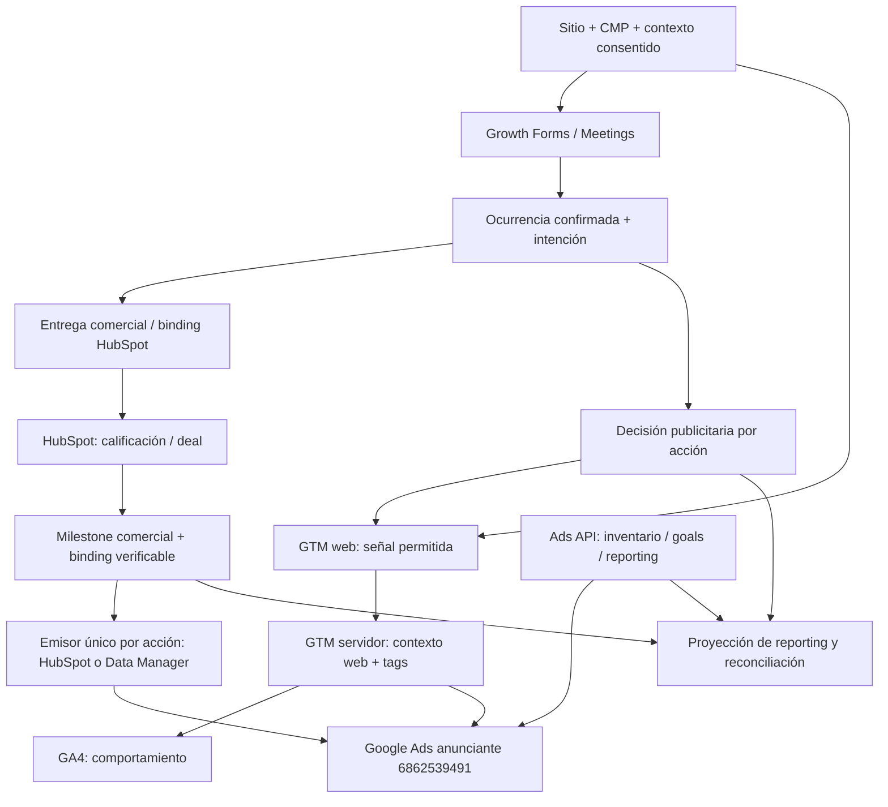

# Google Ads — Arquitectura de medición comercial y conexión API V1

Verificación API18/10,22:57:03Z: **13 formularios comerciales y Discovery con Ads publicado**.
AI Grader incluido por decisión comercial del operador; Contacto general fuera de Ads. Lead Gen Web
corregido a quote_request con key/slug/versión/destinos preservados. Se publicaron12 formularios
adicionales; no se modificaron GTM, campañas, pujas o deployment. Primera recepción y atribución
siguen pendientes. [Publicación y evidencia](../audits/growth/2026-10-18-commercial-forms-policy-publication.md).

Checkpoint operativo 18/10, 20:43:28Z: **configuración Ads activada y cadena de despliegue verificada**.
Anunciante6862539491, EC ON con método GTM, Web 6/Server 10 live y políticas Performance/Discovery
rev2 publicadas (activationAt20:35Z). Bridge compatible publicado en WordPress/Think; HubSpot
submission tracing configurado y captura Meta incluida en Server10. Flag Production true leído
20:36:20.421Z; companion deployment dpl_ER5v1bwisSTkfWE6BCd7jfJNLxvk del mismo mainEC READY,
alias exacto y clave env/build presentes. API expone nombres, no el booleano congelado ni una conversión.
Primera ocurrencia comercial, recibos positivos y atribución **pendientes**. El detalle vigente y
sus límites están en la [auditoría de activación](../audits/growth/2026-10-18-google-ads-activation.md).

Checkpoint histórico 18/10, 19:51Z: **release de código RELEASED**, main
`ec317c928fffcb919d71bdb62821b80280af2347`. CI, Deep y smoke de main PASS; orquestador
[39159325900](https://github.com/efeoncepro/greenhouse-eo/actions/runs/39159325900) SUCCESS. Manifest `ec317c928fff-33c067f4-bc76-4a21-a5e0-a37a99ac726b`
`released` a las 19:51:25.548Z, leído en PostgreSQL a las 19:51:44.315Z.
Vercel Production `dpl_F13UyAaTEjkcttFKc7aZjjtgTFNt` READY y alias releídos a las 19:49:59Z;
health HTTP 200 PASS a las 19:49:44Z; watchdog final `ok`, 6/6 runtimes, `drift=0` y `dataMissing=0`.
Canarios admin 7/7, bundles Forms/Meetings/CTA y dos negativos `private, no-store` PASS a las 19:06Z;
sin lead ni reserva real. Las expansiones SQL de recibos están aplicadas. Excepción específica
de batch autorizada a las 18:53:53Z. [Auditoría y límites](../audits/releases/2026-10-18-full-develop-production-release.md).

Readback histórico a las19:49:57.865Z: Ads conservaba flag ausente/OFF, sin publicación GTM ni políticas
Ads nuevas en ese corte. Hosts compatibles, Preview funcional, opt-in por fuente, EC efectiva y primer
resultado positivo conservaban gates independientes; su avance posterior figura en el checkpoint operativo. El [paquete previo](../operations/releases/google-ads-2026-10-18/README.md) y la
[validación inicial](../audits/growth/2026-10-18-google-ads-prerelease-validation.md) conservan sus cortes fechados.

## 1. Estado, alcance y precedencia

- Estado: `Accepted` como dirección arquitectónica por instrucción del operador el **2026-10-17**.
- Forms/Meetings: contrato online servido; configuración Ads ampliada a13 Forms comerciales y Discovery22:57Z, con companion deployment READY y cadena de configuración verificada.
  Conexión multiorganización, API/MCP de producto y sender de resultados CRM siguen **pendientes**.
  GTM6/10 publicado; nuevas organizaciones, puja y otras fuentes conservan sus gates propios. Primera recepción comercial sigue pendiente.
- Delta operativo 17/10: CLI local de lectura y gestión implementada; OAuth renombrado **Efeonce**.
  [Evidencia y límites](../audits/growth/2026-10-17-google-ads-cli-oauth-implementation.md).
- Dueño: Growth / Measurement; corresponsables: RevOps / HubSpot, Platform / Identity, Data / Insights y Finance.
- Decisión: [ADR de integración Google Ads](GREENHOUSE_GOOGLE_ADS_INTEGRATION_DECISION_V1.md).
- Evidencia fechada: [discovery y prueba API](../audits/growth/2026-10-17-google-ads-api-discovery.md).
- Reversibilidad: conexión y destinos reversibles; una conversión ya enviada requiere el mecanismo de ajuste
  que admita su ruta, no un rollback de código.
- Confianza: alta en límites de dominio y necesidad de preservar ocurrencias; condicionada a pruebas de
  autorización, identidad, consentimiento, recepción y atribución para cada capacidad de proveedor.

La arquitectura integra Growth Forms, Meetings, HubSpot, GTM web/servidor, GA4, Google Ads API y una ruta
de resultados comerciales elegida por acción. GA4 y GSC se reutilizan como fuentes con contratos propios.
No se convierten en autorización Ads ni en identificadores individuales de adquisición.

El discovery privado de esta conversación se conserva en
`/Users/jreye/Documents/google-ads-architecture-discovery-2026-10-17/README.md`.
Este documento es la arquitectura versionada; el archivo privado y la auditoría conservan observaciones
fechadas. Código, schema, runtime y decisiones vigentes prevalecen sobre inventarios históricos.

### 1.1 Identidades y recursos iniciales

| Plano | Identidad o recurso autorizado |
| --- | --- |
| Administración Google Cloud, consola y CLI | **`julio.reyes@efeonce.org`**, siempre |
| Proyecto Cloud | `efeonce-group` |
| Autorización de usuario Google Ads | **`jreyes@efeoncepro.com`** |
| Anunciante inicial único | **`686-253-9491`**, ID API **`6862539491`** |
| Manager validado por API | `9531478329`; ruta de acceso necesaria en el probe, no otro anunciante autorizado |
| Organización Greenhouse inicial | `org-2df565fb-98aa-42f7-b324-ea9a2209017f` |
| HubSpot | Portal Efeonce `48713323` |
| GTM web / servidor | `GTM-NGHPGRLZ` / `GTM-K2X4ZTTK` |
| GA4 | Propiedad `486264460`, stream `G-KYPPY57M14` |
| GSC | `sc-domain:efeoncepro.com` |

`customerId`, `loginCustomerId`, `conversionCustomerId`, `AW-…`, conversion action ID y conversion label
son identificadores diferentes. Ninguno se deduce del número visible de la cuenta. El propietario efectivo
de conversiones se consulta al proveedor; un MCC puede ser ese propietario sin sustituir al anunciante
autorizado. El acceso del usuario a otras cuentas no amplía el binding de producto.

### 1.2 Qué está autorizado en esta etapa

La instrucción inicial autorizó documentar la arquitectura, autorizar/probar acceso API **de lectura** a la
cuenta indicada y registrar evidencia. El alcance no incluye publicación GTM, altas de conversiones,
ingesta de eventos, modificación CRM, campañas, presupuesto, IAM ni cambio de configuración OAuth Cloud.
Las credenciales o grants privados no se copian al repositorio, documentación o salidas de comandos.

El operador amplió posteriormente el alcance a OAuth Efeonce y CLI de lectura/gestión. Se autorizó el
cambio de marca y la custodia propia del grant; ninguna mutación publicitaria concreta está autorizada
por esa ampliación genérica. La prueba inicial del 17/10 se mantuvo en lectura. El catálogo de gestión
y la separación entre capacidad implementada y apply real se detallan en §5.4.

La autorización posterior del operador cubre release completo, bridges compatibles, publicación GTM,
EC y las dos políticas comerciales documentadas en la auditoría de activación. Se preservan las
identidades y los límites por fuente; esta ampliación no autoriza campañas, presupuestos, otras cuentas,
replay histórico ni fabricación de conversiones. Los párrafos anteriores conservan el alcance inicial.

## 2. Problema, resultados y dueños de verdad

El sistema debe relacionar una inversión publicitaria con una solicitud, reserva y resultado comercial
verificables. Contar un `generate_lead` genérico no prueba intención comercial, calidad, negocio ganado
ni atribución al anuncio. Tampoco una respuesta HTTP prueba que el proveedor procesó o atribuyó el evento.

| Hecho o decisión | Fuente de verdad | Consumidores |
| --- | --- | --- |
| Solicitud aceptada, versión, validación y consentimiento del formulario | Growth Forms | CRM, Measurement, analítica |
| Reserva confirmada por el proveedor | Growth Meetings y su ejecución | CRM binding, Measurement, analítica |
| Contexto observado de adquisición | Captura Growth gobernada por consentimiento | Atribución y destinos autorizados |
| Intención y elegibilidad publicitaria de una ocurrencia | Growth Measurement y revisión de política | Senders, CLI/API, reconciliación |
| Contacto, calificación, oportunidad y etapa comercial efectiva | HubSpot y contratos comerciales vigentes | Proyección CRM, milestones |
| Binding entre identidades de sistemas | Adaptador dueño, con método y evidencia | Milestones y reconciliación |
| Configuración de conversiones, objetivos, gasto y atribución Ads | Google Ads | Readers, reporting, operación |
| Comportamiento web y embudo analítico | GA4 | Analítica e Insights |
| Impresiones/clics orgánicos agregados por consulta/página/mercado | GSC | SEO e Insights |
| Contrato económico y reglas de valor/FX | Finance y definición comercial aprobada | Proyección de valor publicitario |

El identificador de un contacto no es una ocurrencia; una persona puede enviar dos solicitudes y participar
en varios negocios. El mismo negocio puede reabrirse. Una categoría de tráfico de GA4, un click ID y una
etapa HubSpot no son equivalentes. Las atribuciones de Ads, GA4 y HubSpot se presentan con su método y
ventana; no se suman como tres ventas ni se fuerzan a coincidir.

### 2.1 Preocupaciones y autoridad de aceptación

| Preocupación | Prioridad / dueño | Evidencia de aceptación |
| --- | --- | --- |
| Optimizar por demanda comercial útil | P0 / operador y RevOps | Definición de hito y objetivo por campaña; negativos de intención |
| No usar otra cuenta ni ampliar autoridad por MCC | P0 / Platform / Identity | Binding exacto y denegaciones cross-account/cross-org |
| No perder aceptación ni crear duplicados al fallar medición | P0 / Growth / Integrations | Fallos parciales, timeout ambiguo y replay con identidad estable |
| Conservar privacidad y consentimiento | P0 / dueño de datos y Privacy | Matriz permiso/finalidad, TTL aprobado, revocación y purge |
| Distinguir recepción, procesamiento y atribución | P0 / Measurement / Data | Recibos, diagnóstico y métricas con cobertura explícita |
| Representar ingresos y monedas honestamente | P0 / Finance | Semántica de valor, moneda, FX y ajustes |
| Operar sin bifurcar lógica entre agentes/UI | P1 / Platform / Growth | Primitive canónico y paridad de contratos |
| Mantener costo y recuperación controlables | P1 / Ops | Cuotas, presupuesto de requests, drenaje, alertas y ensayo de recuperación |

## 3. Baseline observado y límites de evidencia

Snapshot del **17-10-2026**; no es configuración garantizada para futuras ejecuciones.

| Superficie | Estado observado | Límite |
| --- | --- | --- |
| Google Cloud | Google Ads API habilitada; consola muestra nivel Explorador | No prueba acceso OAuth al anunciante |
| Google Ads UI inicial | Cuenta `6862539491`; autoetiquetado ON; ninguna acción visible en el inventario UI; conversiones mejoradas OFF | API posterior sí devuelve dos acciones GA4 `HIDDEN`; UI cero no equivale a cero acciones API |
| Google Ads API v26 | Autorización Ads y lectura del anunciante verificadas vía `login-customer-id: 9531478329`; acceso directo devuelve 403 | Prueba local operativa; conexión de producto y senders aún pendientes |
| Identidad / tracking por API | `Efeonce - Agencia`, CLP, `America/Santiago`, no test, autoetiquetado ON; owner `customers/6862539491`, tracking ID `18432951465` | `NOT_CONVERSION_TRACKED` y effective enablement `OFF`; no medición de conversiones activada |
| Conversion actions API | Dos acciones importadas GA4, `purchase` y `generate_lead`, ambas `HIDDEN` y `primaryForGoal=false` | No son acciones nativas Ads habilitadas ni acreditan recepción/atribución |
| Inventario API de campañas/goals | Cero filas en consultas limitadas de campañas, account goals, campaign goals, campaign goal config y custom goals; sin página pendiente | Cobertura del snapshot consultado; no se infiere actividad histórica ni disponibilidad de otras cuentas |
| GTM web | Google tag y espejo genérico Forms/Meetings a GA4 | No tiene implementada la selección comercial Ads de esta arquitectura |
| GTM servidor | GA4 y Meta CAPI existentes; sin Ads Conversion Tracking ni Conversion Linker en el snapshot del discovery | No hay sender Ads habilitado |
| GA4 / GSC Efeonce | Metadata de conexiones `active`, scopes de lectura separados, sin error registrado | Metadata no sustituye un nuevo probe de Data API/Search Analytics |
| Vínculos GA4 | Links observados a anunciante `6862539491` y manager `9531478329` | Link no importa ni envía conversiones por sí solo |
| HubSpot Ads | Cuenta anunciante conectada, activa y seguimiento automático ON | No certifica conversiones lifecycle ni elegibilidad de enriquecimiento |
| HubSpot schema | `hs_google_click_id` existe; marcador nativo Greenhouse aún no provisionado en el readback | No se infiere GCLID presente en contactos |
| Growth Measurement | Políticas por fuente/surface/version, cifrado, worker y destinos `meta` / `google_upd` | No existe destino Google Ads equivalente |
| `google_upd` | Envía `user_data` sin `events` a GA4 Measurement Protocol | No registra una conversión Ads |
| Forms / CRM / Meta | Handoff actualizado: envíos reales TASK-1865 entregados a HubSpot, GA4 `generate_lead` y una `Lead` Meta Server observada | No acredita por sí solo identidad exacta HubSpot, atribución Ads ni mejora causada en performance |
| Recibos nativos HubSpot y Meta | Baseline 17/10: código local y pruebas; checkpoint 18/10: schema aplicado y worker compatible servido | En18/10, propiedad/mapping Performance y captura Meta configurados con opt-in; primera identidad nativa/recepción Graph pendientes |

La entrada anterior de Handoff que mencionaba cero filas/ausencia de Lead es histórica y fue superada por
el cierre de TASK-1865. La [relectura del último lead Performance](../audits/growth/2026-10-17-performance-latest-lead-trace.md)
mantiene entrega HubSpot y una Lead servidor, con binding exacto/atribución pendientes.

### 3.1 Evidencia de prueba API Ads

**Prueba completada, únicamente de lectura, el 17/10/2026.** El usuario confirmó que es una cuenta nueva.
La consulta directa falló por permiso y la ruta de manager validada funcionó sin cambiar el anunciante.
OAuth/API de operador operativos no equivalen a una conexión de producto desplegada.

| Campo | Evidencia |
| --- | --- |
| Principal Ads | `jreyes@efeoncepro.com`; identidad autorizada verificada en el flujo; no publicar subject ni tokens |
| Proyecto dueño del cliente OAuth / identidad Cloud | `efeonce-group` / `julio.reyes@efeonce.org`, sin sustituir el perfil Cloud |
| Scopes concedidos | `openid`, `userinfo.email`, `adwords`; no `datamanager` |
| Versión API y fecha/hora UTC | v26; autorización `2026-10-17T22:36:48.098Z`; lectura/readback hasta `22:37:33.349Z` |
| Acceso directo | HTTP 403 `USER_PERMISSION_DENIED`, request ID `DMBSt4nupryvWQy7gcV9HQ` |
| Ruta manager validada | `login-customer-id: 9531478329`; target `customers/6862539491`; HTTP 200, request ID `GFegTWDTAzRFrvglERgbaQ` |
| Identidad en readback | `6862539491`, `Efeonce - Agencia`, CLP, `America/Santiago`, `testAccount=false`, `autoTaggingEnabled=true` |
| Propietario efectivo de conversiones | `customers/6862539491`; `conversionTrackingId=18432951465` |
| Estado tracking | `conversionTrackingStatus=NOT_CONVERSION_TRACKED`, `effectiveEnablementSetting=OFF` |
| Acciones | Dos importadas GA4 `HIDDEN`; inventario corregido HTTP 200, request ID `6lVFgR9KQRB0hCe29IvMiQ` |
| Objetivos/campañas | Cero filas en las consultas limitadas indicadas; sin página pendiente en sus respuestas |
| Evidencia de ninguna mutación Ads | Allowlist `googleAds.search`; `mutations=0` en ambas corridas |

Acciones devueltas por API:

| ID / nombre | Tipo / categoría | Configuración observada |
| --- | --- | --- |
| `7852171430` — `efeoncepro.com (web) purchase` | `GOOGLE_ANALYTICS_4_PURCHASE` / `PURCHASE` | `HIDDEN`, `primaryForGoal=false`, `MANY_PER_CLICK`, click 90 días, view 1 día, valor default 1 CLP |
| `7852171433` — `efeoncepro.com (web) generate_lead` | `GOOGLE_ANALYTICS_4_GENERATE_LEAD` / `SUBMIT_LEAD_FORM` | `HIDDEN`, `primaryForGoal=false`, `MANY_PER_CLICK`, click 90 días, view 1 día, valor default 1 CLP |

La consulta inicial de acciones utilizó un campo `default_value_settings` no reconocido y devolvió
HTTP 400 `UNRECOGNIZED_FIELD`; se corrigió a `value_settings` y el inventario se volvió a leer con éxito.
Fue un error de query/compatibilidad, no prueba de desconexión. Sus snippets son eventos GA4 y no
acreditan un label nativo Ads. El tracking ID leído tampoco autoriza deducir un `AW/label` desplegable
para estas acciones. El valor default 1 CLP es configuración observada; no se adopta como valor comercial.
Tampoco se heredan automáticamente `MANY_PER_CLICK`, ventanas o estado de esas acciones. Desocultarlas o
hacerlas primarias sería un cambio de configuración separado, con revisión de intención/goals y permiso.
La conexión API exitosa no autoriza esa modificación ni vuelve comercial el evento GA4 genérico.

Evidencia privada saneada: `.auth/google-ads-discovery-20261017/probe-results.json` e
`inventory-results.json`; detalle durable redactado en la auditoría enlazada. El material OAuth privado
se mantiene separado y no se lee ni copia como evidencia documental.

El detalle privado se referencia desde la auditoría; nunca se adjuntan tokens, códigos OAuth, URLs con
credenciales o filas con datos personales. El probe no usa create/update/upload como prueba de lectura.

## 4. Estrategia y límites físicos

Arquetipo primario: integración transaccional de dominios con outbox y proyecciones. Secundarios:
medición de marketing y reporting analítico. No requiere agentes de IA para clasificar, autorizar o enviar.
Las reglas de intención/consentimiento son deterministas y versionadas.

### 4.1 Modular Placement Contract

| Concern | Hogar de implementación actual propuesto | Límite |
| --- | --- | --- |
| Conexión, OAuth, bindings y readers Ads | `src/lib/growth/google-ads/**` | Server-only; adaptador REST con token provider inyectable |
| Atribución, política, decisión, delivery y ajustes | `src/lib/growth/measurement/**` | Primitive común; proyecciones por destino sin otro ledger de negocio |
| Captura de formulario / reserva | `src/lib/growth/forms/**`, `src/lib/growth/meetings/**` | Conservan aceptación y semántica propias |
| Binding HubSpot Forms | `src/lib/growth/forms/destinations/hubspot/**` | Reutiliza el ADR de recibos nativos |
| Calificación y transiciones de negocios | Dueños `src/lib/hubspot/**`, `src/lib/commercial/**` | Measurement consume hechos; no reescribe CRM para obtener atribución |
| Contrato web | `src/growth-measurement-context/**` y renderers actuales | Browser-safe, sin secretos/PII/hash/identidad CRM |
| Async, sync y diagnóstico | `services/ops-worker` existente | Jobs limitados, contratos HTTP/cola vigentes, no bucles largos en Vercel |
| API/CLI/UI/MCP | Adapters del primitive canónico | Sin reglas o SQL paralelos por consumidor |
| Reporting y downstream | Stores/proyecciones canónicos; Insights por contrato | Warehouse y UI no adquieren autoridad de conexión ni conversión |

Las rutas anteriores son placement objetivo, no afirmación de módulos Ads existentes. Se reusan DB helpers,
Secret Manager, autoridad, outbox y cron; no otro Pool, runtime, servidor MCP, repositorio o catch-all shared.
El [desacople por dominios](GREENHOUSE_PRODUCT_DOMAIN_DECOUPLING_DECISION_V1.md) fija Growth hacia Marketing
Studio en su corte correspondiente. Ahora se implementa en el runtime vigente, con contratos extraíbles,
siguiendo el [modelo de nuevo trabajo](../operations/MODULAR_MIGRATION_NEW_WORK_OPERATING_MODEL_V1.md).
La dirección de extracción no autoriza mover tablas ni código en este trabajo.

### 4.2 Vista de flujo y correspondencias

| Correspondencia obligatoria | Verificación / dueño |
| --- | --- |
| Cada entrega deriva de decisión, binding de acción y organización | FK/constraints + negativos en consumer; Growth |
| Cada llamada proveedor resuelve cuenta desde binding autorizado | Contract tests y probe saneado; Identity / Growth |
| Cada hito CRM enlaza entidad y fecha efectivas, no fecha del cron | Fixtures de transición/backfill y readback; RevOps |
| Cada dato enviado tiene finalidad, clasificación y TTL | Allowlist, pruebas de redacción/purge; Privacy / Growth |
| Cada métrica conserva grain, fuente, ventana y freshness | Data contract y reconciliación; Data |

## 5. Autorización: Cloud, Ads, Data Manager y autoridad por organización

### 5.1 Planos separados

Cloud se administra con `julio.reyes@efeonce.org`; Ads se autoriza con `jreyes@efeoncepro.com`. No se reemplaza
ADC ni el perfil gcloud canónico para conseguir un token Ads. No se extraen credenciales de la sesión
HubSpot, navegador, GA4, GSC o SA de GTM. Un acceso IAM Cloud no concede acceso Ads.

La aplicación OAuth registrada puede reutilizar configuración técnica después de verificar proyecto,
audiencia, callbacks y policy; el **grant, secreto y metadata de Ads son propios**. GA4/GSC ya usan scopes
de lectura diferentes. No ampliar un grant existente ni sobrescribir su referencia de secreto.

**Requisito de producción ratificado por el operador el 17/10:** la pantalla de autorización debe
identificar a **Efeonce**. La marca histórica «Claude» del piloto no cumple ese requisito. Nombre interno
del client y marca de consentimiento son configuraciones distintas: Google muestra
[branding por proyecto](https://developers.google.com/identity/protocols/oauth2/cross-client-identity).
La unidad de conexión debe inventariar clientes/consumidores compartidos, establecer la marca Efeonce,
dominios, soporte y políticas, revisar publicación/audiencia y resolver la verificación requerida.
Cambiar el nombre no acredita verificación. El gate incluye nuevo consentimiento visible Efeonce y
readback Ads, más regresión de las conexiones GA4/GSC afectadas. Administración y proyecto canónicos
se mantienen. En la unidad operativa posterior se guardaron nombre Efeonce y sus páginas públicas;
IDs, callbacks y scopes de los clientes se preservaron. Configuración guardada no acredita verificación Google.

Google Ads documenta `adwords` y no una variante de scope read-only. El cliente expone lecturas y las
operaciones de gestión cerradas de §5.4; el scope amplio no habilita mutaciones fuera de ese contrato.
Configure, ingest y report conservan autoridad separada; la ingesta no está implementada en esta CLI.

Data Manager tiene scope `datamanager` y habilitación/autoridad propios. Autorizar Ads no activa ingesta.
La [guía vigente de acceso Ads](https://developers.google.com/google-ads/api/docs/api-policy/developer-token),
consultada en el discovery del 17/10, sitúa nivel de acceso en el proyecto y retira el developer token
histórico desde septiembre de 2026. No copiar snippets antiguos que añaden ese secreto. Antes de cada
integración ejecutable se fija versión API y se revalida [OAuth](https://developers.google.com/google-ads/api/docs/oauth/overview)
y [deprecaciones](https://developers.google.com/google-ads/api/docs/deprecations).

### 5.2 Binding de conexión y acción

Contrato conceptual; DDL y migración se diseñan en su unidad backend/data:

| Entidad | Campos/invariantes mínimos |
| --- | --- |
| Conexión Ads | `connectionId`, organización, principal/subject, proyecto OAuth, scopes reales, secret reference, estado, verificación y revokedAt |
| Binding de anunciante | `connectionId`, `organizationId`, `customerId`, ruta manager comprobada opcional, propietario efectivo de conversiones y revisión |
| Binding de acción | organización, anunciante, propietario, resource name real, tipo/categoría, goal, emisor, identidad/dedupe, policy/value versions, lifecycle y activación |
| Grant de consumidor | actor, organización/capability, propósito y restricciones; no credencial Google en el payload |

El control de acceso calcula la intersección actor → organización → capability → conexión → recurso.
Un parámetro `organizationId` o `customerId` puede restringir un selector, nunca ampliar autoridad. La cola,
cache, dedupe y diagnóstico incluyen organización, conexión y recurso. Antes del dispatch se revalida
binding activo; una revocación impide nuevos envíos y no puede retirar una llamada HTTP ya iniciada.

El bootstrap sólo permite `6862539491`. Un cambio de manager, propietario de conversiones, cuenta o emisor
crea una revisión gobernada y exige nuevo readback; no se corrige silenciosamente un binding desde un
resultado inesperado. Se admite `conversionCustomerId` distinto únicamente si la configuración efectiva
de la cuenta lo prueba y el binding lo autoriza expresamente.

Estados de conexión objetivo: `pending_authorization`, `active`, `reauthorization_required`, `paused`,
`revoked`, `disconnected`. Un timestamp de verificación no convierte una conexión revocada en activa.
Token refresh se serializa por conexión para evitar carreras; un token nuevo conserva el subject/scopes
esperados. La rotación cambia la referencia secreta de forma gobernada y preserva el binding de cuenta.
Un error de refresh no marca gasto/conversiones cero ni provoca una autorización interactiva desde el cron.

### 5.3 OAuth de producto y probes

1. Actor interno autorizado inicia conexión; state aleatorio con expiración y consumo atómico, ligado al
   mismo actor, organización, callback y propósito. PKCE donde corresponda al cliente.
2. El usuario concede Ads explícitamente. `login_hint` orienta la UX; no prueba identidad.
3. El callback verifica state, actor que lo consume, identidad autorizada y scopes devueltos. Se rechaza
   scope insuficiente, actor distinto o recurso no permitido; token server-only, referencia secreta.
4. `ListAccessibleCustomers` descubre accesos directos. Una hija ausente no demuestra falta de acceso vía
   MCC; se valida la ruta de manager y luego se consulta el anunciante exacto.
5. Se consulta `customer`, conversion settings, acciones y goals con versión API fijada y campos validados.
   Cero filas con cobertura completa es un resultado válido; error/403/paginación incompleta es cobertura parcial.
6. Se registra evidencia saneada: principal, recurso, versión, request ID, fecha y alcance leído. Nunca
   token o respuesta con PII en logs/Sentry. 401/403 bloquean la capacidad; no se buscan credenciales alternativas.

Los patterns GA4 de state ligado al actor y scopes se reutilizan por contrato. Las diferencias observadas
en GSC no se copian ni autorizan un refactor lateral. OAuth/API pueden fallar sin bloquear los formularios.

### 5.4 API, CLI y MCP

Readers conceptuales: descubrir conexión, leer cuenta, acciones/goals, campañas/métricas, estado de ingesta,
decision trace y reconciliación. Commands conceptuales: conectar/desconectar, configurar binding de acción,
publicar política y, en fases posteriores, ingerir/ajustar. Son contratos a implementar, no endpoints ya servidos.

Cada operación tiene schema versionado, paginación/cobertura, safe errors, capability y audit. La CLI llama
el mismo primitive o API gobernada. Un runner local de prueba no se convierte por accidente en token store
o fuente de verdad de producto. No se acepta GAQL arbitrario desde MCP en la primera versión: consultas
con plantillas/grains y budgets explícitos, sin acceso a otros clientes por manager.

Si se expone MCP, Greenhouse declara reader/command en su manifest; el gateway decide qué cruza sin poseer
tokens Ads o consultar DB. Acceso nativo first-party y consentimiento MCP delegado siguen separados.
El [MCP oficial de Google Ads](https://developers.google.com/google-ads/api/docs/developer-toolkit/mcp-server)
puede ayudar al operador en lectura, pero no reemplaza el contrato multiorganización del producto.

#### CLI de consulta: entregable obligatorio de la fase 1

El operador pidió una CLI equivalente en forma de uso a Meta, GA4 y GSC y luego amplió el alcance a
gestión. El entrypoint **implementado** es `pnpm google-ads`, contrato `google-ads-agent.v1`.
La unidad actual es un adapter local de operador con grant propio en Secret Manager; la conexión
multiorganización, API/MCP/UI y sync de producto siguen pendientes. No depende de activar tags.

| Grupo propuesto | Datos / comportamiento de lectura |
| --- | --- |
| `discover` / `help` | Contrato, operaciones disponibles, filtros, métricas/dimensiones compatibles y ejemplos |
| `connection verify` / `account` | Identidad segura, target, ruta manager, owner de conversiones, moneda/timezone, estado y scopes; sin material secreto |
| `campaigns` | Inventario paginado, estado y canal de las campañas del anunciante vinculado |
| `conversions` / `goals` | Acciones, tipos/estados, objetivos de cuenta/campaña/custom, valores y ventanas, sin cambiar configuración |
| `report` | Impresiones, clics, coste, conversiones y valor disponibles; fechas/segmentos y grain explícitos |

El catálogo ejecutable y sus flags salen de `pnpm --silent google-ads discover`; incluye también
presupuestos, grupos y metadatos `ad_group_ad`. El secreto propio se instaló mediante importación explícita
del grant autorizado, validando identidad y cuenta antes de guardarlo; no existe fallback implícito al piloto.
Conserva target `6862539491` y manager comprobado y rechaza otro anunciante aunque el principal pueda
acceder por MCC. La ampliación multicuenta requiere su autoridad y binding propios.

Salida estructurada JSON y vista legible comparten schema versionado: rango solicitado, filtros/grain,
`fetchedAt`, API version, moneda/timezone, filas, cobertura/paginación y errores. Coste conserva micros y
unidad monetaria; se diferencia cero, no disponible y lectura parcial. Plantillas permiten únicamente
combinaciones de campos/segmentos verificadas, con budgets, límite de resultados y cuota; GAQL arbitrario
no es una vía para eludir esas restricciones. La ampliación de gestión se rige por el contrato siguiente;
upload y publicación GTM quedan fuera de esta CLI. Aceptación: ayuda/discovery, errores sin secretos, negativos de
cuenta/org, paginación y una lectura real de esta cuenta nueva; inventarios vacíos son resultados válidos.

#### Gestión autorizada por plan

El operador amplió la capacidad de la CLI a creación/actualización; las lecturas reales de esta sesión
no incluyen un apply. `write plan` compila un input privado cerrado; `write validate` usa `validateOnly`;
`write apply --confirm DIGEST` valida con Google antes del único dispatch y reserva el digest en
`.auth/google-ads-agent/writes/` con permisos 0700/0600, creación exclusiva y fsync antes del envío.
El journal conserva preparado/dispatching/accepted/rejected/unknown. No borrar ni editar un recibo para
reintentar: una incidencia requiere reconciliación y decisión operativa independiente.

Catálogo actual: create/update de campaign Budget, campaña SEARCH, adGroup SEARCH_STANDARD y
conversionAction WEBPAGE/UPLOAD_CLICKS; update de accountGoal/campaignGoal. Una operación por plan,
sin partial failure ni máscaras arbitrarias; se omite ese campo donde el endpoint Google no lo admite.
Campañas/grupos sólo PAUSED; valores monetarios, moneda y referencias de recursos se validan antes de
Google. Activación, eliminación, creatividades e ingesta quedan fuera del catálogo. El principal OAuth
amplio no habilita operaciones ausentes. El presupuesto de una campaña puede afectar gasto futuro;
su payload concreto requiere revisión y autorización del operador antes de apply.

`write verify` lee el resource name nativo con todos los campos derivados del plan y devuelve diff.
Un recurso existente no acredita que sus campos coincidan. Ausencia/mismatch da exit 8; transporte
ambiguo o digest ya reservado da exit 7. El ACK de mutate no se presenta como readback ni como conversión
atribuida. [Manual](../manual-de-uso/growth/conectar-google-ads-con-agentes.md).

## 6. Información, identidad y atribución

### 6.1 Modelo lógico y grano

| Entidad conceptual | Grano / clave | Evidencia y límite |
| --- | --- | --- |
| Attribution context | Observación consentida en una superficie y momento | Click IDs permitidos, UTMs saneadas, referrer, procedencia y permiso; no certeza de atribución Ads |
| Business occurrence | Una aceptación Forms o booking confirmado | ID de fuente estable, versión/surface/intención/fecha original |
| CRM binding | Relación de ocurrencia con entrega/contacto/deal | Provider ID, método, confianza, cobertura y verificación; varios bindings cuando corresponda |
| Business milestone | Hecho comercial efectivo por entidad/hito | Estado anterior/nuevo, versión, effectiveAt, sourceObservedAt y procedencia |
| Conversion decision | Ocurrencia/hito × acción | Eligible/excluded/pending/error, razones, permisos y policy revision |
| Delivery | Decisión × destino/acción | Identidad de conversión estable, payload versionado, receipt y estado |
| Delivery attempt | Un intento de esa entrega | Lease/CAS, request ID, timeout/partial failure y fechas |
| Adjustment | Corrección de la conversión original | Tipo soportado, causa, nueva versión de valor y receipt |

Se extienden stores dueños; no se crea un CRM espejo o una fact table universal que mezcle estos grains.
Una relación de contacto a negocio sólo prueba asociación; el criterio para atribuir ese negocio a una
solicitud debe declararse (y conservar evidencia/confianza), sobre todo con varios contactos/solicitudes.

La clave lógica estable de entrega incluye organización + ocurrencia/hito de negocio + binding de acción
o su identidad semántica. Un retry no cambia ID/fecha/valor/consentimiento; un despliegue o revisión de
policy no crea una conversión nueva. La revisión autorizante se guarda como evidencia. Cambiar el mapping
de la misma acción no permite sortear dedupe; sustituir acción/emisor exige cutover explícito.

Invariantes persistentes a materializar en DDL/commands:

- Un binding anunciante pertenece a una organización/conexión; toda acción/decisión/entrega referencia
  ese mismo scope. Una cuenta compartida entre organizaciones exige un contrato explícito, no herencia por MCC.
- Unicidad de ocurrencia de fuente y de decisión/acción lógica; los intentos son append-only por entrega.
- Exactamente un emisor activo para una acción y cohorte temporal; sin solapes en cutovers.
- IDs, conversion time, revisión autorizante y payload original no cambian después de comenzar HTTP.
- Un provider receipt sólo finaliza el intento/lease al que corresponde; no pisa evidencia terminal ajena.
- Constraints no permiten `processed` sin método/evidencia de procesamiento ni `verified` sin checks requeridos.
- Ajuste siempre referencia conversión original del mismo scope; dedupe persiste tras purgar payload sensible.

Los eventos internos nuevos, si la implementación los requiere, se registran en el catálogo canónico y
declaran `eventId`, tipo/schema version, organización, source aggregate, occurrence time, observed time,
correlation/causation y referencias mínimas. Los payloads outbox no contienen tokens o matching material.
La versión del hecho comercial y la versión del adapter son separadas; reejecutar un consumer no vuelve
a emitir el hecho ni crea otra entrega. Las compatibilidades aditivas se prueban con producer/consumer
actuales y anteriores; una ruptura requiere versión/cutover y ventana de coexistencia explícitos.

### 6.2 Captura en el origen

El contrato actual sólo contiene `clientId`, `fbp` y `fbc`; no `gclid`, `gbraid`, `wbraid` o `hutk`.
La extensión debe declarar tamaño/formato/procedencia, momento de observación y permiso por campo.
No copiar cualquier parámetro URL ni usar un ID publicitario como autenticación o identidad de persona.
Una UTM no prueba por sí sola un clic Ads; `hs_google_click_id` del contacto es mutable y no sustituye
el contexto histórico de la ocurrencia.

La captura debe funcionar en navegación multipágina y WP/Think/agenda dentro de superficies autorizadas.
Se distingue adquisición inicial, último contexto elegible y contexto de conversión: no sobrescribir el
primero con la última visita ni elegir silenciosamente uno para todo el funnel. Cada destino declara
qué observación utiliza y qué combinaciones de identificadores admite. No inventar GCLID ni transformar
braids en GCLID. No incluir PII o click IDs crudos en GA4 custom dimensions, logs, URLs de recibo o Sentry.

Los hosts sólo capturan/transmiten contrato público; la clasificación y la elegibilidad se resuelven en
backend. Click IDs que Google necesite para atribuir viajan únicamente por las interfaces permitidas del
proveedor, con consentimiento y controles de datos; no se reutilizan como parámetros analíticos genéricos.

### 6.3 Clasificación por intención

La elegibilidad actual por `form_kind` excluye applications/riesgo alto, pero no interpreta cada respuesta
de un contacto mixto. Se propone vocabulario versionado por ocurrencia:
`commercial_request`, `commercial_diagnostic`, `content_download`, `support`, `press`, `careers`, `unknown`.

La regla usa campos tipados y condiciones declaradas por la fuente. `unknown` no pasa como comercial.
Descargar contenido no implica pedir servicio ni estar calificado. No se introduce una clasificación IA
opaca sobre texto libre para decidir puja. Un formulario aceptado no comercial mantiene su CRM/operación
y analítica apropiada, pero no genera la acción comercial Ads.

### 6.3.1 Cobertura de formularios comerciales

El alcance confirmado por el operador el 18/10 comprende **todos los formularios que reciben
solicitudes comerciales de leads**: contacto, cotización, diagnóstico de servicio y brief comercial.
Ebooks, descargas, newsletter, postulaciones, soporte y pruebas permanecen fuera de la acción
`commercial_lead`; no se propone incorporarlos a Ads en esta ampliación.

La elegibilidad técnica de contact/diagnostic_intake/quote_request y riesgo low-medium no sustituye
intención comercial. El operador confirmó AI Grader comercial y Contacto general: Grader está
incluido y Contacto fueraAds. Lead Gen Web se corrigió por el command/store Forms de lead_magnet a
quote_request, con hash/versión fijados, sin cambiar identidad o versiones. No se exceptúan los ebooks.

Se reutilizan la acción «Solicitud comercial aceptada», `conversionKey=commercial_lead` y los tags
Web/Server ya publicados. Cada fuente conserva su política revisada/publicada, mapping y destinos
previos; no se crea una etiqueta, acción Ads o campaña por formulario. «Performance» identifica
el diagnóstico de pauta y «Discovery» la agenda: son fuentes del sitio, no tipos de campaña Ads.
Discovery mantiene `meeting_booking` y su acción de reserva confirmada.

API22:57:03Z verificó13 formularios comerciales y Discovery activos,12 altas adicionales,
con destinos/mappings existentes preservados. [Publicación por fuente](../audits/growth/2026-10-18-commercial-forms-policy-publication.md).
Una versión nueva exige revisar su política. Inscripción automática y control de cobertura al
publicar siguen como propuesta. La corrección de clasificación se aplicó por primitive canónico;
la nueva API de mantenimiento está implementada localmente, sin desplegar. No se cambiaron pujas.

### 6.4 Unión con HubSpot Forms

Reutilizar el [ADR de identidad nativa](GREENHOUSE_HUBSPOT_FORM_RECEIPT_DECISION_V1.md): marcador
`ef_greenhouse_submission_id` server-generated en campo técnico de formulario; luego GET paginado,
match exacto/único y `provider_submission_id = conversionId`. Estados y CAS existentes preservan
ambigüedad/denegación/exhaustion; un fallo del recibo no modifica entrega ni vuelve a ejecutar el POST.

Las expansiones SQL de recibos se aplicaron el 18/10 con autorización específica; el worker compatible
está servido. La propiedad técnica y el opt-in de mapping de Performance se configuraron y releyeron el 18/10:13campos
comerciales intactos y14º oculto/opcional. [Recibo operativo](../audits/growth/2026-10-18-google-ads-activation.md).
Primera ocurrencia nativa pendiente; históricos sin marcador no se promueven por email/hora.
El valor actual de la propiedad Contact tampoco prueba una submission anterior. Contact ID y deal ID
se añaden al binding por evidencia independiente; no se interpreta `conversionId` como contact ID.

El adapter secure-submit actual sólo envía `pageUri`/`pageName` y campos mapeados. Incorporar `hutk` exige
captura consentida, mapping y prueba de asociación nativa; no se afirma funcionando por la existencia
del campo en la documentación. Cambiar mapping CRM no publica policy publicitaria y viceversa.

### 6.5 Unión con Meetings

El proveedor Scheduler devuelve `contactId`/`calendarEventId`; el command revisado no los persiste como
binding durable. El ledger de bookings protege email mediante HMAC y no debe convertirse en almacén de
contactos recuperables. La unidad de identidad define un binding privado mínimo, acceso y conservación
sin poner esa evidencia en el payload público, GA4, logs o Sentry.

`TASK-1885` conserva la brecha de captura de campaña del renderer pese a admitir UTMs server-side.
Su cierre exige contrato/reader y prueba de navegación; el histórico sin origen se lee `no registrado`,
no `directo`. Scheduler no implica paridad de atribución con embed HubSpot. Un POST Forms auxiliar
crearía otra submission real: no se usa como artificio de tracking sin propósito y decisión propios.

## 7. Consentimiento, datos y retención

### 7.1 Matriz de permiso y finalidad

| Permiso/finalidad | Dueño de evidencia | Comportamiento |
| --- | --- | --- |
| Procesamiento de la solicitud | Snapshot legal Forms/Meetings | Permite atender solicitud; no autoriza publicidad |
| Comunicaciones comerciales | Consentimientos explícitos por canal/tipo | No equivale a cookies o matching Ads |
| `analytics_storage` | CMP/categorías y mapping versionado | Gobierna almacenamiento/analítica según contrato |
| `ad_storage` | CMP/categorías y mapping versionado | Gobierna almacenamiento publicitario |
| `ad_user_data` | CMP/categorías y mapping versionado | Gobierna envío de datos de usuario para publicidad |
| `ad_personalization` | CMP/categorías y mapping versionado | Gobierna personalización; no se infiere de analytics |
| GPC/revocación | Navegador/request y evidencia de política | Aplica el deny que corresponda; no se restaura por retry |

Hoy la categoría advertisement del bridge deriva los tres permisos Ads. La versión nueva explicita esa
traducción sin inventar consentimiento granular que el CMP no preguntó. Missing/unknown es ausencia de
grant, no false convertido luego a true por un worker. La ausencia de publicidad nunca impide aceptar
el formulario por ese motivo. La decisión legal de usar una ruta de pings cookieless/modelado, si se
requiere, es un contrato separado; no se asume que Consent Mode autoriza enviar cualquier dato.

El snapshot de un retry no se rejuvenece ni altera. Para milestones posteriores se evalúa autorización
aplicable a esa finalidad y tiempo, junto con revocaciones vigentes; no reutilizar ciegamente el permiso
de semanas atrás ni reconstruirlo desde lifecycle. Enqueue y dispatch revisan binding y policy actuales.
Una revocación ocurrida después del inicio HTTP queda auditada y sigue el proceso de retiro/ajuste que
admita el proveedor; apagar flags no elimina datos remotos.

### 7.2 Clasificación y lifecycle de datos

| Dataset | Conservación / acceso objetivo |
| --- | --- |
| Datos comerciales de formulario/CRM | Canon de Forms/HubSpot vigente; no ampliar copias por Ads |
| Sobre de matching inmediato | Mantener contrato actual cifrado: hasta 48 h; entrega hasta 24 h/cinco intentos mientras no se apruebe su cambio |
| Contexto atribución para milestones tardíos | TTL propio por finalidad, ciclo comercial y ventana del proveedor; aprobación Privacy/Growth antes de habilitar captura durable |
| Binding privado de ocurrencias y provider IDs | Mínimo necesario, acceso de dominio/capability y TTL declarado |
| Decisiones, receipts y attempts | Evidencia mínima redactada, purga propia y sin PII/payload crudo |
| Facts Ads agregados | Retención analítica por contrato, fuente/fecha/grain y control multiorg |
| OAuth/token material | Secret Manager o destino local privado autorizado; referencia server-only, revocación/rotación y acceso auditado |

No se fija aquí un plazo universal de meses sin decisión del dueño. Hasta aprobar TTL y mecanismo de
purga, el almacenamiento ampliado y la ingesta de calidad permanecen apagados. Un hash publicitario
sigue siendo dato sujeto a controles: no entra en dataLayer, GA4 ordinario, logs, dimensiones o Sentry.
HMAC interno no se transforma en hash de matching ni permite reconstruir el contacto borrado.

La purge elimina payloads/identificadores vencidos sin borrar los estados mínimos necesarios para no
duplicar una conversión. Las claves de dedupe no contienen PII cruda. Borrado y revocación deben recorrer
staging/colas, binding, payloads y secretos propios; la retención remota se gobierna con el proveedor,
sin prometer eliminación por borrar una fila local.

## 8. Contrato de acciones, objetivos y valor

### 8.1 Acciones de negocio candidatas

| Acción | Autoridad / identidad | Exclusiones y semántica |
| --- | --- | --- |
| Solicitud comercial aceptada | Forms confirmado; ocurrencia | Intención no comercial, pruebas, inválidos y duplicados técnicos |
| Reunión confirmada | Meetings exitoso; booking | No es reunión realizada; replay no es otra reserva |
| Lead calificado | Regla efectiva RevOps; entidad/hito | Precisar Contact lifecycle frente a Lead object; ni creación ni email corporativo bastan |
| Oportunidad calificada | Deal/hito con criterio de compra | No toda alta de deal o asociación Contact equivale al hito |
| Negocio ganado | Deal/cierre efectivo, motion | No es cobro; adquisición, expansión y renovación se distinguen |

Los nombres son semántica propuesta, no acciones creadas. Cada binding guarda tipo/categoría/ventanas,
counting policy, fecha de activación, fuente, emisor, valor y goals. IDs/labels se extraen del propietario
efectivo y del tipo real, nunca se calculan. Se excluyen tráfico QA interno, fixtures, pruebas y backfills
por procedencia declarada y policy; no se marca sintético un lead real para esconderlo.

### 8.2 Objetivos de puja

Captación y calidad pueden coexistir para observar el funnel, pero se selecciona qué acciones son primarias
para **cada campaña**. `primary_for_goal` no basta como comprobación: se leen account-default goals,
campaign conversion goals y custom goals efectivos. Un goal personalizado puede cambiar qué acciones
entran en la optimización. El reader devuelve la configuración efectiva y su origen, no sólo el flag.

La primera señal de puja depende del volumen/cadencia real y la capacidad de calificar. El operador decide
la transición desde captación a calidad con evidencia; no se inventa aquí un umbral de conversiones o una
mejora garantizada. La activación preserva un baseline de CPA/cobertura y fecha de cambio. No se suman
solicitud, reunión, SQL y ganado como éxitos intercambiables para comprar más volumen temprano.

### 8.3 Valor y moneda

El contrato define valor neto/bruto, contrato/mes/margen, recurrencia, pass-through, motion y fecha efectiva.
HubSpot indicó USD como moneda principal y timezone `US/Eastern` en el discovery; Ads debe leer los suyos
por API y GA4 sus settings antes de comparar días. El probe Ads ya confirmó **CLP / America/Santiago**;
esa diferencia efectiva con HubSpot debe preservarse al reconciliar. No usar timezone de la máquina
para construir reportes.

`deal.won` lleva `amountClp`; enviarlo con `currency=USD` sería incorrecto. El adapter re-lee el agregado
autorizado y resuelve importe original/moneda o valor convertido con fuente, fecha, tasa y método FX.
Se guarda versión de proyección de valor. Valor ausente es desconocido, no cero; un valor fijo de lead
es una decisión comercial distinta del ingreso observado y queda etiquetado como tal.

Cambios de amount, moneda, cierre, cancelación, fraude o reapertura usan ajuste soportado referenciado a
la conversión original. No se genera otra conversión para “corregir” una venta. Una ruta que no pueda
retraer/restatar lo requerido queda bloqueada para esa acción o registra una excepción aceptada con owner.

## 9. Selección de entrega por acción

### 9.1 Tres superficies Google

| Superficie | Responsabilidad | Autoridad |
| --- | --- | --- |
| Google Ads API | Lectura GAQL, cuenta/campañas, configuración de acciones/goals y reporting | Grant Ads, proyecto habilitado, rol y binding |
| GTM web y servidor | Instrumentación web y tags de captación con contexto de navegador | Consentimiento + política + acceso/publicación GTM |
| Data Manager API | Ingesta backend de eventos y diagnóstico | Grant y API Data Manager + binding de destino |

Una integración nueva no presupone elegibilidad de `UploadClickConversions` legacy. El discovery del
17/10 verificó restricciones anunciadas desde junio de 2026 y la dirección hacia Data Manager para nuevas
ingestas. La unidad ejecutable comprueba [deprecaciones](https://developers.google.com/google-ads/api/docs/deprecations)
y [categorías de conversión](https://developers.google.com/google-ads/api/docs/conversions/categories)
antes de fijar su ruta. No ampliar scope o mantener API legacy como fallback silencioso.

### 9.2 Captación mediante GTM

Implementación local 17/10: `config.googleAds` publica intención `commercial_lead|meeting_booking`,
`activationAt` y EC independiente; gate `GROWTH_MEASUREMENT_GOOGLE_ADS_ENABLED` default OFF.
La captura existente cifra la proyección sin nuevo destino/cron/outbox. Sólo un enqueue confirmado
en el commit comercial habilita el recibo público dedicado. Forms contact/diagnostic_intake/
quote_request de riesgo low/medium requieren opt-in; lead_magnet/application/newsletter quedan fuera.
La fuente y versión se revalidan al preparar; no hay backfill automático.

`googleAdsConversion` lleva UUID durable como transactionId, key, fechas y hashes EC web opcionales.
TTL recibo 10 minutos; memoria browser de hashes máximo 10 segundos o expiración previa. El getter
no enumerable entrega sólo email/teléfono SHA256 al `user_data` reservado del tag; callback,
timeout, pagehide y retiro vacían esa memoria. El evento dataLayer sólo contiene key/UUID y controles
de callback. No persistir el receipt en estado UI, almacenamiento browser o telemetría ordinaria.

El contexto común añade cuatro consentimientos Google explícitos y click IDs observados. El bridge
conserva esos IDs tras grant durante un máximo de 30 días en cookie propia, sin tocar `_gcl_*` ni
rejuvenecer su fecha al leer. Revocación/GPC limpia. El backend guarda contexto sólo cifrado con la
retención existente de 48 h; no se proyecta a `hs_google_click_id` ni constituye binding CRM histórico.
Los IDs no se fabrican, convierten entre sí ni se inyectan en parámetros internos Google.

El tag web transporta `gh_ads_conversion` a GA4 Client, con cuatro additional consents y gate CMP.
El Server selecciona acción por key, UUID, Client GA4, host canónico, gate explícito y consentimiento
nativo G111; Ads nativo consume transaction_id/user_data. La excepción en tag GA4 18 evita un segundo
evento analítico. Linker Server sólo page_view GA4 de hosts permitidos con consentimiento nativo.
Meta y el espejo generate_lead quedan separados. [Operación y límites](../manual-de-uso/growth/activar-conversiones-google-ads.md).

Baseline objetivo: señal de aceptación **comercial elegible**, sin PII, con ID estable; transporte web a
sGTM; Ads Conversion Tracking y Conversion Linker servidor conforme a la
[guía oficial](https://developers.google.com/tag-platform/tag-manager/server-side/ads-setup).
El evento genérico `gh_form_submission_accepted → generate_lead` de GA4 permanece como analítica; no se
convierte en criterio de puja sin la decisión de negocio. La señal Ads declara acción y correlación
permitidas por contrato; un dato enviado por navegador no sustituye aceptación server-confirmed.

Se mantiene una sola conversión por resultado. El campo de transaction/order ID se mapea al contrato de
la etiqueta; no asumir que `event_id` GA4 deduplica Ads o que un mismo ID deduplica acciones diferentes.
Importar simultáneamente el mismo resultado desde GA4 y etiqueta nativa crea fuentes distintas y debe
evitarse como doble objetivo principal.

El navegador sigue siendo dependencia de esa ruta aunque el tag final corra en servidor: cerrar pestaña,
bloquear script o perder red puede impedir el transporte. No se promete cobertura backend durable.
La confirmación de recepción en servidor y el diagnóstico provider se distinguen de atribución real.
Un Conversion Linker web adicional se decide tras revisar la cobertura efectiva del Google tag; no se
duplica automáticamente si ya realiza esa función para el destino.

El endpoint actual sGTM usa `run.app`. Un subdominio propio puede mejorar el contexto de cookies según
la [guía de dominio propio](https://developers.google.com/tag-platform/tag-manager/server-side/custom-domain),
pero requiere DNS/TLS, cookies, costo, owner y rollback en su unidad de infraestructura. No forma parte
de la autorización de prueba API ni se provisiona por documentarlo.

### 9.3 Calidad comercial: HubSpot nativo frente a Data Manager

La elección es **por acción** y queda en binding publicado. Se evalúa primero la capacidad nativa porque
la cuenta ya está conectada. No se crea un sender propio para duplicar un resultado ya cubierto, ni se
delega una acción cuyo contrato excede lo que el nativo puede probar.

| Criterio | HubSpot nativo | Worker / Data Manager |
| --- | --- | --- |
| Calificación lifecycle con valor fijo | Candidato de menor implementación propia si coincide con la definición | Candidato cuando el milestone no coincide o se necesita control de decisión |
| Oportunidad/valor real por deal | No inferir desde cambio de lifecycle Contact | Candidato con contrato de entidad, valor y asociación explícitos |
| Consentimiento y click/identity association | Exigir elegibilidad real y prueba por ocurrencia | Exigir captura/binding y mapping compatible con destino |
| Estados/recibos/diagnóstico y soporte | Deben ser accesibles y suficientes para operación | Propios con requests, diagnostics, parcialidad y reconciliación |
| Ajustes/retractación | Verificar paridad exigida para cada acción | Verificar tipo de acción y paridad real de API; tampoco se asume |
| Coste y dependencias | Tier, permisos, límites y operación HubSpot | API/scopes, cuotas, sender y mantenimiento propios |

La [guía HubSpot](https://knowledge.hubspot.com/ads/create-and-sync-ad-conversion-events-with-your-google-ads-account)
describe conversiones lifecycle y enriquecimiento web; el lifecycle utiliza valor fijo. No se afirma que
una submission vía secure-submit sea automáticamente elegible para ese enriquecimiento. Entitlement,
conexión, fuente, identidad y consentimiento se verifican antes de elegirlo.

**Gate nativo:** una definición de hito equivalente, scopes/tier, cuentas destino exactas, contexto
disponible, consentimiento, prueba de evento real, evidencia operativa/diagnóstico y capacidad de corrección
suficientes. Si cualquiera de esos criterios no satisface la acción, se documenta la brecha y se evalúa
Data Manager. Una recepción sin atribución no prueba equivalencia de end-to-end.

**Gate Data Manager:** API habilitada, scope/autoridad aprobados, destino exacto, tipo de acción compatible,
identidad/matching requeridos, sender con fallos parciales, diagnóstico y ajustes probados. La ingesta
offline y online multi-source no se mezclan: los tipos `UPLOAD_CLICKS` y `WEBPAGE` tienen contratos propios.
La ruta online multi-source observada en el research está en beta y tiene requisitos de transaction ID
compartido y período inicial de 14 días; queda fuera del baseline hasta evaluación dedicada.
El research actual no acredita retractación completa del conteo por Data Manager: sus mecanismos de
ajuste no se presentan como equivalentes a retirar una conversión. Si la acción requiere esa capacidad,
se resuelve con una ruta soportada y autorizada o permanece bloqueada; no se sustituye por otro upload.

**Salida/cambio de emisor:** congelar revisión y watermark de cutover; desactivar nuevos enqueues del
anterior, drenar/reconciliar sus pendientes, preservar IDs/recibos y habilitar el sucesor desde el corte.
No crear otra acción/ID para eludir un resultado desconocido. Debe demostrarse dedupe o partición de
cohortes; si no, pausar la acción. Volver al sender anterior tampoco autoriza replay de lo ya enviado.

Fuentes de implementación:
[acceso Data Manager](https://developers.google.com/data-manager/api/devguides/quickstart/set-up-access),
[online](https://developers.google.com/data-manager/api/devguides/events/google-ads/online/send-events),
[offline](https://developers.google.com/data-manager/api/devguides/events/google-ads/offline/upgrade),
[diagnóstico](https://developers.google.com/data-manager/api/devguides/diagnostics).

## 10. Consistencia, entrega y fallos

### 10.1 Secuencia de negocio

1. Growth acepta una solicitud o confirma una reserva con las validaciones vigentes.
2. En la transacción dueña guarda ocurrencia, consentimiento y outbox comercial. La proyección de
   medición es aislable por SAVEPOINT: su fallo no revierte la aceptación ni la entrega CRM.
3. Una decisión por acción registra elegibilidad y razones aun cuando no haya envío. La implementación
   nueva distingue `no_consent`, `noncommercial_intent`, `no_policy`, `no_binding`, `identity_missing`,
   `expired`, `backfill_excluded` y fallo técnico, sin payload sensible.
4. El worker reclama una entrega por lease; verifica autoridad/policy actuales y prepara el intento
   desde snapshot inmutable. Destinos independientes no repiten éxitos ajenos.
5. La respuesta se finaliza con CAS del lease/attempt y evidencia saneada. Diagnósticos asíncronos
   actualizan procesamiento sin reenvío del evento.
6. Un milestone CRM posterior consume hechos ya durables, re-lee estado autorizado y resuelve binding,
   fecha efectiva, valor y acción. No llama Google inline desde webhook, sync o request del usuario.

### 10.2 Máquina de estados objetivo

Estados de decisión: `eligible`, `excluded`, `pending_evidence`, `evaluation_failed`.
Estados de entrega: `queued`, `sending`, `received`, `processing`, `processed`, `partial_failure`,
`permanent_failure`, `unknown_remote_outcome`, `expired`, `cancelled_before_send`.
La atribución es observación separada del estado de entrega; puede ser agregada o no consultable
individualmente. No se rellena `attributed=true` por HTTP 2xx, processed o coincidencia de conteos.

| Estímulo | Respuesta requerida |
| --- | --- |
| Credencial no disponible/expirada | Bloquear destino afectado, safe error, reauth gobernado; no fallback a otra identidad |
| Policy/binding revocado antes HTTP | No enviar; conservar decisión/razón y fuente comercial |
| 429/transitorio confirmado | Backoff con jitter, `Retry-After` cuando aplique, deadline y budget; mismo ID/payload |
| Validación/tipo/permiso no válido | Terminal o pending config con owner; no reintentar indiscriminadamente |
| Timeout / respuesta ilegible / ACK perdido | `unknown_remote_outcome`; reconciliar usando identidad/diagnóstico antes de repetir operación no idempotente |
| Partial failure del batch | Conservar el alcance real del diagnóstico; sólo correlacionar elementos cuando el proveedor los identifica. Conteos agregados no indican qué miembros fallaron |
| Worker cae tras éxito remoto | Lease expira, reconciliación/CAS; no crear ID nuevo ni suponer fracaso remoto |
| Schema recibo faltante | Detectar antes del POST para capacidades dependientes; preservar fuentes/otros destinos |
| Datos caducados | Expirar con razón; no cambiar conversion time a hoy ni revivir consentimiento |
| Dos workers compiten | Claim por destino con lock/lease y CAS; sólo el intento vigente puede finalizar |

La cola Measurement existente ya usa `SKIP LOCKED`, lease y CAS; el nuevo destino hereda esos patrones
con sus propios budgets/requisitos. Las ventanas 24/48 h vigentes no se extienden a milestones tardíos
por añadir un enum. La retención de correlación debe superar el horizonte de redelivery permitido,
sin conservar material de matching más tiempo del aprobado.

Data Manager informa estado por destino y conteos de errores/advertencias por razón; ese diagnóstico
no demuestra por sí solo identidad o resultado de cada evento del lote. Conservar estado agregado y
miembros desconocidos, sin promoverlos a `processed` por coincidencia de cantidades. Si la acción
requiere evidencia individual, usar lotes unitarios o un mecanismo de correlación verificado. No
reenviar supuestos «fallidos» identificados sólo por un conteo.

### 10.3 Brecha actual Forms y reconciliación

La revisión estática del dispatcher Forms muestra selector sin claim visible, iteración de todos los
destinos y retries de timeout frente a secure-submit no idempotente. Eso no prueba un incidente live,
pero impide afirmar exactly-once remoto general. La [identidad nativa](GREENHOUSE_HUBSPOT_FORM_RECEIPT_DECISION_V1.md)
detecta coincidencias/ambigüedad; no hace idempotente el POST de HubSpot.

Antes de ampliar fan-out o comprometer dedupe end-to-end, su unidad de hardening verifica concurrencia,
éxito parcial y éxito remoto sin persistencia. No reenvía destinos ya exitosos ni corrige evidencia
faltante con otro POST. Se separa retry seguro de entrega desconocida y se registra resolución humana
cuando el proveedor no permite confirmación suficiente.

### 10.4 CRM: orden, replays y backfills

Los webhooks son aviso autenticado, no estado comercial autoritativo ni señal para Google inline.
Inbox/outbox y readers canónicos resuelven transiciones con versión/fecha efectiva. El worker identifica
eventos viejos, fuera de orden o duplicados; una proyección actual no inventa la hora original del hito.

`classifyDealTransition` puede emitir ganado al materializar por primera vez un deal ya ganado. Una
reapertura seguida de ganado puede emitir de nuevo. El consumer publicitario exige cohorte, activationAt,
`origin` de backfill/live, binding y regla de unicidad de negocio; los eventos canónicos no se alteran
para acomodar un sender. La sincronización técnica no es otra venta. No asumir que el handler onboarding
de deals certifica el milestone publicitario: tiene otro propósito y puede observar una proyección atrasada.

## 11. Reporting Ads y reconciliación multifuente

### 11.1 Facts y unidades

| Dataset / vista | Grano y medidas | Restricciones |
| --- | --- | --- |
| Customer/campaign settings | Snapshot por cuenta/campaña y observadoAt | Tipo/estado, moneda/timezone, goals y versión; no sumar snapshots |
| Campaign daily performance | Cuenta × campaña × fecha proveedor × set exacto de segmentos | Cost micros, impresiones, clics y métricas soportadas; no join directo uno-a-muchos a leads |
| Conversion action daily | Cuenta/propietario × acción × fecha × segmentos declarados | Conversions/all conversions, valores/modelos y base de fecha explícitos |
| Business funnel | Organización × ocurrencia/hito, con tiempo de negocio | Aceptación/CRM/eligibilidad; no atribución Ads inventada |
| Delivery operations | Acción × entrega/intento | Received/processed/errors/lag; HTTP no se cuenta como conversión atribuida |
| Reconciliation | Cohorte/ventana y definición declaradas | Razones de diferencia y cobertura; no exige igualdad universal |

Se guardan API version, GAQL template/version, segmentos, moneda/timezone, `fetchedAt`, rango solicitado,
cobertura/paginación, watermark y método de upsert. Costes micros se convierten explícitamente sin perder
la unidad original. Las conversiones pueden ser fraccionarias por atribución; no redondear a personas.
No sumar filas de grains distintos ni multiplicar gasto por un join con varias acciones/contactos/deals.

Cada query template fija recurso FROM, campos, segmentos compatibles, rango máximo, filtros y paginación.
El contrato valida disponibilidad en la versión Ads elegida antes de exponer el dataset. El sync upserta
por la clave completa del grain y no concatena respuestas de un retry como filas adicionales. Un cambio
de set de segmentos crea una versión/dataset distinguible; no altera silenciosamente el significado de
una fact existente. Los daily facts no pretenden reconstruir click→persona: ese enlace vive en el
binding privado de negocio, con permisos y evidencia independientes.

Ads distingue métricas por fecha de interacción y, donde estén disponibles, fecha de conversión. El
reporte declara cuál usa; no equipara día Ads, día GA4, día HubSpot y día Santiago por igualdad de string.
La moneda base del anuncio no cambia porque el dashboard muestre CLP; una conversión FX conserva método.
GSC permanece agregado y no se une consulta→persona; DataForSEO ETV es estimación con metodología propia,
no gasto Ads ni revenue real y no sustituye esta fact table.

### 11.2 Frescura, correcciones y cuotas

Las cifras Ads pueden variar por conversión tardía, modelo, ajustes y procesamiento. Se conserva ventana
reconsultable configurable y un watermark de completitud operacional, sin presentar cifras recientes
como definitivas. Lookback y cadencia se fijan después del inventario de ventanas y medición de coste,
no por una promesa universal de “tiempo real”. Diagnóstico de ingesta también es asíncrono.

El sync limita filas, fechas, segmentos y concurrencia por cuenta/conexión; respeta cuotas y budgets del
proyecto observados. El nivel Explorador del discovery no es un entitlement perpetuo. Cuota agotada,
403, página truncada o conexión desconectada producen estado parcial/stale, no cero gasto/conversiones.
Se reanuda por cursor/rango seguro sin emitir conversiones de negocio. Reporting es read-only frente Ads.

### 11.3 Reconciliación con denominadores explícitos

El recorrido operativo es:

`aceptadas → comerciales → autorizadas → vinculadas → elegibles → enviadas → recibidas → procesadas → atribuidas`.

Cada escalón declara fuente, timezone, rango/cohorte, razón de exclusión y fecha de última observación.
No toda solicitud viene de publicidad, no toda autorización tiene click/matching y un evento procesado
puede no atribuirse. La reconciliación muestra discrepancias y evidencia, no atribuye causalidad por
similitud de horarios o totales. ROAS sólo se presenta con numerador/denominador, moneda, método y ventana
compatibles; métricas CRM de pipeline se etiquetan como pipeline, no ingreso cobrado.

## 12. Operación, seguridad y observabilidad

Controles obligatorios de diseño:

- Audit de conexión/binding/policy/acción con actor, versión, razón y resultado saneado; no tokens/PII.
- Kill switches por conexión y destino/acción: detienen nuevos envíos, preservan Forms, CRM y recibos.
- Budgets de requests por sync, backlog/deadline, bounded diagnostics, alertas sólo accionables.
- Readers de pendientes, unknown, partial, expirados y revocados; cada clase tiene owner de resolución.
- Métricas de lag acceptance→decision→HTTP→processing, oldest queued, receipt coverage, TTL purge,
  401/403/429, schema drift y costes operativos; el lag de atribución se separa del lag de entrega.
- Logs por opaque correlation/attempt ID y safe error; no URL con query sensible, correo ni cuerpo crudo.
- Jobs usan secreto/autoridad del binding; se rechaza cruzar organización incluso en retry/replay/support.
- Una modificación pública GTM conserva workspace→preview→confirmación/publicación gobernada y readback.
- Estado `unknown` conserva presupuesto y prioridad de reconciliación; no dispara rePOST automático ciego.

Objetivos iniciales verificables: cero envíos cross-account/cross-org; cero PII/hash en telemetría ordinaria;
cero cambio del resultado comercial por fallo de matching; identidad estable en el 100% de retries
autorizados; 100% de entregas con decisión/binding/revisión; purga conforme al TTL aprobado. Son
**criterios de aceptación**, no SLOs ya medidos. Latencia/cobertura objetivo de negocio se fijan al
medir baseline y antes de habilitar producción; Ads no ofrece un SLO propio inferido desde nuestro cron.

La recuperación no depende de un único operador: runbook de reauth, conexión pausada, claims vencidos,
reconciliación y redrive con dry-run; privilegios de soporte mínimos. La pérdida de una credencial no
autoriza usar ADC Cloud, otro portal o la conexión de otra organización. Rotación y despliegue conservan
el canon de secretos/release. No se afirma compliance legal por aplicar estos controles técnicos.

## 13. Alternativas y consecuencias

| Alternativa | Decisión / consecuencia |
| --- | --- |
| Importar únicamente `generate_lead` GA4 | Rechazada como objetivo: mezcla intención y no resuelve identidad/calidad |
| GTM captación + HubSpot nativo por lifecycle compatible | Preferida para esas acciones si supera gate; menor sender propio, dependencia de entitlement/semántica |
| GTM captación + Data Manager por deal/valor/control | Elegida para acciones que requieran esa paridad; mayor operación y autorización propias |
| Backend multi-source para captación | Evaluación futura por cobertura; beta/requisitos y dedupe no certificados aquí |
| UploadClickConversions legacy como nueva integración | No baseline; sujeto a restricciones/deprecaciones vigentes, sin fallback implícito |
| Otro microservicio o MCP dedicado Ads | No justificado por el volumen/owners actuales; usar primitives/worker existentes |
| Enviar cada cambio CRM directamente desde webhook | Rechazado: acopla latencia, replays, estado atrasado y falla comercial/publicitaria |
| Guardar todos los identificadores para siempre | Rechazado: finalidad/retención no resueltas; bloquea activación del dataset ampliado |

La separación conserva cuatro verdades y aumenta el trabajo de reconciliación. El coste adicional se
justifica por evitar optimizar contra tráfico no comercial o reimportar negocios históricos. La
dependencia de navegador se acepta sólo para la ruta web documentada y queda visible. Si la cobertura
requerida excede lo que esa ruta prueba, se evalúa backend compatible en una decisión propia.

## 14. Evolución, rollout y aceptación

Unidades propuestas; no son tasks creadas. Las unidades backend/data y UI se separan. Cada task futura
declara su ADR, current/future home, API parity, tests, release y evidencia; mencionar una TASK existente
en esta arquitectura no autoriza ejecutarla.

| Fase | Implementación acotada | Gate para avanzar | Rollback |
| --- | --- | --- | --- |
| 0. Acceso de operador y evidencia | **Completada en esta sesión:** OAuth/probe read-only v26 a `6862539491` vía MCC `9531478329`, cuenta/owner/acciones/goals/moneda/timezone | Respuestas 200 y readback; dos acciones GA4 ocultas; `mutations=0`; evidencia en auditoría, sin atribución de producto desplegado | Revocar/eliminar credencial privada de prueba según autorización, sin tocar grants GA4/GSC |
| 1. Conexión de producto y lectura | OAuth visible **Efeonce**, binding por organización, state/actor/scopes, readers API y **CLI de consulta obligatoria**, reporting limitado | Branding/verificación aplicables, regresión GA4/GSC; CLI discover/inventario/report; negativos de cuenta/org, scopes, errores, paginación y grains; OAuth/revocation probados | Desconectar binding, detener sync; conservar recibos mínimos |
| 2. Contrato de negocio/valor/datos | Clasificación de intención, acciones/goals, TTL y decisiones observables | Operador/RevOps/Privacy/Finance aceptan definiciones; sin blocker P0 | No activar senders; reglas revisionadas |
| 3. Atribución e identidad | Captura click context, Forms receipt rollout independiente, booking binding y campaña renderer | Caso autorizado con uniones verificables y purge; no identidad histórica inventada | Detener captura nueva, volver contrato compatible y purgar según policy |
| 4. Captación Ads | Workspace web/server, IDs/labels reales, selección comercial y dedupe | Preview/negativos, consentimiento, revisión de goals, publicación autorizada y primera recepción real | Desactivar acción/sender, versión GTM compatible; no borrar evidencia |
| 5. Calidad comercial | Gate HubSpot por acción; Data Manager sólo para las no cubiertas | Milestone real + binding + diagnóstico; unknown/partial/ajustes probados; cuenta exacta | Pausar por acción, reconciliar cola, preservar IDs/cutover |
| 6. Operación/puja/reporting | Reconciliación, budgets, soporte y transición de objetivos | Baseline/cobertura/latencia medidos, firma comercial de goal strategy y recuperación ensayada | Retirar cambio de goals por configuración gobernada; no replay de conversiones |

Expansiones schema se aplican antes del writer/worker dependiente en release autorizado. Contract/destructivo
espera retirada de todos los writers previos. Fixtures/pruebas locales usan provider fake; no fabricar leads
reales, conversiones o gasto para cerrar gates. Las pruebas live usan ocurrencias autorizadas y se registran
como tales, separadas de validación local. El primer caso atribuible puede requerir tráfico publicitario
real; habilitar API o publicar tag no lo sustituye.

### 14.1 Matriz mínima de escenarios

| Escenario | Resultado esperado / evidencia |
| --- | --- |
| Cuenta `6862539491`, Cloud Julio y OAuth Ads jreyes | Lectura exacta, identidad/proyecto/scopes/request ID registrados |
| Otro anunciante MCC o actor de otra organización | Denegado antes de provider dispatch; cero fuga de existencia/datos |
| State expirado, reutilizado o consumido por otro actor | Callback rechazado; conexión previa preservada |
| Clic permitido, navegación multipágina y formulario comercial aceptado | Contexto observado conservado, decisión única, fuente/tiempo inmutables |
| Soporte/prensa/careers/desconocido o solicitud inválida | Cero conversiones comerciales; operación/analítica según finalidad |
| Analytics permitido y publicidad denegada | Solicitud funciona; cero matching/envío publicitario no autorizado |
| GPC o revocación antes del retry | Deny y limpieza según policy; consentimiento no rejuvenecido |
| Doble clic, submit deduplicado, replay booking | Ocurrencia/ID estables; no otro éxito por reintento |
| Éxito destino A, fallo B | A no se repite; estado B independiente |
| Timeout tras posible éxito remoto y crash post-HTTP | Unknown, lease/CAS y reconciliación sin ID nuevo ni rePOST ciego |
| Batch parcial y diagnóstico diferido | Cobertura agregada/individual explícita; miembros desconocidos sin reenvío ciego, mismo ID; HTTP no se presenta como atribuido |
| Contacto con varias solicitudes/deals | Binding por ocurrencia y regla de negocio explícita; sin overwrite histórico |
| Backfill ganado, evento fuera de orden, reapertura | No se crea adquisición por sync; ajuste o excepción revisable |
| Importe cambia o moneda es distinta | Proyección y FX versionados; ajuste vinculado, sin doble alta |
| Dataset vencido o scope revocado | No envío; reason/purge/audit, sin fallback de identidad |
| Reporting truncado o quota agotada | Cobertura parcial/stale; no cero inventado ni gasto duplicado por joins |
| Primera recepción sin atribución | Estados separados y pendiente de evidencia real de atribución |

### 14.2 Readiness

- `design accepted`: esta dirección y sus límites están aprobados; no implica cierre de preguntas P0.
- `build ready` por fase: contratos/owner/retención/valor y dependencias resueltos para esa unidad, con task.
- `launch ready` por acción: binding, permisos, QA, publicación, rollback y recibos reales verificados.
- `attribution verified`: evidencia Ads adecuada a su granularidad, ventana y cuenta; no sólo ACK.
- `recovery proven`: ensayo de fallos y reconciliación realizado; no se infiere de tener un runbook.

## 15. Riesgos abiertos y revisión

| Riesgo o decisión pendiente | Owner / fecha-gate | Consecuencia si sigue abierto |
| --- | --- | --- |
| Conexión de producto y bindings tras probe operativo | Platform / fase 1 | API de operador verificada vía manager, owner local confirmado; falta implementar autoridad/conexión de producto, sin activar acciones por este éxito |
| Definición exacta de calificado y entidad HubSpot | RevOps / antes fase 2 | Calidad comercial sin activar |
| Objetivo primario y criterio de transición de puja | Operador / antes fase 4 o 6 | Medición observacional; no cambiar optimización |
| Valor, motion, moneda/FX y correcciones | Finance / antes fase 5 | Acciones por valor sin activar |
| TTL de atribución y binding para ciclo comercial | Privacy / Growth / antes fase 3 | Captura durable ampliada y sender tardío OFF |
| Marcador HubSpot / rollout independiente | Integrations / antes aceptar identidad nativa | Correlación limitada, sin prueba exacta retrospectiva |
| Booking→CRM y campaña renderer | Growth / Meetings / antes calidad de reservas | No atribuir hito CRM a booking por email/hora |
| Ambigüedad/retries multidestino Forms | Growth / Integrations / antes ampliar fan-out | No promesa exactly-once remoto; hardening/reconciliación requeridos |
| Equivalencia HubSpot nativo por acción | RevOps / fase 5 | Elegir Data Manager sólo tras gate propio |
| Subdominio sGTM y cobertura navegador | Ops / Measurement / unidad de infra separada | Contexto/cobertura actuales explícitos; no garantía backend |

Revisar al cambiar API/entitlement Google, proyecto OAuth, conversion owner, propósito/retención, tipo de
acción, emisor, pipeline, definición de valor, multiorganización o destino físico del dominio. Revisar
también cuando unknown/backlog o coste de operación impidan cumplir el contrato, o se requiera cobertura
backend que la ruta web no puede demostrar. No se cambian estos límites por añadir una tool o UI.

## 16. Fuentes y continuidad

Fuentes internas verificadas en el discovery del 17/10/2026:

- [Handoff vigente](../../Handoff.md), incluyendo cierre TASK-1865 y delta recibos locales del 17/10.
- [Tracking Engine](GREENHOUSE_TRACKING_ENGINE_ARCHITECTURE_V1.md) y
  [plan de tracking](../reference/measurement-gtm-ga4/TRACKING-PLAN.md).
- [Política de matching](GREENHOUSE_GROWTH_MEASUREMENT_POLICY_DECISION_V1.md) y
  [runtime de matching](../reference/measurement-gtm-ga4/10-growth-lead-matching-runtime.md).
- [Recibo HubSpot](GREENHOUSE_HUBSPOT_FORM_RECEIPT_DECISION_V1.md),
  [activación nativa](../manual-de-uso/growth/guardar-identidad-nativa-hubspot.md) y
  [recibo Meta](GREENHOUSE_META_EVENT_RECEIPT_DECISION_V1.md).
- [Full API Parity](GREENHOUSE_FULL_API_PARITY_DECISION_V1.md),
  [API Platform](GREENHOUSE_API_PLATFORM_ARCHITECTURE_V1.md),
  [webhooks](GREENHOUSE_WEBHOOKS_ARCHITECTURE_V1.md) y
  [source sync](GREENHOUSE_SOURCE_SYNC_PIPELINES_V1.md).
- [Autoridad interna](EFEONCE_INTERNAL_NATIVE_AUTHORITY_DECISION_V1.md) y
  [router MCP](EFEONCE_MCP_AGENT_SKILL_ROUTER_V1.md).
- [Atribución agenda pendiente](../tasks/to-do/TASK-1885-meeting-booking-campaign-attribution.md) y
  [contexto HubSpot, con precedencia del inventario vigente](../context/11_hubspot-bowtie.md).

Referencias de código: `src/lib/growth/measurement/{contracts,policy-contract,policy-source,prepare,payload,store,dispatch}.ts`;
`src/growth-measurement-context/context.ts`; `src/lib/growth/forms/{commands,store,dispatch}.ts`;
`src/lib/growth/forms/destinations/hubspot/{adapter,receipts,reconcile-receipts}.ts`;
`src/lib/growth/meetings/{command,store,provider/hubspot}.ts`;
`src/lib/growth/analytics-ga4/{oauth-client,command,connection-store,state-store}.ts`;
`src/lib/growth/search-console/{oauth-client,command,reader}.ts`;
`src/lib/commercial/{deals-store,deal-events}.ts` y `src/lib/webhooks/handlers/hubspot-deals.ts`.

Las referencias oficiales enlazadas en las secciones 5 y 9 fueron contrastadas en el discovery de esta
sesión. Disponibilidad documental, acceso real, recepción, procesamiento y atribución se verifican por
separado. No copiar versiones/snippets de una página vieja cuando contradicen su guía vigente.

El [contrato Grader](GROWTH_GRADER_COMMERCIAL_MEASUREMENT_V1.md) fija la ruta portátil verificada y
la compatibilidad de la fachada histórica: contexto visitante y recibo post-persistencia, sin otro sender.
