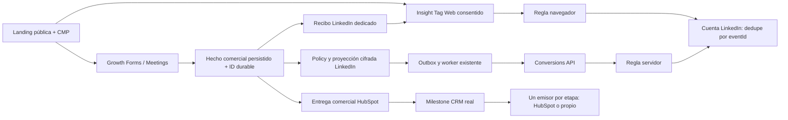

# LinkedIn Ads — arquitectura de medición propuesta

- Estado del ADR: **`Proposed`**, 2026-10-19. El pedido autoriza investigación y documentación;
  no acepta todavía la arquitectura ni autoriza instalación, grants, envío o publicación.
- Dueño propuesto: Growth / Measurement, con Marketing Operations, RevOps, Privacy y Platform.
- Alcance: anuncios LinkedIn, fuentes comerciales web de Forms/Meetings y futura calidad CRM.
- Implementación LinkedIn: **no construida ni activada por este trabajo**.
- Confidence: **medium** para la propuesta; acceso y configuración reales aún desconocidos.
- Validated as of: **2026-10-19**, fuentes primarias y código local; no cuenta/provider autenticados.
- Evidencia: código y snapshots versionados inspeccionados; documentación oficial consultada por
  los investigadores. Cuenta, Partner ID, reglas, roles, token y conexión HubSpot LinkedIn sin verificar.
- Reversibilidad: el código y los gates se pueden retirar; datos ya enviados y atribución/aprendizaje
  del anunciante no se revierten mediante rollback del código.

## Contexto y decisión propuesta

Greenhouse ya confirma leads y reservas, publica políticas por fuente/versión/superficie, conserva
proyecciones cifradas y entrega datos comerciales a HubSpot. Su medición Meta/Google permite reutilizar
primitives, pero no concede acceso, consentimiento, IDs ni capacidad de envío a LinkedIn.

Se propone **InsightTag 2.0 en GTM Web**, consentido y limitado a superficies públicas revisadas,
para navegación y conversiones event-specific. Las conversiones salen exclusivamente de una aceptación
comercial persistida, con un identificador durable por hecho. Como segunda capa, **Conversions API**
usa una proyección dedicada y un único sender servidor: adapter del worker existente a LinkedIn directo
como opción provisional preferida; plantilla oficial sGTM como alternativa que exige revisión.

No se importa ni instala una plantilla en este discovery. LinkedIn documenta el
[template Web 2.0](https://www.linkedin.com/help/lms/answer/a416960) y mantiene una
[plantilla CAPI servidor oficial](https://github.com/linkedin-developers/linkedin-capi-tag-template).
El primero es JavaScript del navegador; el segundo no reemplaza su observación first-party.

El diagrama describe el objetivo. Ningún nodo nuevo LinkedIn se considera existente por aparecer aquí.

## Estado comprobado y límites

| Superficie | Evidencia local | Implicación |
| --- | --- | --- |
| GTM Web versionado | 11 tags, sin fingerprints LinkedIn | No hay implementación LinkedIn en ese snapshot; releer live antes de operar |
| GTM Server versionado | 5 tags Google Ads/GA4/Meta, sin LinkedIn | La plantilla oficial LinkedIn no está incorporada en ese snapshot |
| Policy | Destinos cerrados `meta` y `google_upd`, bloque `googleAds` separado | Añadir LinkedIn requiere contrato y comportamiento, no sólo publicar datos |
| Browser context | Categorías HubSpot/GPC, Meta/GA4 y Google consent/click context | No captura `li_fat_id` ni existe recibo LinkedIn |
| Worker y almacenamiento | Cifrado, leases/CAS, recheck policy y receipts Meta | Reutilizables con una extensión explícita; el dispatcher actual no acepta LinkedIn |
| Migración versionada | CHECK de destino sólo `meta`/`google_upd` | CAPI requiere expansión de schema gobernada y release compatible |
| HubSpot/hosts externos | Sin discovery autenticado LinkedIn en esta unidad | No se afirma ausencia global de pixel, conexión o campañas |

Referencias: `docs/reference/measurement-gtm-ga4/{container-snapshot,server-container-snapshot}.json`;
`src/lib/growth/measurement/{contracts,policy-contract,prepare,payload,store,dispatch}.ts`;
`src/growth-measurement-context/context.ts`;
`migrations/20261013233429748_task-2034-growth-measurement-enrichment.sql`.
Las menciones LinkedIn de iconos, URLs, perfiles o cuestionarios no son una integración publicitaria.

## Autoridad y configuración por anunciante

Antes de implementar se leen la identidad LinkedIn autorizada, cuenta Ads/URN exacta, roles humanos,
propietario del Insight Tag y acceso FULL/USE_ONLY. El **Partner ID es el identificador del tag**,
no el de la cuenta. Un tag puede compartirse entre cuentas; falta de acceso no justifica crear otro.
[Permisos de tag](https://www.linkedin.com/help/lms/answer/a424432) y
[contrato API](https://learn.microsoft.com/en-us/linkedin/marketing/integrations/ads-reporting/conversion-tracking).

No se elige por analogía la cuenta Google Ads ni sus identidades. Cloud, GA4/GSC, Meta, una Page
LinkedIn o una sesión social no acreditan permiso sobre Ads. El binding futuro conserva organización,
cuenta, Partner ID, reglas por fuente/hito, campañas/ad sets asociados, versión y estado de activación.
Ningún token queda en GTM Web, DTO público, URL, dataLayer o archivo versionado.

CAPI ofrece dos accesos distintos: token **Direct API** generado en Campaign Manager, o integración
partner con app/product approval y OAuth de usuario. La documentación enumera `rw_conversions` y
`r_ads` para el flujo OAuth; no deducir permisos de reporting general del token Direct API. Inventariar
endpoint/rol/grant efectivo antes de construir una CLI. Guardar token en el mecanismo de secretos
canónico, con lectura mínima y revocación; que un proveedor no lo expire no evita su rotación operativa.
[Overview](https://learn.microsoft.com/en-us/linkedin/marketing/conversions/conversions-overview),
[acceso](https://learn.microsoft.com/en-us/linkedin/marketing/conversions/getting-access-conversions).

## Hechos y elegibilidad comercial

| Hecho local propuesto | Prueba de ocurrencia | Conversión LinkedIn a decidir |
| --- | --- | --- |
| `commercial_lead` | Forms fresh accepted y commit de proyección | Regla comercial LEAD o categoría específica aprobada |
| `meeting_booking` | Respuesta proveedor válida + transición durable a succeeded | Regla BOOK_APPOINTMENT |
| Etapa CRM | Transición real autoritativa en HubSpot, posterior al cutover | Regla propia de etapa y emisor único |

La cobertura candidata es la intención comercial ya ratificada para Google Ads: Forms comerciales,
AI Grader y agendas elegibles. **No es inscripción automática en LinkedIn**. Se revisan nuevamente fuente,
versión publicada, surface, origen, mapping y cuenta. Contacto general, ebooks, newsletter, empleo,
soporte, encuestas y fixtures quedan fuera. El nombre de una landing no determina la intención.

No disparan conversiones un clic, validación cliente, apertura de agenda, selección de horario,
render de gracias, polling del Grader ni reintento/dedupe de un hecho ya aceptado. El UUID canónico
se crea una vez por aceptación nueva y conserva fecha durante todos los intentos. Los hitos CRM
posteriores tienen su propia identidad; no se reutiliza un ID por persona, formulario o sesión.

El backend y el renderer requieren un **recibo LinkedIn propio**. `googleAdsConversion`,
`gh_ads_conversion` y el espejo GA4 `generate_lead` no son permisos ni recibos para LinkedIn.
Para Grader se conserva Forms como fuente, no se instrumenta el polling del informe.
[Forms/Grader](GROWTH_GRADER_COMMERCIAL_MEASUREMENT_V1.md) y
[runtime común](../reference/measurement-gtm-ga4/10-growth-lead-matching-runtime.md).

## Consentimiento, adquisición e identidad

HubSpot CMP conserva la autoridad de categorías. LinkedIn exige obtener los permisos necesarios y
excluye páginas con datos sensibles. La implementación futura mantiene default denied, publicidad
explícita, ausencia de veto GPC y revocación efectiva antes de cualquier solicitud LinkedIn, incluido el fallback
del template. Google Consent Mode no bloquea automáticamente un tag externo; los cuatro campos
Google no se convierten en consentimiento universal. La finalidad/vendor LinkedIn exige mapping y
prueba propios sobre la elección real del CMP. Falta definir y probar cómo llega una revocación al
sender backend antes de entregar: el snapshot capturado en un POST no es un registro central de
revocación. Si no puede probarse autoridad vigente, ese envío queda bloqueado; no se presume que
consultar el banner desde el worker sea posible.
[Insight Tag](https://www.linkedin.com/help/lms/answer/a489169),
[consent checks GTM](https://support.google.com/tagmanager/answer/10718549?hl=en).

Tres capacidades tienen contratos diferentes:

| Capacidad | Mecanismo | Propuesta local |
| --- | --- | --- |
| Enhanced conversion tracking | First-party click ID `li_fat_id` en landing/cookie | Captura consentida, procedencia/fecha, transporte Forms/Meetings y retención propia aprobada |
| Enhanced matching Web | Información como email mediante `lintrk('setUserData', …)`; hashing en sitio según proveedor | Opcional, fuera de la fase base hasta revisar timing, consentimiento y clear; nunca PII en dataLayer |
| Identidad CAPI | `SHA256_EMAIL` y/o `LINKEDIN_FIRST_PARTY_ADS_TRACKING_UUID` | Normalización LinkedIn dedicada y payload mínimo cifrado; no copiar hashes Google indiscriminadamente |

Fuentes: [click IDs](https://learn.microsoft.com/en-us/linkedin/marketing/conversions/enabling-first-party-cookies),
[enhanced tracking](https://www.linkedin.com/help/lms/answer/a423304),
[enhanced matching](https://www.linkedin.com/help/lms/answer/a6241147),
[schema CAPI](https://learn.microsoft.com/en-us/linkedin/marketing/integrations/ads-reporting/conversions-api-schema).

La cookie de tracking se documenta con 30 días desde el último clic; el mapping del proveedor de
365 días **no autoriza esa retención local**. Diseñar el TTL con Privacy y no copiar el de Google.
Capturar `li_fat_id` real; no fabricar IDs ni convertir `gclid`, `fbclid`, GA4 client ID o submission ID.
El nuevo `li_adsid` del Insight Tag es otro identificador: inventariar su exposición por región y
actualizar disclosure, sin asignarle un idType CAPI inexistente.

No enviar teléfonos, User-Agent o IPv6 por herencia de Meta: el schema consultado no los admite como
esa proyección. IP/country/nombres son ampliaciones opcionales que requieren necesidad, formato
oficial y política propia; la primera propuesta minimiza a email hash y/o click ID real. El hash sigue
siendo dato personal seudonimizado; no se publica en telemetría, URLs, logs o recibos operativos.

## Dos reglas por fuente y deduplicación

Para el mismo hecho emitido por Insight Tag y CAPI, LinkedIn documenta **dos reglas**, una por fuente,
en la misma cuenta, con el mismo `eventId`. La copia Insight Tag prevalece y la CAPI se descuenta.
Web usa `event_id`/campo Event ID; servidor usa `eventId`. No usar una sola regla para ambas fuentes,
ni dos UUID diferentes, ni asumir la ventana de Meta: la fuente consultada no fija esa ventana numérica.
[Deduplicación oficial](https://learn.microsoft.com/en-us/linkedin/marketing/conversions/deduplication).

Cada hito redundante tiene su pareja de reglas y asociaciones revisadas. No aceptar una asociación
a todas las campañas/ad sets por defecto sin revisar su alcance autorizado. Los UUID browser existentes
no garantizan coincidencia con el hecho backend; el nuevo recibo debe transportar su UUID canónico.
Dedupe proveedor browser/server no garantiza idempotencia server/server: imponer unicidad local por
ocurrencia/destino/regla y conservar ID/fecha en retry. Una respuesta incierta no autoriza nuevo ID.

## CAPI durable y alternativas

La opción provisional preferida extiende el worker de Measurement: commit del hecho → proyección
cifrada/outbox → claim lease → recheck policy → adapter LinkedIn → receipt mínimo → CAS terminal.
La aceptación comercial sigue protegida por SAVEPOINT y no depende del proveedor de anuncios.
Un secret, policy o API indisponible bloquea LinkedIn sin romper Forms/Meetings ni otros destinos.

El adapter fija versión `Linkedin-Version`, protocolo Rest.li y schema probado, con
`conversionHappenedAt` en milisegundos y la fecha real. Respuesta 201 es aceptación de transporte;
no es matching ni atribución. Payload inválido, denegación y API retirada se tratan por causa;
429 y fallos confirmados como no aceptados usan backoff/jitter y límite de edad/intentos. Un timeout
u otro fallo con posible aceptación, incluido5xx ambiguo, queda `unknown_delivery` para reconciliar:
no se permite retry automático hasta probar la política e idempotencia servidor/servidor. Si se
habilita un retry, conserva ID/fecha originales; nunca reenvía ciegamente un lote. No se encontró `validateOnly` ni `test_event_code` documentado
para conversionEvents. [Contrato CAPI](https://learn.microsoft.com/en-us/linkedin/marketing/integrations/ads-reporting/conversions-api).

La plantilla oficial sGTM es alternativa válida para evaluar, no una instalación existente. La revisión
oficial del discovery detectó versión hardcodeada, autolectura de datos GA4, tratamiento de IP y éxito
2xx sin outbox durable. Requiere pin/hash, allowlist de campos, consentimiento/auth, versión vigente,
receipt y decisión de reintentos. Nunca usar ambos senders servidor para el mismo hecho/regla.
[Fuente oficial revisada](https://github.com/linkedin-developers/linkedin-capi-tag-template/blob/488ef89314a5201b398e91782400c996e9c02d69/template.tpl).

| Alternativa | Ventaja | Límite que decide |
| --- | --- | --- |
| Sólo Web inicial | Menor extensión backend y control GTM conocido | Depende del navegador; no ofrece recuperación durable |
| Worker → LinkedIn directo | Reutiliza ID, cifrado, outbox, leases y auditoría | Schema, secretos, auth, migración y adapter nuevos |
| Worker → sGTM oficial → LinkedIn | Aprovecha operación de contenedor | Revisión de plantilla, ingress, minimización y receipt; no duplica sender |
| HubSpot nativo | Adecuado para etapas CRM compatibles | Entitlement, identidad, fechas y semántica no equivalen a web accepted |

## HubSpot, CRM y Lead Gen Forms nativos

Growth conserva aceptación/booking; HubSpot conserva contacto, calificación, oportunidad y negocio.
Los UTMs deben viajar hasta el CRM y reconciliarse con método declarado; no sustituyen identidad de
click ni prueba de atribución LinkedIn. Antes de instalar, inventariar también pixels auto-instalados
por HubSpot, WordPress y Think. Un solo loader de Insight Tag por sitio, con ownership compartido
si corresponde; no duplicarlo mediante GTM y HubSpot Ads.

Los eventos lifecycle nativos HubSpot pueden enviar CAPI después de conectar Ads y crear el evento.
Se revisan plan/permisos, consentimiento, datos compartidos, etapa y cutover. El diseño local exige
una propiedad explícita de consentimiento/finalidad aunque la integración permita omitirla; no
seleccionar todos los contactos por defecto ni ampliar compartición por una opción automática. Se asigna **un emisor
por etapa/regla: HubSpot o propio**, sin presumir que HubSpot comparte nuestro eventId para dedupe.
El flujo documentado sólo cuenta cambios posteriores a crear el evento; no backfill por analogía.
[HubSpot oficial](https://knowledge.hubspot.com/ads/create-and-sync-ad-conversion-events-with-your-linkedin-ads-account).

LinkedIn Lead Gen Forms nativos viven dentro de LinkedIn. Son una entrada distinta mediante HubSpot
Lead Sync o API autorizada, con su ID real e idempotencia. No crear una falsa submission web ni
reenviar esa captación desde otro sender como si fuera un segundo lead. Lead Sync y CAPI tienen
acceso y sentido de datos diferentes. [Integración nativa documentada](https://ecosystem.hubspot.com/marketplace/listing/linkedin-ads).

## Extensiones necesarias y secuencia de rollout

1. **Discovery autenticado sin writes.** Confirmar cuenta/roles, tag/Partner ID/FULL o USE_ONLY,
   duplicados, reglas/métodos, asociaciones, ventanas/modelo/valor y HubSpot. La UI actual habla de
   ad sets mientras algunas APIs dicen campaigns; mapear entidad/version exacta sin renombrar URNs.
2. **Contrato y aceptación del ADR.** Decidir finalidad, hosts/rutas, datos/TTL, acciones y emisor.
   Reglas/IDs reales se configuran por binding, nunca se copian de tutoriales. Valores sólo aprobados,
   sin atribuir ingreso a un lead o reunión por conveniencia.
3. **Implementación protegida.** Context/schema/provider consent, policy/validación/UI/CLI, recibo y
   renderer dedicado. Para CAPI: destino SQL aditivo, payload/adapter exhaustivos, flags OFF,
   secreto canónico, receipts/observabilidad y pruebas. No reutilizar fallback ternario Google.
4. **QA previa.** Tests offline de contratos, payload, dedupe, source drift, replay y fallos; templates
   pinned y Preview con red bloqueada. Cero solicitudes LinkedIn ante unknown/denied/GPC/revoke,
   hosts privados/ajenos o ausencia de policy; aceptación/booking siguen sanos.
5. **Publicación autorizada por plano.** Release backend/hosts, migración, policies, GTM, settings y
   flags son operaciones distintas con readback/rollback. No activarlas con este documento.
6. **Validación legítima posterior.** Señal/tag activo no es conversión. Un hecho comercial real y
   consentido permite seguir ID/rules/dedupe; recepción, matching y atribución se registran separados.
   No fabricar leads, reservas, adclicks ni conversiones, ni reenviar históricos para llenar evidencia.

Rollback detiene la emisión LinkedIn por flags/policy y restaura versiones compatibles de tag/host;
no altera entregas comerciales ni otras plataformas. Preserva identidad y receipts; no borra filas
para habilitar reenvíos. La eliminación de una regla o secreto exige un plan propio.

## Documentación y estado de cierre

- [Referencia técnica LinkedIn](../reference/measurement-gtm-ga4/11-linkedin-insight-tag-conversions-api.md).
- [Preparar medición LinkedIn](../manual-de-uso/growth/preparar-medicion-linkedin.md).
- [Superficie funcional](../documentation/growth/linkedin-ads-measurement.md).
- [Políticas comunes](GREENHOUSE_GROWTH_MEASUREMENT_POLICY_DECISION_V1.md).
- [Arquitectura Google Ads existente](GREENHOUSE_GOOGLE_ADS_MEASUREMENT_ARCHITECTURE_V1.md),
  reutilizable sólo en sus primitives neutrales, no como consentimiento o binding LinkedIn.

**Pendientes antes de implementar:** cuenta y autoridad exactas, inventario live sin duplicados,
Partner ID/rules y asociaciones, política Privacy/retención, aceptación del ADR, elección sender,
contratos/QA y autorización de publicación. Este discovery no modificó GTM, Ads, HubSpot, cloud,
flags ni código runtime, y no verificó recepción/matching/atribución de Efeonce en LinkedIn.
