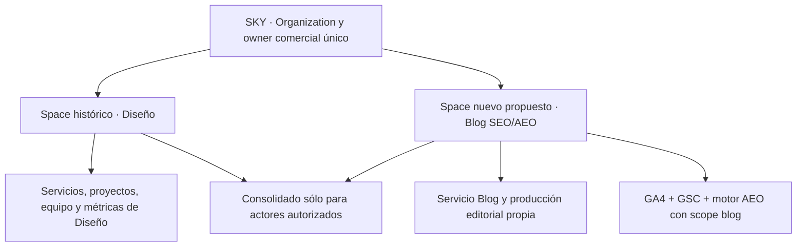
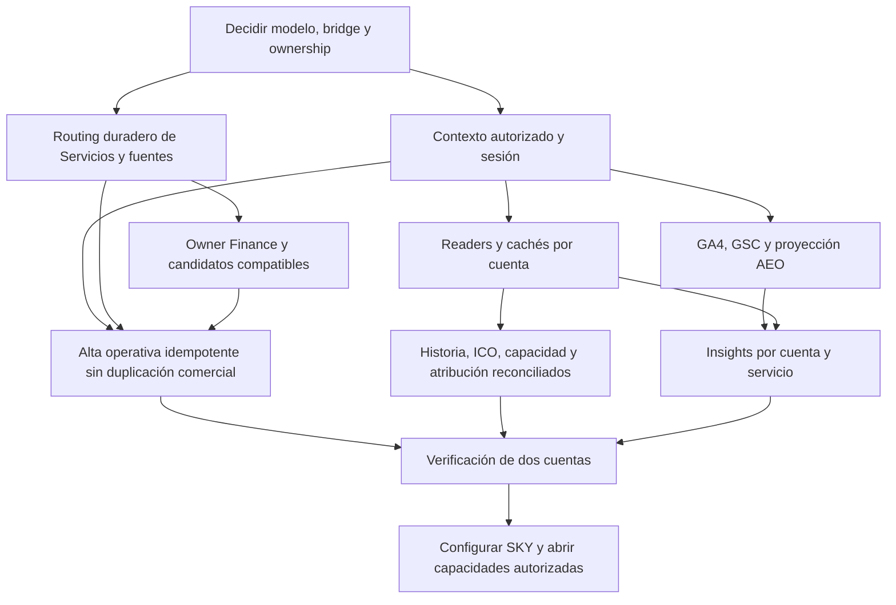

# Discovery integral · SKY con dos cuentas operativas

Fecha: **2026-10-27**. Estado: **investigación y propuesta técnica consolidadas; sin implementación ni provisioning**.
Pedido del operador: estudiar integralmente cómo operar Diseño y Blog SEO/AEO como dos cuentas con stakeholders,
trabajo, acceso e indicadores propios, manteniendo una misma Organization SKY y su consolidado autorizado.
El informe Blog requiere **GA4 + GSC + corridas del motor AEO propio** desde su primera entrega.

## 1. Dictamen

**La estructura recomendada es una Organization SKY, dos Spaces operativos y los Servicios dentro de su cuenta.**
El Space histórico conserva Diseño; Blog SEO/AEO se incorpora con contexto y datos propios. No hace falta duplicar
la empresa en CRM, inventar otro Account master ni reconstruir la historia del cliente.

La estructura ya cabe en el modelo canónico. La implementación actual, en cambio, todavía contiene muchas
suposiciones de un Space por client o Company. Crear el segundo Space sin resolverlas puede cambiar silenciosamente
routing de servicios, sesión, fuentes, equipo, indicadores y atribución. **Ni siquiera una fila inactiva es una
barrera suficiente frente a todos los resolvers actuales.**

El puente técnico hacia `clients` requiere una decisión explícita. La candidata de transición es un bridge operativo
por Space con un único owner comercial/financiero, si supera sus pruebas. La alternativa comparte el bridge y migra
todos los consumers client-only al contexto Space. Ninguna se ejecuta invocando el alta comercial existente ni
duplicando perfiles Finance; el capítulo 01 compara ambas sin declarar operativa una solución aún no construida.

## 2. Mapa de documentos

| Capítulo | Responde | Entregables |
| --- | --- | --- |
| [01 · Identidad, acceso y contexto](01-identity-access-and-context.md) | ¿Cómo separar stakeholders sin duplicar personas o empresa? | Alternativas de bridge, schema vivo, sesión/refresh, memberships, grants, API/MCP, cachés, amenazas y migración |
| [02 · Modelo, sync y provisioning](02-model-service-sync-and-provisioning.md) | ¿Cómo crear y conservar la separación frente a cada writer? | Ownership por campo, routing de servicios/fuentes, onboarding, Notion/BQ/robots, CAS, recuperación y aceptación |
| [03 · Historia, métricas y consolidado](03-history-metrics-and-consolidation.md) | ¿Cómo preservar Diseño y comenzar SEO sin inventar o duplicar historia? | Inventario, Proyecto→Servicio, ICO, capacidad, Finance/atribución, fechas, residuales y reconciliación |
| [04 · Medición e Insights](04-measurement-bindings-and-insights.md) | ¿Cómo asegurar GA4/GSC/motor AEO por cuenta y servicio? | Contexto, asignación de fuentes, receipts, gates, pinning, idempotencia, biblioteca, schedules y distribución |
| [05 · Decisiones y ejecución](05-decisions-transition-and-execution-plan.md) | ¿En qué orden construir y verificar todo esto? | Decisiones propuestas, unidades dependientes, conciliación con backlog, transición, barreras previas y rollback |

El [discovery específico de medición](../../insights/2026-10-27-sky-blog-discovery/README.md) conserva el detalle de
host, GA4, histórico GSC y proyección AEO. Este dossier amplía el alcance a la cuenta operativa completa y gobierna
las recomendaciones integrales cuando las notas anteriores sólo trataban una preview de Insights.

## 3. Modelo recomendado y lenguaje

- **Organization:** identidad y relación comercial, fuentes organizacionales y consolidado.
- **Cuenta operativa / Space:** equipo interlocutor, trabajo, fuentes, permisos, indicadores y experiencia propios.
- **Service:** compromiso contratado, condiciones y vigencia, vinculado inequívocamente al Space.
- **client legacy:** puente técnico existente. Si la opción A' crea un hijo operativo, no constituye otra empresa,
  cliente comercial, perfil financiero ni identidad de persona. Su owner se resuelve explícitamente.

Un Space puede agrupar varios servicios de una misma relación operativa. No se crea automáticamente otro por cada
SKU, campaña, factura o departamento del organigrama. La separación responde a operación/autoridad y rendición de
resultados distintas. Otra organización requiere una contraparte/cuenta realmente distinta, no sólo otro interlocutor.

## 4. Qué comprobamos

| Área | Evidencia de este discovery y sus antecedentes del día | Límite |
| --- | --- | --- |
| SKY actual | Una Organization, un Space activo, un client puente; Diseño y Blog activos en el mismo Space | Aún no existen dos cuentas aisladas |
| Proyectos/tareas | 123 proyectos, 7.867 tareas; todos con `module_id=NULL`; 30 tareas sin proyecto | Conteos de registros, no validación de vigencia, entrega o pertenencia de cada fila |
| Clasificación | `module_id` apunta al catálogo técnico `service_modules`, no a `services` | No insertar IDs `SVC-HS-*` en esa FK |
| Equipo | Tres asignaciones activas, sin serviceId | No prueban tres FTE disponibles para cada cuenta; no se consultaron personas |
| Servicios/sync | Cuatro paths de intake y un upsert común; routing Company→Space con `LIMIT 1` | Reasignación manual no es durable frente al sync actual |
| Sesión | View viva une Spaces por client; el lector toma una fila | Dos Spaces con mismo bridge pueden volver ambiguo el contexto sin refactor |
| Constraints/alta | HubSpot company en `clients` no es UNIQUE; el command comercial sí rechaza otro client y crea perfil Finance | Schema permisivo no autoriza un alta operativa mediante ese command |
| Notion | Provisioning/source getters y projector conservan supuestos client-only; upsert por ID externo puede mover ownership | Compartir/copiar la DB no equivale a partición segura |
| Caché | Account360 cachea org+facet; equipo/capacidad y aliases requieren contexto explícito | Reutilizar esas respuestas para un Space puede mezclar poblaciones |
| Finanzas/atribución | Metadata de 27 facturas y 10 pagos, más facts/residuales; no se extrajeron montos | Duplicar aliases o cambiar client candidatos puede falsear atribución sin duplicar un documento |
| Fechas | Inicio CRM del servicio y comienzo de prestación descrito en contexto difieren | Ninguno sustituye automáticamente fecha contractual/efectiva verificada |
| Medición | GSC PG parcial; BQ sin historia SKY en rango; GA4 general con dato blog; motor con citas blog reutilizables | Crear cuenta no arregla cobertura histórica ni vuelve global scores en KPIs del blog |

No se certificó cada endpoint o revisión desplegada. Los hallazgos de sibling/worker/robot son lectura de código y
metadata acotada, no un canary productivo ni afirmación de incidente actual entre dos cuentas que aún no existen.

## 5. Hallazgos que condicionan la solución

### La separación debe sobrevivir a todos los escritores

El sync puede elegir el primer Space de la Company y luego sobrescribir `services.space_id`. El wizard puede
reutilizar el Space antiguo al reconectar Notion. El projector por `notion_project_id` puede reatribuir registros
existentes. El robot PG/BQ necesita resolver fuentes con precedencia/dedupe. No basta una pantalla de selección.

### La identidad comercial y el bridge operativo deben distinguirse

A' conserva un owner comercial y añade el selector técnico que necesitan lectores legacy; B conserva el bridge y
extiende todos esos lectores a Space. Ambas requieren memberships/contexto para personas con varias cuentas.
Un permiso global extra o otra fila de usuario no son sustitutos de esa selección.

### La atribución financiera debe corregirse antes del primer cambio de routing

El materializador puede elegir candidatos por client antes de Organization. Si Blog cambia a un child operativo,
una factura del owner comercial podría dejar de considerarlo y asignarse a Diseño por descarte. Hay que normalizar
owner antes de candidatos/pesos, con Space/Servicio/vigencia, y probar los consumers reactivos **antes** del rebind.
Se separó una foundation financiera previa de la reconciliación histórica posterior para evitar un hueco en el DAG.

### Historia y consolidado requieren poblaciones, no sólo nombres

Conservar IDs y snapshots de Diseño. Nuevo SEO tiene su propia prestación y puede usar historia previa del blog
como baseline. No copiar entregas, FTE, ingresos o medianas de Diseño a SEO. Lo no atribuible queda como residual,
no se asigna al único candidato que quedó por una alteración accidental del bridge.

### La cuenta activa debe llegar hasta el último recurso

Permisos por Organization y un menú distinto no separan filas. El contexto debe llegar a listado/detalle, source
APIs, cachés, métricas, evidencia, outputs, exportaciones, solicitudes, distribución y automatizaciones. Un link
bearer tampoco comprueba departamento; la separación por identidad exige el recorrido autenticado apropiado.

### Las tres fuentes del informe Blog se validan por separado

GA4 puede producir hechos tanto SEO como AEO sin GSC ni corrida nativa. Por ello, pedir módulos `seo` y `aeo` y
comprobar que haya facts no prueba el requirement. Se necesitan receipts independientes `ga4`, `gsc`, `aeo_run`;
su falta mantiene pendiente el entregable aunque `allowPartial` permita límites de métricas concretas.

## 6. Decisiones pendientes antes de código estructural

1. Elegir A' o B tras demostrar sus invariantes con un fixture/prototype; aprobar cómo se resuelve el owner comercial
   y qué significa el bridge técnico. No cerrar la elección sólo porque un schema permita insertar una fila.
2. Formalizar contexto operativo y permisos efectivos, compatibilidad de sesión y multi-tab, y boundaries del consolidado.
3. Establecer ownership/routing versionado de Servicio→Space, fuente→Space y Proyecto→Servicio, con conflicto/CAS.
4. Aceptar la foundation financiera de candidatos/owners previa al rebind y la política de conservación histórica.
5. Fijar binding de medición/edición, tres fuentes obligatorias, métrica GA4 y proyección canónica de citas AEO.
6. Definir la modalidad de acceso/distribución y el orden de apertura de capacidades a stakeholders reales.

Los dueños propuestos son Core/Spaces, Identity, Commercial/Services, Source Sync, Delivery/ICO, Finance, Growth/
motor AEO e Insights. El operador decide el modelo de relación y las excepciones; cada dueño conserva sus fórmulas,
permisos y fuentes. Este dossier propone ADRs/contratos y unidades, no los marca Accepted ni reserva TASK IDs.

## 7. Secuencia recomendada

Las flechas describen dependencias, no trabajo implementado. El capítulo 05 detalla unidades y gates. Un filtro o
preview interna puede desarrollarse antes del alta; la apertura de dos cuentas aisladas exige sus foundations.
No insertar un segundo Space para que el sistema lo use como experimento mientras existan writers ambiguos.

## 8. Calidad y revisión cruzada

La investigación se dividió entre tres subagentes: Identity/Access, Modelo/Sync/Provisioning e Historia/Métricas/
Finance. El coordinador integró medición/Insights y el plan. Después se cruzaron los contratos y el orden de entrega.

La revisión corrigió, entre otros puntos: owner histórico frente a routing latest; dispatch frente a reconciliación
read-only; distinción de owner comercial y bridge operativo; A' en la selección de candidatos financieros; y la
barrera financiera anterior al provisioning para evitar un ciclo o atajo en el plan.

Las matrices contienen escenarios por capítulo y una aceptación integral. Son **pruebas propuestas**, no pruebas
live pasadas. Las 76 pruebas focales ejecutadas en el discovery previo sólo cubren la base actual de medición y
no acreditan la separación multi-Space. No se generaron fixtures en la base compartida ni se hicieron escrituras
de personas, roles, servicios, fuentes, finanzas o cuentas para validar una hipótesis.

Evidencia local ignorada por Git, sin secretos, montos ni filas de personas:

- `.captures/insights-sky-scope-2026-10-27/`: baseline de cuenta, fuentes e Insights, incluidos receipts de BQ/AEO.
- `.captures/sky-multi-account-discovery-2026-10-27/identity-schema-readback.json`: schema/contexto inspeccionado.
- `.captures/sky-multi-account-discovery-2026-10-27/model-source-readback.json`: mapping/modelo y fuentes.
- `.captures/sky-multi-account-discovery-2026-10-27/history-readback.json`: conteos y cobertura histórica/atribución.

## 9. Estado honesto de cierre

El discovery deja identificados modelo, alternativas, alcance de cambios, owners, contratos, dependencias,
transición, rollback y evidencia pendiente. **No está implementado ni launch-ready.** La elección de bridge y sus
probes son condiciones de build-ready; la autorización y pruebas de datos/acceso reales son condiciones de rollout.

No se han creado otra organización, Space, client bridge, usuario, contrato, fuente o perfil financiero; no se
modificaron indicadores/snapshots ni se iniciaron syncs, corridas, backfills, envíos o deploys. El WIP comercial
ajeno permanece intacto. El siguiente paso es formalizar las decisiones y unidades del capítulo 05, no ejecutar
un cambio manual de datos como sustituto del diseño.

## 10. Continuación autorizada — ADR y sandbox local

El mismo 27-10 el operador autorizó formalizar la decisión y primera task, y ejecutar sólo prototipo local.
[ADR Proposed](../../../architecture/GREENHOUSE_OPERATIONAL_ACCOUNTS_UNDER_ORGANIZATION_DECISION_V1.md),
[TASK-2073 cerrada por sandbox](../../../tasks/complete/TASK-2073-operational-account-bridge-local-prototype.md)
y [evaluación reproducible](../2026-10-27-sky-operational-bridge-prototype/README.md): 97 tests/68 checks PASS,
preferencia condicionada A′. No altera el baseline del discovery: sin alta/configuración productiva ni historia
Diseño reasignada. U01/U02/U02F siguen siendo gates previos a provisioning real.
