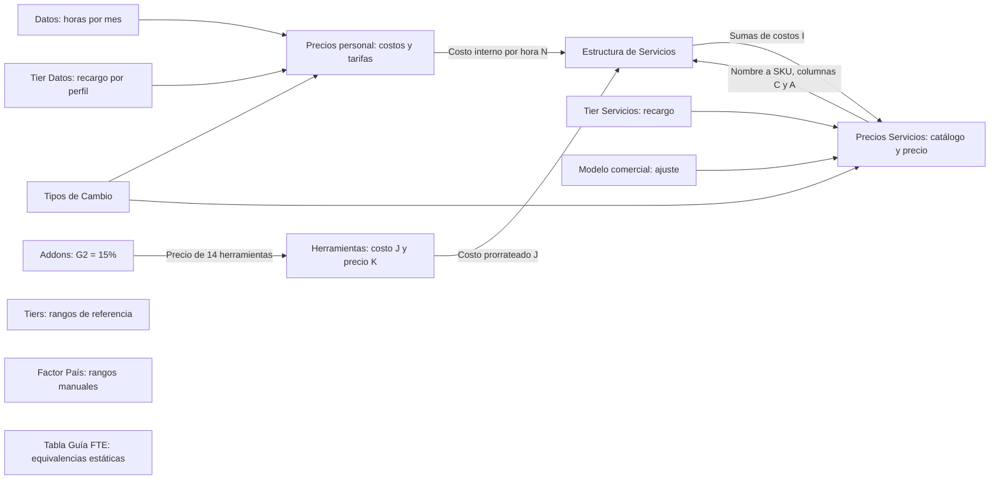

# Lógica del prototipo de cotizador: análisis hoja por hoja

- Fecha: 2026-10-09.
- Alcance: lectura del Excel y análisis de sus reglas para un futuro cotizador independiente por CLI.
- Estado: análisis terminado; motor nuevo no implementado.
- Fuente: [libro original](../../../data/pricing/efeonce-pricing-model-v1.xlsx).
- SHA256: `68a0c361e7ec3b188419cc5d5c7b758419e4d4d499eba5d9242b3f78a1c78d1b`.
- Evidencia verificable: [checks del análisis](2026-10-09-pricing-workbook-logic-analysis-checks.json).
- El libro es un prototipo. Su disposición en hojas y celdas no debe convertirse en una dependencia del futuro cotizador.

## Resultado

Hay dos recorridos de cálculo completos sobre los datos cargados:

1. Costo mensual de perfil → costo por hora → recargo de su tier → tarifa por hora/FTE → monedas.
2. Horas de perfiles y cantidades de herramientas → costo de servicio → recargo de tier + ajuste de modelo comercial → redondeo → monedas.

Se reconciliaron 32 perfiles, 26 herramientas y las tres composiciones de servicio existentes. Los cuatro servicios restantes con nombre no tienen composición; las filas de reserva no son ítems vendibles. La igualdad aritmética no acredita que los costos históricos sigan vigentes ni que todas las cargas de operación estén incluidas.

Se inspeccionaron las 1.480 fórmulas y sus familias. Se compararon independientemente 654 resultados, sin diferencias, con tolerancia de flotantes. No se abrió ni recalculó el libro en Excel/LibreOffice: los controles combinan precedentes estáticos, valores guardados y aritmética independiente. Las sensibilidades descritas son derivaciones de las fórmulas, sin editar celdas.

No se modificaron el Excel, la CLI existente, el catálogo, el motor del portal ni las tarifas. Este documento describe el prototipo; no adopta sus cifras como política comercial.

## Mapa de conexiones



El enlace de vuelta de Precios Servicios a Estructura consulta identificación del catálogo, no el precio calculado. El análisis de referencias de celdas no detectó ciclos ni referencias a hojas inexistentes. Datos también abastece listas de validación: esa relación de selección es distinta de una dependencia aritmética.

## Inventario

| Hoja                    | Fórmulas | Función                           | Estado observado                                                |
| ----------------------- | -------: | --------------------------------- | --------------------------------------------------------------- |
| Datos                   |        0 | Vocabularios y horas/mes          | Parámetro conectado; listas parcialmente conectadas             |
| Tier Datos              |        0 | Recargos de perfiles              | Conectada y operativa                                           |
| Tiers                   |        0 | Clasificación y bandas por rol    | Referencia desconectada, con discrepancias                      |
| Tipos de Cambio         |        0 | Factores USD a moneda destino     | Conectada y operativa, tasas fijas históricas                   |
| Factor País             |        0 | Ajustes comerciales por segmento  | Desconectada; intervalos sin selección                          |
| Tier Servicios          |        0 | Recargo por nivel de servicio     | Conectada y operativa                                           |
| Modelo comercial        |        0 | Ajuste por engagement             | Conectada y operativa; se suma al recargo                       |
| Tabla Guía FTE          |        0 | Dedicación a horas                | Referencia estática desconectada                                |
| Estructura de Servicios |      124 | Composición y suma de costos      | Tres composiciones completas; extensión incompleta              |
| Precios personal        |      911 | Costo y tarifa de perfiles        | 32 perfiles completos; 54 SKUs de reserva                       |
| Precios Servicios       |      373 | Costo, precio y conversiones      | Tres calculados; cuatro sin composición; 43 reservas            |
| Herramientas            |       72 | Prorrateo y precio de herramienta | 26 registros; periodicidad no normalizada                       |
| Addons - Overheads      |        0 | Gastos, fees y descuentos         | Reglas mayormente manuales; G2 alimenta precios de herramientas |

Tier Datos, Tipos de Cambio y Modelo comercial están ocultas. Las otras diez hojas están visibles.

## 1. Datos

**Entradas:** categorías, Staff/Servicio, tiers, áreas, unidades, tipos de herramienta, unidades de prorrateo, facturación, inclusión en add-on, tipo de ítem y tipo de servicio (`A1:L12`). El parámetro numérico de cálculo es `O3 = 180 horas/mes`.

**Conexiones:** Precios personal usa O3 en N, O y W. Las validaciones de extensión consultan listas para herramientas, tiers y Estructura. Varias validaciones iniciales usan listas literales, por lo que cambiar el vocabulario en Datos no actualiza necesariamente todos los desplegables.

**Qué funciona:** una sola base de horas controla costo/hora y la reconstrucción de costo/precio FTE. El comentario de O3 declara expresamente esa intención.

**Límite:** representa horas laborales, sin una deducción calculada de formación, vacaciones, coordinación o capacidad no vendida. Cambiar O3 modifica tarifas por hora y servicios con horas fijas. El precio mensual FTE de un perfil se mantiene: dividir y multiplicar por las mismas horas cancela el efecto.

**Regla recuperable:** parámetro de horas mensuales y vocabularios tipados. La separación de horas laborales y vendibles requiere una decisión adicional.

## 2. Tier Datos

`A2:B5` define cuatro porcentajes: 25%, 30%, 50% y 60%. Precios personal busca por el texto de E, con coincidencia exacta de VLOOKUP, y calcula `costo/hora × (1 + porcentaje)`.

**Qué funciona:** los cuatro niveles alimentan las 32 tarifas cargadas. Excel no distingue mayúsculas en esa búsqueda; `Ip` y `IP` encuentran el mismo tier.

**Límite semántico:** B1 dice “Margen (%)”, pero la operación es recargo sobre costo. Los márgenes sobre venta antes de otros gastos son 20%, 23,0769%, 33,3333% y 37,5%, respectivamente. No se debe cambiar la fórmula por una de margen sobre venta al trasladarla sin decidirlo explícitamente.

**Regla recuperable:** tabla de recargo por tier de perfil, con identificadores propios en lugar de etiquetas de celda.

## 3. Tiers

`A1:E37` contiene 32 entradas de clasificación, separadas por encabezados. Bandas MIN/OPT/MAX:

| Tier | MIN | OPT | MAX |
| ---- | --: | --: | --: |
| 1    | 20% | 30% | 35% |
| 2    | 30% | 40% | 45% |
| 3    | 40% | 50% | 60% |
| 4    | 60% | 70% | 80% |

**Conexión:** ninguna fórmula del libro consulta esta hoja. No controla los recargos de Tier Datos ni valida las tarifas.

**Incompleto:** las etiquetas no coinciden siempre con Precios personal. La auditoría existente, con sus equivalencias de nombres, identifica 14 asignaciones distintas. Hay diferencias claras sin equivalencias: PR Analyst es tier 2 aquí y tier 3 en Precios personal; SEO Specialist es tier 2 aquí y tier 4 en Precios personal. Otras entradas, como Estrategia AEO y Globe OS, no tienen un perfil cargado equivalente directo.

**Regla pendiente:** decidir si estas bandas describen recargo o margen sobre venta, qué clasificación gobierna y cómo se asigna un valor dentro del rango. Hasta entonces es una referencia, no una regla activa.

## 4. Tipos de Cambio

`A1:E7` guarda códigos, factores, fechas y notas. Los factores indican unidades de destino por USD:

| Código | Factor | Actualización registrada |
| ------ | -----: | ------------------------ |
| CLP    |  1.000 | 2025-11-09               |
| COP    |  4.200 | 2025-11-09               |
| MXN    |   18,5 | 2025-11-09               |
| PEN    |    3,8 | 2025-11-09               |
| CLF    |  0,024 | 2025-11-10               |
| USD    |      1 | 2025-11-10               |

**Conexiones:** Precios personal multiplica sus tarifas hora/FTE por cinco factores; Precios Servicios hace lo mismo con el precio final USD. USD ya es la base. No hay una conexión a tasas en vivo.

**Qué funciona:** búsqueda por código, multiplicación y conversión de ambas rutas de precios.

**Límites:** fechas y notas son descriptivas, sin verificación de antigüedad. No hay una política uniforme de redondeo por moneda. Existe un nombre definido `TipoCambio`, que apunta a C1, el encabezado de texto, y no aparece en las fórmulas: no es el mecanismo real de conversión.

**Regla recuperable:** conversión desde USD con par, dirección, factor, fecha y fuente. Cambiar tasa debe ser explícito y conservar la tasa utilizada en cada resultado.

## 5. Factor País

`A3:C9` describe seis segmentos: Chile Corporate (1,0), Chile PYME (0,9), Colombia/PYME LATAM (0,85–0,9), Internacional USD (1,1–1,2), Licitación Pública (0,85–0,95) y Cliente Estratégico (0,95).

**Conexión:** ninguna fórmula consulta esta hoja. Los factores están guardados como texto; tres son intervalos, no números únicos.

**Lo que expresa la tabla:** mezcla países y tipos de comprador. No ejecuta un cálculo de costo laboral o impuesto por país. Por ejemplo, “Licitación Pública” es un segmento, no una geografía. El operador aclaró después del análisis que el propósito era ajustar perfiles por las diferencias entre países; esa intención gobierna el diseño futuro y se conserva en la propuesta enlazada al final.

**Regla pendiente:** cómo seleccionar el factor dentro de un intervalo, sobre qué importe aplicarlo y en qué orden respecto de recargos, fees y descuentos. Elegir CLP en el libro solo convierte moneda; no activa Chile Corporate ni recalcula contratación en Chile.

## 6. Tier Servicios

`A2:C5` define cuatro recargos: 40%, 45%, 50% y 55%. Alimenta I y J de Precios Servicios.

**Qué funciona:** servicios calculados usan su propio tier, independiente de los tiers de los perfiles que los componen. La estructura suma costos internos, no tarifas de agencia, y aplica el recargo de servicio una vez.

**Límite semántico:** “Margen Base” vuelve a denominar un recargo sobre costo. El porcentaje mostrado en I tampoco incluye el ajuste del modelo comercial ni el efecto del redondeo.

**Regla recuperable:** recargo de servicio como parámetro separado del recargo de perfil y del margen real resultante.

## 7. Modelo comercial

`A2:C5`: On-Going 0%, On-Demand 10%, Híbrido 5%, Licencia/Consultoría 15%.

**Conexión y fórmula real:** Precios Servicios J usa `costo × (1 + recargo_tier + ajuste_modelo)`. El ajuste se **suma** al recargo, aunque B1 se llame “Multiplicador”. No usa `costo × (1 + tier) × (1 + modelo)`.

**Qué funciona:** los nombres seleccionados en F resuelven los cuatro porcentajes. EFG-001 suma 55% y 10% para un recargo combinado de 65%.

**Límites:** el modelo no altera perfiles individuales, frecuencia de cobro, setup ni duración. “Híbrido” no separa implementación y mensualidad. Son ajustes de precio, no contratos completos de engagement.

**Regla recuperable:** ajuste aditivo por modelo para servicios. El futuro cotizador debe conservar ese orden al reproducir los casos existentes.

## 8. Tabla Guía FTE

`A1:D12` lista dedicaciones de 0,1 a 1 FTE, con 18–180 horas. Incluye 0,25 = 45 horas y 0,5 = 90 horas.

**Conexión:** ninguna fórmula consulta esta hoja. Tanto la columna FTE como las horas son textos; los porcentajes son numéricos. Las equivalencias coinciden con O3 = 180, pero no se recalculan si O3 cambia.

**Qué funciona:** referencia legible para asignar horas manualmente en Estructura.

**Regla recuperable:** `horas = dedicación × horas_base`. Una cotización de perfil part time no existe como operación autónoma en el libro: 50% = 90 horas y tarifa × 90 sería una derivación del modelo. No corresponde atribuir al archivo una base de 160 horas, una reserva de Talent Assurance o un margen de 40%.

## 9. Estructura de Servicios

`A1:J51` contiene catálogo asociado, tipo de línea, perfil, horas, herramienta, cantidad, costo unitario y subtotal. Hay 21 líneas de ítem cargadas y tres totales.

Reglas:

- A obtiene el SKU del servicio buscando el nombre de B en Precios Servicios C y devolviendo A.
- Si C = Rol, H busca D en Precios personal C:N y devuelve la columna 12 de ese rango: **N, costo interno USD/h**.
- Si C = Herramienta, H busca F en Herramientas C:K y devuelve la columna 8: **J, costo prorrateado**, no K, precio prorrateado.
- I es `horas E × costo H` para rol, o `cantidad G × costo H` para herramienta.
- I9, I19 e I25 suman sus bloques. Las filas de total tienen A = `TOTAL`, no un SKU de servicio.

**Qué funciona:** tres composiciones completas:

| Servicio                                 | Roles                                                  | Herramientas                                                          |    Costo USD |
| ---------------------------------------- | ------------------------------------------------------ | --------------------------------------------------------------------- | -----------: |
| EFG-001 Onboarding HubSpot Marketing Pro | Consultor 4 h + implementador 18 h                     | Notion ×2, Microsoft 365 ×2, ChatGPT ×1                               | 1.119,322222 |
| EFG-002 Diseño Digital Full Funnel       | Creative Operations Lead 180 h + senior designer 360 h | Envato ×1, Adobe ×3, Freepik ×1, Notion ×3, Microsoft 365 ×3, Deel ×3 |     4.900,25 |
| EFG-003 Performance y Paid Ads           | Paid Media Manager 54 h + Creative Designer 36 h       | Notion ×2, Microsoft 365 ×2, Adobe ×1                                 |     1.251,50 |

**Límites:** las búsquedas dependen de nombres, no de SKUs de perfil/herramienta. No validan duplicados, cupos compartidos o disponibilidad. Las horas de una línea no incluyen número de meses. La duración del servicio es texto en otro lugar.

**Extensión incompleta:** A e I llegan a fila 51, pero H solo a 31. Una línea nueva en 32–51 no recibe fórmula de costo unitario. Los tres servicios iniciales apuntan a totales de bloques fijos: agregar una línea con el mismo SKU fuera de su bloque no modifica ese total automáticamente. Las filas de total se excluyen del SUMIF por su identificador `TOTAL`.

**Posible doble costo:** los perfiles ya incluyen Fee Deel L. EFG-002 agrega Deel otra vez como herramienta (USD 36,75). Puede ser una cobertura distinta, pero no está documentada y debe resolverse antes de automatizar. Las dos líneas del mismo diseñador pueden representar dos personas: no deben eliminarse por considerarlas duplicados.

**Regla recuperable:** composición tipada con perfil/herramienta, cantidad, horas, periodo y SKU estable. El costo se suma por identificador de servicio sin depender de posiciones de filas.

## 10. Precios personal

`A2:AB33` contiene 32 perfiles con nombre. F:L son salario base, cuatro bonos, previsionales y Fee Deel. La cadena exacta es:

```text
costo_mes M = F + G + H + I + J + K + L
costo_hora N = M / horas_base
costo_FTE O = N × horas_base
recargo Q = búsqueda del tier E en Tier Datos
precio_hora P = N × (1 + recargo)
precio_FTE W = P × horas_base
precios_locales = precio_USD × factor_moneda
```

**Qué funciona:** los 16 resultados por cada perfil concilian (512 comparaciones). Todas las fórmulas de perfiles cargados siguen las mismas familias. Staff/Servicio es metadato: cambiar D no cambia el cálculo. Categoría B tampoco modifica la tarifa.

**Caso verificable:** Senior Visual Designer ECG-002 suma USD 1.359/mes, divide por 180 a USD 7,55/h y aplica recargo de 30%: USD 9,815/h y USD 1.766,70/FTE. Una derivación de 90 horas produce USD 883,35 y CLP 883.350 a factor 1.000. Esta cifra corresponde al prototipo y no contiene reservas adicionales.

**Límites de costos:** K = 0 en 29 de los 32 perfiles. L está vacío para Consultor HubSpot Premium. La aritmética trata un vacío como cero, sin distinguir “no aplica” de “falta dato”. No modela tipos de contratación, país laboral, bench, herramientas, overhead ni fees de pago adicionales. Los bonos son importes fijos, sin condiciones calculadas.

**Extensión incompleta:** hay 86 SKUs hasta ECG-086, de los que 54 no tienen perfil cargado. M, N y P solo llegan a fila 33; O hasta 64, Q hasta 87, W hasta 37 y conversiones hasta filas distintas (57–69). Muchos ceros en las filas de reserva resultan de multiplicar celdas vacías, no de tarifas gratuitas. Rellenar solo un nombre/salario no crea un nuevo perfil funcional.

**Regla recuperable:** suma de componentes, tarifa interna, recargo y precio por capacidad. La clasificación Staff/Servicio no debe adquirir efectos que el prototipo no tiene sin una decisión explícita.

## 11. Precios Servicios

`A1:S51`: SKU, categoría, nombre, unidad, tipo, modelo, tier, costo, recargo, precio USD y cinco conversiones, alcance, duración y marca.

Reglas activas:

```text
costo H = suma de composición
precio_sin_redondear = H × (1 + recargo_tier + ajuste_modelo)
precio_USD J = redondear hacia arriba al siguiente múltiplo de USD 10
precio_local = J × factor_moneda
```

H2/H3/H4 referencian I9/I19/I25 de Estructura. H5:H46 usa SUMIF por SKU. J2:J35 incluye `IFERROR(...,"Verificar tier/modelo")`; conversiones K:O convierten errores de cálculo a cadena vacía.

**Tres casos completos, comprobados hasta moneda destino:**

| SKU     |    Costo USD | Recargo tier | Ajuste modelo | Antes de redondeo USD | Precio USD |       CLP |
| ------- | -----------: | -----------: | ------------: | --------------------: | ---------: | --------: |
| EFG-001 | 1.119,322222 |          55% |           10% |          1.846,881667 |      1.850 | 1.850.000 |
| EFG-002 |     4.900,25 |          45% |           10% |            7.595,3875 |      7.600 | 7.600.000 |
| EFG-003 |     1.251,50 |          45% |            0% |             1.814,675 |      1.820 | 1.820.000 |

Los márgenes sobre venta, con costos registrados y después del redondeo, son aproximadamente 39,4961%, 35,5230% y 31,2363%. No equivalen al porcentaje de I.

**Cuatro casos sin composición:** EFG-004 GTM, EFG-005 CRM Sales Hub, EFG-006 Auditoría Técnica AEO y EFG-007 Loop Marketing. Tienen nombre, alcance, tier y modelo; H y J = 0 porque no hay líneas de costo asociadas. Esto debe convertirse en “composición faltante”, no en una cotización de cero.

**43 reservas:** EFG-008 a EFG-050, sin nombre. J9:J35 devuelve “Verificar tier/modelo”; J36:J51 carece de fórmula. Las conversiones sí llegan hasta fila 51 y pueden mostrar cero sobre J vacío. H tampoco llega a las últimas cinco filas.

**Inconsistencia de metadatos:** EFG-002 es unidad Proyecto, tipo Retainer, modelo On-Demand y duración Mensual. La aritmética aplica el 10% de On-Demand. Es necesario decidir su cadencia comercial, sin cambiar la fórmula bajo la suposición de que está equivocada.

**Límites:** no hay subtotal de cotización con varios servicios, impuestos, validez, descuentos calculados ni generación documental. Duración/alcance/marca no participan en el precio. Los tres precios son evidencia del prototipo, no tarifas actuales; EFG-003 además debe contrastarse con la práctica vigente de paid media antes de ofrecerlo.

**Regla recuperable:** costeo de composición, ajuste aditivo, redondeo a decenas de USD y conversiones. Frecuencia y duración requieren campos operables propios.

## 12. Herramientas

`A2:N27` tiene 26 herramientas con nombre (ETG-001 a ETG-026); ETG-027 a ETG-033 son siete reservas. Campos: costo total F, frecuencia G, divisor H, unidad de reparto I, costo prorrateado J y precio K.

Reglas:

```text
costo_prorrateado J = costo F, si H está vacío o es cero
costo_prorrateado J = F / valor_numérico(H), en otro caso
precio K = vacío, si J es vacío o "N/A"
precio K = J × 1,15, en los demás casos con porcentaje inicial de 15%
```

**Qué funciona:** división por reparto y recargo, 52 resultados comparados sin diferencias. HubSpot tiene F = `N/A`, por lo que J conserva ese texto y K queda vacío. La nota del libro dice “Incluido como partner”; este análisis no verifica esa disponibilidad ni la interpreta como licencia gratuita del cliente.

**Conexión parcial:** K2:K15 toma el 15% de Addons G2. K16:K37 tiene `1.15` escrito directamente. Si G2 cambia, Notion y las herramientas posteriores conservan 15%. Estructura utiliza J, por lo que el recargo de herramienta K no se acumula con el de servicio.

**Periodicidad:** G no se consulta al calcular J. Cloudways anual USD 240 con divisor 1 da 240; Elementor anual 100/3 da 33,3333; WP Rocket anual 59/3 da 19,6667. Crocoblock anual 130/12 da 10,8333, con unidad “Usuarios/mes”. Puede haber una intención de repartir por tiempo, pero el libro solo divide por H; no distingue anualidad, meses, usuarios, proyectos o consumo. Es indispensable fijar esa unidad antes de sumarlo a un costo mensual.

**Límites:** M (“Incluye en Add-on”) y L (“Aplicable a”) son metadatos, no reglas de inclusión/exclusión. Divisor vacío/cero usa todo el costo en lugar de señalar reparto incompleto. La plantilla J/K llega a 37, aunque otros rangos de validación se extienden más.

**Regla recuperable:** costo y unidad de proveedor, reparto explícito, cantidad y periodo. El recargo de herramienta independiente y su uso en servicios deben permanecer separados.

## 13. Addons - Overheads

`A1:K10` reúne nueve conceptos. No hay fórmulas en esta hoja. F/G/H pueden ser costo, porcentaje y texto de regla; todos los G cargados son 15%.

| SKU                            | Regla escrita en H               | Estado del cálculo                                       |
| ------------------------------ | -------------------------------- | -------------------------------------------------------- |
| EFO-001 Herramientas creativas | USD 50/mes                       | Importe manual; F = H = 50 pese a G = 15%                |
| EFO-002 Herramientas MarTech   | USD 80/mes                       | Importe manual; F = H = 80 pese a G = 15%                |
| EFO-003 Gestión de proyecto    | 10% del subtotal                 | Sin base/subtotal conectado                              |
| EFO-004 Recruiting/onboarding  | Un mes del costo del recurso     | Setup manual; no resuelve qué recurso ni cantidad        |
| EFO-005 Continuidad Staff Aug  | 5% del valor mensual del recurso | Condición de renovación manual                           |
| EFO-006 Transacciones          | 4–7% variable                    | Falta elegir tasa y base según método de pago            |
| EFO-007 AI/Data                | 3% del proyecto o USD 30 mínimo  | Texto; falta convertirlo en fórmula y fijar periodo/base |
| EFO-008 Overhead general       | 8–10% global                     | Intervalo, base y orden sin calcular                     |
| EFO-009 Retención              | −10%                             | Condición >12 meses y aprobación solo en notas           |

**Conexión real:** G2 alimenta K2:K15 de Herramientas. Los nueve cargos/ajustes de H no se aplican a perfiles ni servicios. Por tanto, llamar a la hoja “completamente desconectada” sería impreciso; el vínculo existe, pero no implementa su catálogo de fees.

**Reglas pendientes:** condiciones de elegibilidad, base de cada porcentaje, orden de aplicación, mínimo, periodo, acumulación y prevención de costos duplicados. También distinguir costo interno de cargo al cliente. Talent Assurance no aparece como una reserva calculada de capacitación/backup dentro del libro.

## Comportamiento al cambiar parámetros

Derivaciones de las referencias inspeccionadas, sin modificación ni recálculo nativo del archivo:

| Cambio                                               | Efecto de las fórmulas                                                                                                                                    | Parte que no se actualiza                                  |
| ---------------------------------------------------- | --------------------------------------------------------------------------------------------------------------------------------------------------------- | ---------------------------------------------------------- |
| Horas base 180 → 160                                 | Senior designer pasa de USD 9,815/h a 11,041875/h; su FTE sigue en USD 1.766,70; onboarding con horas fijas cambia de costo USD 1.119,322222 a 1.248,6125 | Guía FTE sigue diciendo 50% = 90 h                         |
| Cambiar recargo de un perfil                         | Cambia su tarifa de venta                                                                                                                                 | Servicios siguen usando costo interno N                    |
| Cambiar G2 de addons 15% → 20%                       | Adobe K pasa de USD 23 a 24                                                                                                                               | Notion K conserva USD 27,60; costos de servicios no usan K |
| Cambiar FX CLP 1.000 → otro factor                   | Cambian precios CLP de perfiles y servicios                                                                                                               | Costos USD y factores por país                             |
| Añadir línea fuera del bloque de un servicio inicial | Calcula la línea si tiene fórmula H                                                                                                                       | El total fijo del servicio no necesariamente la incorpora  |

## Características nativas y errores ocultos

- No hay macros VBA ni vínculos a otros libros; hay una cadena de cálculo guardada y `fullCalcOnLoad=True`.
- No hay tablas estructuradas. La extensión depende de rangos copiados y columnas completas, no de filas que hereden fórmulas de una tabla.
- No se encontraron valores cacheados del tipo error Excel. Esto no acredita integridad: IFERROR convierte fallos a vacío o “Verificar tier/modelo”, y SUMIF sin coincidencias devuelve cero.
- De las 1.480 fórmulas, el XML contiene 1.146 resultados numéricos, 49 cadenas no vacías y 285 cadenas vacías (`t="str"`, `<v/>`). Estas últimas son resultados de texto vacío, no 285 cachés de recálculo ausentes. Una lectura de openpyxl devuelve None para esas cadenas, y no debe clasificarlas automáticamente como fórmula sin evaluar.
- Hay 12 validaciones en extensiones XML que openpyxl advierte que no preservaría al guardar. Se inspeccionaron directamente sin guardar el libro. Algunas se extienden a columnas de cantidad/horas: lista de roles también en E37:E540 y herramientas en G89:G838. Es una irregularidad de selección por revisar en Excel, no una regla de negocio a migrar.
- Las validaciones no verifican costo completo, referencia única ni composición con al menos una línea. El cotizador debe detectar esos casos explícitamente.

## Qué puede recuperarse y qué exige definición

| Bloque de negocio | Recuperación de comportamiento existente                       | Pendiente antes de tratarlo como completo                        |
| ----------------- | -------------------------------------------------------------- | ---------------------------------------------------------------- |
| Perfiles          | Componentes, horas, costo/hora, recargo y tarifa por capacidad | Costos vigentes, vacíos/no aplica, contratación y reservas       |
| Monedas           | Multiplicación por factor desde USD                            | Fuente/fecha elegida y redondeo por moneda                       |
| Servicios         | Líneas de costo, recargo + ajuste y redondeo USD               | Cuatro composiciones, periodo/cadencia, límites y duplicaciones  |
| Herramientas      | División por reparto y recargo                                 | Unidades, anual/mensual, consumo y costo desconocido             |
| Dedicación        | Relación proporcional con horas base                           | Resolver part time y capacidad vendible sin usar guía estática   |
| País/segmento     | Recuperar tabla e intención                                    | Selección del factor, base y orden                               |
| Tiers por rol     | Recuperar clasificaciones y bandas                             | Reconciliar tablas y recargo vs margen                           |
| Addons            | Recuperar cada condición escrita                               | Convertir las notas en reglas ejecutables y definir orden        |
| Cotización        | Reutilizar resultados como insumo futuro                       | Totales multiítem, impuestos declarados, condiciones y documento |

Para la futura CLI, estas reglas deberían expresarse con identificadores, parámetros y contratos propios. El agente resuelve el pedido y ejecuta el cálculo determinista; no inventa costos faltantes. La reproducción inicial de casos completos sirve para validar la lógica recuperada. Las mejoras posteriores deben señalar qué decisión cambia el comportamiento del prototipo.

## Continuidad

Este análisis complementa la [auditoría de la CLI de consulta/costeo](2026-10-09-pricing-workbook-cli.md). Esa CLI sigue consultando una proyección histórica y haciendo escenarios declarados; no es todavía el cotizador independiente solicitado. No se amplía el ADR ni se adopta una nueva fuente de precios durante este análisis.

La próxima unidad de diseño puede utilizar este mapa para definir catálogo y reglas independientes. Primero debe fijar los pendientes que afectan cálculos, sin exigir completar los 54 perfiles ni los 43 servicios de reserva para lanzar una primera versión útil.

## Aclaraciones del operador posteriores al análisis

El operador confirmó el propósito del fee de plataforma genérico (Deel como ejemplo de proveedor), los tiers como niveles de especialización/demanda y las herramientas asociadas a cada perfil. Precisó que país tiene dos dimensiones: costo según país del talento y precio/disposición a pagar según el mercado donde se ofrece. Aprobó el resto del diseño funcional. El estado observado de las fórmulas permanece igual.

Estas direcciones y las reglas de conexión propuestas viven en [Cotizador por CLI: modelo propuesto](../../documentation/finance/cotizador-cli-modelo-propuesto.md). No constituyen una implementación ni aprueban automáticamente factores, precios, kits o tasas nuevas.
