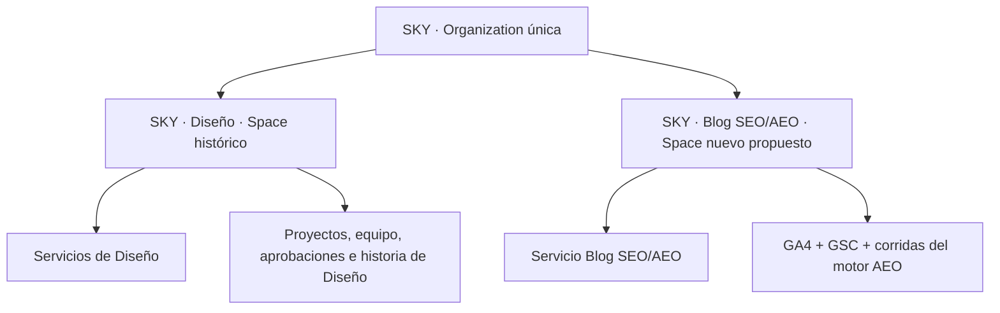

# SKY · Una organización y dos cuentas operativas

Fecha: 2026-10-27. Estado: recomendación de discovery, **no decisión Accepted ni configuración aplicada**.
Nuevo contexto del operador: SKY trabajó durante más de un año con Diseño; se suma el servicio SEO y cambian
stakeholders/departamentos. Efeonce necesita conservar un cliente consolidado y operar dos cuentas independientes.

Ampliación con subagentes: [discovery integral de cuentas operativas](../../client-portal/2026-10-27-sky-multi-account-discovery/README.md).
Allí se comparan bridges, contratos/owners, impactos de sync/Notion/Finance y gates antes del segundo Space.
Esta nota conserva el diagnóstico inicial y no sustituye esa evaluación de transición.

## 1. Recomendación

**Mantener una sola Organization SKY y usar dos Spaces como cuentas operativas: Diseño y Blog SEO/AEO.** Los
Servicios contratados se vinculan al Space pertinente. Account 360 sigue siendo la lectura consolidada de SKY;
no se crea otra entidad Account/engagement ni otra empresa ficticia para representar un departamento.

El modelo canónico ya distingue Organization como identidad/contexto comercial y Space como hijo operativo con
configuración, delivery y fuentes. Fuente: `GREENHOUSE_360_OBJECT_MODEL_V1.md:83–93`.

En lenguaje de operación se pueden llamar **cuentas**; internamente el objeto canónico ya disponible es Space.
El naming de interfaz es una propuesta, no un cambio ejecutado. Un Space puede contener varios servicios de una
misma relación operativa. No crear un Space por cada SKU, entrega, campaña o factura automáticamente.

### Distinciones que importan

| Capa | Qué representa | En SKY |
| --- | --- | --- |
| Organization | Identidad de la relación con la empresa, contexto comercial y consolidado autorizado | SKY, una vez |
| Space / cuenta operativa | Equipo interlocutor, operación, datos, acceso y experiencia del cliente | Diseño y Blog SEO/AEO |
| Service | Compromiso contratado con alcance, condiciones y vigencia | Servicio de Diseño; servicio Blog SEO/AEO, cada uno en su cuenta |
| Proyecto/campaña | Unidad de trabajo dentro de la operación | Entregables de Diseño o producción editorial SEO, con vínculo explícito |
| Persona | Identidad longitudinal y roles/membresías | Una persona puede acceder a una cuenta o ambas con permisos explícitos |

La cuenta operativa no equivale necesariamente al organigrama formal del cliente. Es una relación que requiere
responsables, presupuesto/alcance, backlog, aprobaciones y rendición de resultados propios. Puede coincidir con
un departamento y agrupar más de un servicio. Que dos interlocutores trabajen en SKY no les concede acceso mutuo.

## 2. Por qué no duplicar SKY como dos organizaciones

Duplicar la organización sólo para dividir stakeholders fragmentaría la identidad comercial, las integraciones,
la historia y el consolidado; obligaría a resolver de nuevo cómo reconocer que ambas son el mismo cliente.
También podría duplicar asociaciones CRM, habilitaciones, contexto financiero y conteos de clientes.

La separación de stakeholders es una necesidad de **scope operativo y autorización**, no evidencia de que haya
dos empresas. Otra organización puede ser apropiada ante una contraparte/cuenta realmente distinta, como una
entidad contratante diferente con identidad y límites propios. Ese supuesto se verifica, no se infiere de un
departamento o de un presupuesto separado. Este discovery no cambia identidades legales ni facturación.

Separar sólo dos informes por Servicio sería insuficiente para el objetivo ampliado: seguirían mezclados el
backlog, las aprobaciones o las lecturas de portal si mantienen el contexto de toda la organización.

## 3. Estado actual verificado

SELECT read-only del coordinador sobre configuración y conteos; no se consultaron personas ni sesiones de usuarios.
Recibo: `.captures/insights-sky-scope-2026-10-27/operating-accounts-readback.json`.

| Objeto | Corte del 27-10 |
| --- | --- |
| Organización | `org-b9977f96-f7ef-4afb-bb26-7355d78c981f` |
| Space actual | `EO-SPC-0011`, `spc-ae463d9f-b404-438b-bd5c-bd117d45c3b9`, «Sky Airline», activo |
| Puente client actual | `hubspot-company-30825221458` |
| Servicio Diseño | `SVC-HS-551519372424`, activo, en el Space actual |
| Servicio Blog | `SVC-HS-591725750952`, activo, en el mismo Space |
| Proyectos | 123 registros, todos bajo ese Space/client; todos con `module_id=NULL` |
| Vínculo editorial | `services.notion_project_id=NULL` en los servicios leídos |
| Otros registros | Paid Social Care activo y dos seeds archivados: no se clasifican ni borran por esta recomendación |
| Definición viva `session_360` | Une spaces activos mediante `spc.client_id=u.client_id` y agrupa por `spc.space_id` |

El conteo de proyectos no certifica que todos estén activos ni que todos sean Diseño. El antecedente de un año de
Diseño procede del operador; la asignación histórica se preserva y cualquier reclasificación requiere evidencia.

## 4. Qué se separa y qué se conserva consolidado

| Capacidad | Por cuenta operativa | Consolidado SKY |
| --- | --- | --- |
| Responsable Efeonce y stakeholders | Equipo y roles específicos; contactos compartidos sólo cuando corresponda | Relación general con la empresa |
| Operación | Backlog, proyectos, prioridades, aprobaciones y calendario | Visión de portafolio para personas autorizadas |
| Indicadores | Diseño conserva ICO; Blog usa GA4/GSC/motor AEO y su propia entrega cuando esté vinculada | Composición de resultados, sin mezclar unidades ni promediar porcentajes a ciegas |
| Informes | Informe, evidencia, destinatarios y recurrencia propios | Lectura global sólo con permiso explícito |
| Contratos y economía | Alcance, vigencia, presupuesto/fee y atribución del servicio | Contexto comercial/financiero de la misma relación y contraparte real |
| Identidad | Membresías/roles por Space/Servicio; una misma persona puede tener varias | Un principal y perfil longitudinal; sin duplicar usuarios por departamento |
| Integraciones | Binding autorizado de fuente/target/panel por cuenta | Puede reutilizar conexión organizacional si su autorización permite la lectura; sin duplicar tokens por conveniencia |

La habilitación organizacional de un producto sigue siendo un techo; el scope operativo y el permiso personal
intersectan ese techo. Un selector visual no concede acceso a otra cuenta. Tampoco un dominio de correo, un
cargo de director o una asociación CRM autorizan automáticamente el consolidado.

## 5. Historia: preservar Diseño e inaugurar SEO correctamente

1. **Conservar los IDs y el Space histórico.** Preparar su interpretación/nombre como Diseño con trazabilidad,
   sin recrear el cliente, migrar todos sus proyectos o recalcular un año de indicadores para abrir SEO.
2. **Crear el contexto operativo SEO cuando esté listo el aislamiento.** Tiene su fecha de inicio contractual y
   operacional y sus propios proyectos, responsables, fuentes y requisitos de reporte.
3. **No copiar la historia de Diseño a SEO.** Si ya hay trabajo editorial en el espacio compartido, identificarlo
   por evidencia, resolver vínculo por proyecto/servicio y aplicar una política fechada. No usar sólo nombres.
4. **No reescribir snapshots o informes emitidos.** Las correcciones nuevas se versionan; las proyecciones
   históricas conservan alcance y fuente de su período.
5. **Separar baseline analítico de historia de prestación.** GSC/GA4/AEO anteriores al servicio pueden ser una
   línea base del blog; no son un año de trabajo SEO realizado por Efeonce ni desempeño atribuible al contrato nuevo.
6. **No convertir ausencia en cero.** Si SEO no tiene métricas de entrega de meses previos, se declara que el
   servicio/población todavía no existía o no tiene cobertura, según el hecho pertinente.

`readSpaceMetrics(spaceId, año, mes)` ya lee snapshots por Space (`src/lib/ico-engine/read-metrics.ts:313–328`).
La historia de Diseño no requiere mover su identidad. El adapter ICO de Insights, en cambio, agrega hoy los
Spaces de la organización; ese consumer debe dejar de usar el agregado como si fuera una sola cuenta operativa.

## 6. Por qué crear el segundo Space por sí solo todavía no basta

### 6.1 El sync presupone un Space por Company

`src/lib/services/service-sync.ts:111–125` resuelve Company→Organization→Space con `LIMIT 1`, sin selector del servicio.
`upsert-service-from-hubspot.ts:144–147` reescribe `space_id` y `organization_id` en cada upsert.

Hace falta un mapping determinista por servicio y una regla de ownership que sobreviva al webhook, safety-net y
backfill. Un movimiento manual de Blog podría ser revertido por el siguiente sync. No duplicar la Company ni
escoger Space por similitud de nombre para sortearlo. Si no hay binding o hay ambigüedad, queda pendiente visible.

### 6.2 El puente legacy de sesión requiere diseño

La definición viva de `session_360` y el lector `src/lib/tenant/identity-store.ts:285–291` conservan el puente por
client. Dos Spaces activos con el mismo client pueden producir varias filas de contexto; el lector toma una con
`LIMIT 1`, sin un selector de Space. No se debe provisionar esa combinación y afirmar aislamiento.

Antes de hacerlo se decide si cada cuenta necesita su propio puente operativo legacy o si se refactoriza la
resolución hacia memberships/Space activo explícitos. La identidad comercial/financiera de SKY se conserva en
ambos casos. Un eventual registro técnico de tenant no se convierte en otra empresa ni duplica facturas o saldos.

No se prescribe crear hoy un nuevo `client_id` ni compartir el existente sin cambios: hay que verificar todas las
constraints y consumers de esa transición en la unidad de Identity/Space correspondiente.

### 6.3 Acceso organizacional no es acceso departamental

El portal resuelve módulos por organización. Los vetos por persona pueden quitar una vista completa, pero no
expresan por sí solos «esta biblioteca de informes sólo del Space SEO».

Insights también valida organización, capability y audience (`src/lib/efeonce-insights/authz.ts:120–147`); sus
lecturas actuales no prueban aislamiento departamental por crear otro Space. Hay que transportar y comprobar
scope operativo server-side en listas, detalle, evidencias, outputs, exportaciones, notificaciones y distribución.

Las memberships de personas y asignaciones de equipo deben comprobar el Space concreto. La pertenencia genérica
a SKY no habilita ambos. Una persona con acceso a ambos puede tener un selector de cuentas; su lista autorizada
sale del servidor. También deben funcionar correctamente URL directa, API y MCP, no sólo el menú.

Los links bearer de Insights otorgan acceso a una edición a quien tenga el enlace; no acreditan identidad ni
departamento. Debe decidirse qué informes admiten ese modelo y quién puede emitir/compartirlos; no prometer
aislamiento por identidad con una modalidad bearer que deliberadamente no lo comprueba.

### 6.4 Fuentes compartidas y scopes específicos

GA4/GSC/AEO y la configuración actual de contenido están anclados a la organización. Se pueden conservar
conexiones y evidencia común, pero la cuenta Blog debe fijar sus fuentes, alcance y corrida/proyección aplicables.
El mismo token de una fuente no autoriza a todos los stakeholders de SKY a verla.

**Consecuencia para el discovery anterior:** el requisito GA4+GSC+motor AEO y el alcance blog-only pertenecen al
informe de la cuenta SEO y su servicio. No deben imponerse como defaults globales a los informes de Diseño.
El catálogo/registro de definiciones puede seguir teniendo owner organizacional; su asignación y obligación
se resuelven por Space/Servicio y se sellan por edición.

## 7. Cambios de prioridad del plan anterior

Hay dos capacidades relacionadas, pero distintas:

- **Medición e informe del blog:** filtrar GA4/GSC, proyectar citas AEO, fijar evidencia y exigir las tres fuentes.
- **Cuenta operativa independiente:** separar ownership, sync, membresías, permisos, contexto de sesión, datos,
  indicadores y experiencia de stakeholders bajo una Organization compartida.

El filtro de URL puede desarrollarse sin esperar toda la transformación de cuentas. Pero un informe interno
correcto no demuestra que los clientes puedan entrar a dos cuentas aisladas. Para abrir esa experiencia sí es
necesario completar la frontera operativa; TASK-1960 por sí sola sólo cubre parte del reporting.

Se propone formalizar una decisión de arquitectura y una unidad de identidad/Space + sync como fundamento, con
unidades dependientes para scope de lectores, acceso e Insights por servicio. No iniciar cambios de schema,
acceso o migración basándose sólo en esta recomendación.

## 8. Aceptación de la separación

- SKY conserva una organización canónica y el consolidado sigue siendo una lectura con alcance explícito.
- Diseño conserva sus IDs, su historia, sus snapshots y el acceso ya autorizado.
- SEO tiene Space/Servicio inequívocos y sus informes GA4/GSC/motor AEO; no hereda resultados de Diseño.
- Reejecutar la sincronización no mueve Blog de nuevo a Diseño ni selecciona un Space arbitrario.
- La sesión resuelve exactamente un contexto activo autorizado; varias cuentas autorizadas no implican varias
  identidades ni un `LIMIT 1` indeterminado.
- Persona SEO no puede leer Diseño, y viceversa, mediante menú, URL directa, API, exportaciones y biblioteca.
- Una persona con acceso a ambas puede cambiar de cuenta sin ampliar permisos ni mezclar cachés.
- El consolidado global sólo aparece a actores autorizados; los conteos de clientes y el contexto financiero
  no se duplican por crear una cuenta operativa.
- Datos o proyectos no clasificados quedan pendientes visibles; no entran al Space elegido por defecto.

## 9. Evidencia y límites

Se consultaron definición viva de sesión, Spaces, Servicios y conteos de proyectos. No se probaron sesiones
reales de stakeholders, accesos cross-Space ni la experiencia UI. La ambigüedad descrita es un riesgo de añadir
el segundo Space con el puente actual, no una afirmación de fuga actual en la cuenta de un solo Space.

Las reglas aceptadas de organización/Space y experiencia por Servicio gobiernan la dirección. La implementación
de acceso fino, binding de sync y transición concreta se propone aquí; no se da por desplegada.
No se cambió ninguna organización, Space, servicio, proyecto, contrato, módulo, rol, usuario, indicador ni factura.

Fuentes principales: [modelo 360](../../../architecture/GREENHOUSE_360_OBJECT_MODEL_V1.md),
[Account 360](../../../architecture/ACCOUNT_360_IMPLEMENTATION_V1.md),
[experiencia por Servicio](../../../architecture/GREENHOUSE_CLIENT_SERVICE_EXPERIENCE_DECISION_V1.md),
[intake de servicios](../../../architecture/GREENHOUSE_HUBSPOT_SERVICES_INTAKE_V1.md) y
[TASK-1960](../../../tasks/to-do/TASK-1960-efeonce-insights-report-per-contracted-service.md).
