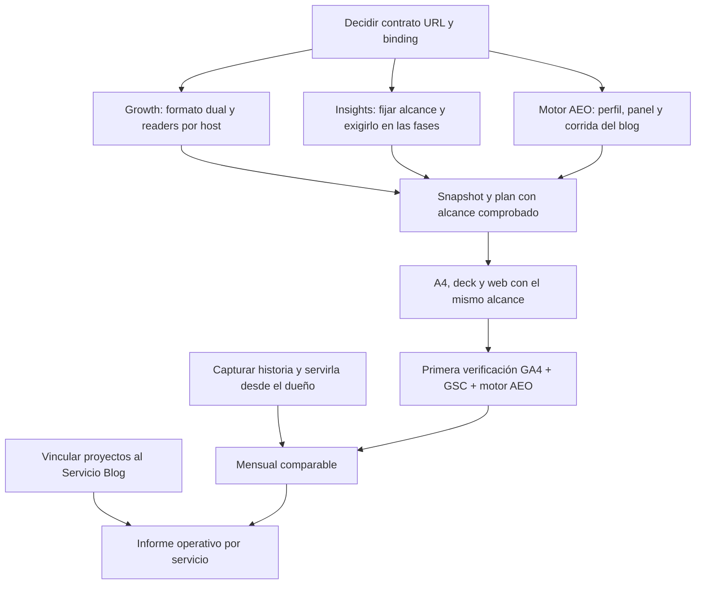

# Discovery · Efeonce Insights de SKY limitado al blog

Fecha: **2026-10-27**. Pedido: investigar con subagentes cómo asegurar que los análisis del servicio Blog/SEO de
SKY midan sólo las URL del blog. Estado: **discovery técnico terminado; recomendaciones propuestas, sin implementación**.
Esta carpeta amplía la [auditoría inicial](../2026-10-27-sky-blog-content-scope.md), conserva su evidencia y resuelve
unknowns adicionales. No es un ADR Accepted, una nueva task ni una autorización de rollout.

**Alcance confirmado por Julio, 27-10:** el primer informe debe incluir **GA4 + GSC + corridas AEO del motor propio**.
Se retira la propuesta anterior de una primera entrega sólo GSC/SEO. Las tres fuentes son requisitos de aceptación;
el tráfico desde asistentes observado en GA4 no sustituye las corridas AEO.

**Contexto adicional del operador:** Diseño y SEO deben operar como dos cuentas con stakeholders distintos dentro
de la misma SKY. La [recomendación de Organization/Spaces](06-operating-accounts-under-one-organization.md)
conserva una organización y propone dos cuentas operativas. Amplía el requisito del informe a una frontera de
operación/acceso; crear otro Space por sí solo todavía no asegura esa separación.

**Discovery integral posterior:** el [dossier multi-cuenta de SKY](../../client-portal/2026-10-27-sky-multi-account-discovery/README.md)
desarrolla identidad, bridge técnico, sync/provisioning, historia/ICO/Finance, contextos de medición y plan de
transición. Es la referencia para la solución completa; esta carpeta conserva el detalle de medición por URL.

## Lectura recomendada

| Documento | Pregunta que responde | Contenido |
| --- | --- | --- |
| Este índice | ¿Qué encontramos y qué conviene construir? | Dictamen, evidencia, prioridades y decisiones |
| [01 · Contrato URL](01-url-scope-contract.md) | ¿Cómo representar y aplicar host+rutas sin romper Berel ni medir todo por error? | Alternativas, formato dual, persistencia, SQL, canonicalización, compatibilidad y casos adversariales |
| [02 · Analítica e histórico](02-analytics-and-history.md) | ¿Qué mide cada fuente y cómo obtener períodos comparables? | GA4, controles de total, metadata, GSC PG/BQ, completitud, ranking, cola y estimaciones |
| [03 · Informe y verificación](03-service-report-and-verification.md) | ¿Dónde se exige y congela el alcance y cómo llega al cliente? | Binding de edición, retries, `allowPartial`, servicios, schedules, gates, PDF/deck/web |
| [04 · Decisiones y entrega](04-decisions-and-delivery-plan.md) | ¿Cuál es el orden implementable y cómo se verifica? | Registro de concerns, decisiones candidatas, unidades, transición, rollback y escenarios de calidad |
| [05 · Motor AEO obligatorio](05-aeo-engine-required.md) | ¿Cómo incorporar corridas propias referidas al blog? | Perfil/panel/run, citas por URL, métricas y denominadores, estado real de SKY y gates por fuente |
| [06 · Cuentas operativas de SKY](06-operating-accounts-under-one-organization.md) | ¿Cómo separar Diseño y SEO dentro del mismo cliente? | Organization/Spaces/Servicios, historia, stakeholders, acceso, sync y transición |

## 1. Dictamen

**Reutilizar la base de Berel, ampliándola a URL con host exacto y manteniendo el filtro bajo el dueño de cada
fuente.** La configuración actual sólo distingue rutas; SKY necesita `blog.skyairline.com` con artículos en la
raíz. No resuelve el problema configurar `/blog`, enumerar artículos o poner «Blog» en la portada.

La capacidad mínima comprende contrato seguro de host, readers GA4/GSC que lo apliquen, corrida AEO y panel
pertinentes al blog, referencia estable de esas identidades por edición y salidas que las expliquen. Los lectores existentes de GA4
no proporcionan el recorte de host y el dato debe pasar por ese reader, no por consultas paralelas en Insights.

El alcance propuesto incluye **todas las páginas del host actual**, raíz y categorías incluidas. No significa
«sólo artículos escritos por Efeonce» ni incluye automáticamente la antigua ruta `www.skyairline.com/blog/`.
Las dos extensiones requerirían decisiones e inventarios propios.

## 2. Qué verificamos

| Área | Resultado observado | Alcance de la evidencia |
| --- | --- | --- |
| Berel | Alcance v1 append-only vigente, con carpetas y guías exactas | Configuración leída del store canónico; ediciones viejas no se alteraron |
| SKY | Sin configuración de alcance | `readSeoContentScope` devuelve `null` |
| GSC conectado | `https://blog.skyairline.com/`, activo | La propiedad ya corresponde al blog |
| GSC operativo | 149.831 filas y 1.511 páginas; fechas 11–25 octubre, todas las URL observadas del blog | No acredita septiembre, el mes entero ni exhaustividad de Google |
| GSC histórico BQ | **Cero fechas de SKY** en `[2025-06-27, 2026-10-27)` | Tabla/rango/org consultados; no afirma que Google carezca del pasado |
| GA4 | Propiedad persistida activa `354430952`, general de SKY | No se ejecutó una nueva Data API; existe prueba del host fechada 15-10 |
| Target SEO | `root_domain=skyairline.com` | El nombre `seot-sky-blog-cl` no restringe las URL |
| Ranking PG | Sin filas para targets SKY | No se certifica disponibilidad de serie histórica de ranking |
| Reporting | Seis ediciones, todas sólo ICO; ninguna recurrencia de SKY | No apareció una edición SEO que este discovery deba corregir |
| Motor AEO de SKY | Perfil del dominio principal y runs baseline, sin PromptSet propio de SKY | Hay corridas del motor, pero todavía no prueban un panel editorial del blog; detalle en anexo 05 |
| Evidencia blog en el motor | Corrida CL de octubre con 12 filas de cita directa a URL del blog | Permite adaptar la proyección existente; no son 12 URL únicas ni una tasa ya calculada |
| Base de pruebas | **76 pruebas pasadas en cuatro archivos** | Regresión del código existente; no certifica una implementación por host |

Comprobación BQ nueva: metadata + dry-run + SELECT mediante el cliente canónico, con un techo explícito de **50 MiB**.
El dry-run informó 0 bytes y la lectura no encontró fechas. No se materializó ni compró dato alguno.

Evidencia local ignorada por Git y sin credenciales:

- `.captures/insights-sky-scope-2026-10-27/readback.json`: conexiones, alcance, PG, targets, cola, ediciones y schedules.
- `.captures/insights-sky-scope-2026-10-27/bq-discovery.json`: metadata y consulta histórica acotada.
- `.captures/insights-sky-scope-2026-10-27/discovery-probes.json`: comprobaciones puras independientes del coordinador.

Las rutas/filas de código de los anexos corresponden al checkout inspeccionado; no son garantías perpetuas del
runtime desplegado. El alias Vercel READY no basta para acreditar cada guard ni el SHA del worker.

## 3. Hallazgos nuevos que cambian el diseño

### El código viejo puede perder el filtro sin fallar

El matcher actual acepta el mismo slug del blog y de `www`. Además, el parser acepta una regla con `host`, pero
**descarta ese campo**. Añadirlo al JSON no hace que exista un filtro. Una columna nueva de hosts con `rules=[]`
también puede ser ignorada por el runtime viejo, que interpreta esas reglas vacías como sitio completo.

Se propone un envelope nuevo que el parser de TASK-2033 rechace, conservando arrays legacy para Berel. Esto evita
esa ampliación silenciosa durante coexistencia, pero **no protege binarios anteriores a TASK-2033**: se necesita
comprobar el piso de versión de los generadores y mantener el guard en todo el ciclo de la edición.

### El alcance actual se decide al recolectar, no al aceptar la edición

Un cambio de configuración entre creación y reintento podría modificar la población. Hace falta fijar una
referencia exacta y un digest por edición. El retry de la misma key/payload debe seguir devolviendo la misma edición
y alcance, aunque haya cambiado la configuración vigente. El hash de la intención del caller no debe depender de
una lectura mutable de `latest` ejecutada antes de comprobar la idempotencia.

### Fallar el adapter y bloquear un informe incorrecto son garantías distintas

`collectInsightEvidence` convierte cualquier excepción de un adapter en `no_data`; después, `allowPartial=true`
puede permitir omisiones de módulos. Evita usar datos amplios en ese fallo, pero no prueba que un informe Blog
requerido vaya a conservar su identidad. La falta o inconsistencia del scope obligatorio necesita un guard que
no se pueda omitir como una fuente temporalmente caída.

La obligación de medir el blog también necesita una expectativa persistente independiente de la versión activa:
si se deduce sólo de que existe scope, su ausencia o un `clear` podrían reactivar el fallback amplio. Se propone
resolver su dueño/storage antes de código; no se afirma que esa política exista hoy.

### El propio hostname puede bloquear la emisión al cliente

El gate de presentación interpreta texto con puntos como posible identificador interno. El probe reprodujo el
rechazo de `Sólo blog.skyairline.com` por `internal_identifier`. La corrección debe reconocer únicamente hosts
públicos validados y sellados, preservando el rechazo de nombres internos y de dominios parecidos. No se debe
desactivar el gate ni permitir texto arbitrario con puntos.

### GA4 necesita distinguir actividad y entrada, y controlar los totales

Un host de evento y una ruta de landing no acreditan por sí solos el host donde comenzó la sesión. El contrato
debe nombrar la población que puede comprobar. El adapter actual suma desgloses y declara cobertura completa;
el diseño propone controles agregados y metadata de calidad. Hay consultas y alternativas detalladas en el
anexo 02. GA4 es fuente obligatoria: la semántica final se debe acreditar antes de aceptar el informe. Una nueva
exportación GA4 a BQ no se considera resuelta ni autorizada por inferencia.

### AEO exige una corrida del motor, con panel y citas apropiados

El adapter actual puede recibir hechos GA4 de tráfico IA aunque no haya podido leer un reporte del Grader.
Por ello, solicitar módulos `seo` y `aeo` no garantiza las tres fuentes. Hace falta un gate explícito por fuente:
GSC válido, GA4 válido y corrida AEO válida, todos vinculados al alcance y período declarados.
La selección debe fijar la identidad de corrida/perfil/panel. Las citas del blog se proyectan por URL en el dueño
del motor, preservando denominadores y sin rebautizar un score general de SKY como score del blog.
La corrida existente de octubre contiene evidencia reutilizable: no hace falta exigir otra corrida ni un panel
dedicado para empezar esa proyección. El instrumento general debe quedar declarado, y el gate de esa proyección
debe validarse. La presencia de esas citas no convierte el informe en una medición editorial ya implementada.

### La historia no se arregla conectando una tabla

Los readers de Insights sólo leen PG; el histórico canónico vive en BQ, pero **SKY no tiene filas en el rango
verificado**. Un informe mensual comparable necesita capturar el pasado permitido y consumirlo con criterios de
fuente/cobertura. Además, la existencia de filas de un día no demuestra que todas sus páginas se hayan capturado.
No se debe rellenar PG con meses de historia para eludir la separación operativa/analítica.

## 4. Recomendación de entrega y orden

| Entrega | Qué contendría | Condición para aceptarla |
| --- | --- | --- |
| Primero: Blog SEO/AEO con las tres fuentes | GA4 del blog + GSC del blog + corrida del motor AEO pertinente al blog; período declarado | Tres fuentes presentes y verificadas, identidades selladas, formatos revisados y sin mezclar ICO de Diseño |
| En paralelo, antes de abrir las dos cuentas | Contexto operativo y acceso separados bajo una Organization | Binding de sync, sesión inequívoca y permisos/readers por Space/Servicio; anexo 06 |
| Después: mensual comparable | Mismas fuentes y población en ventanas completas; baseline estacional apropiado | Historia disponible, readers conectados, controles de completitud y comparabilidad |
| Finalmente: operación por servicio | Producción editorial, ICO y destinatarios/cadencia del servicio Blog | Vínculo Servicio↔proyectos y TASK-1960, separado de Diseño |

No se requiere desarrollar todo TASK-1960 para una preview interna de medición GA4/GSC/AEO. Para abrir cuentas
independientes al cliente sí se exige la frontera del anexo 06. OTD/RpA de producción editorial necesita además
proyectos vinculados al Servicio. `request.scope` son chips de portada y no proporciona ese aislamiento.

Secuencia propuesta:



Los caminos de historia y servicio se mantienen explícitos; ninguna flecha representa algo implementado.
Los archivos afectados, seams y criterios por unidad están en el anexo 04. No se reservaron IDs de tasks.

## 5. Decisiones concretas antes de implementar

1. **Formato y coexistencia:** aceptar el protocolo host-only/host+rutas y su barrera ante lectores legacy.
2. **Momento de congelación:** fijar la referencia por edición, la semántica de revise/recover y el comportamiento
   de las ocurrencias programadas ante un cambio de alcance.
3. **Policy:** tratar alcance requerido inválido como error de identidad de la medición, no como omisión de datos.
   Conservar la expectativa requerida aunque el alcance vigente sea `null` o vacío; elegir su persistencia en el dueño.
4. **Métrica GA4:** acreditar la población del blog y controles de total/calidad; GA4 no se puede omitir del informe
   aceptado. No renombrar actividad como entrada ni usar una sustitución silenciosa de la métrica acordada.
5. **Nivel de primera entrega:** período acotado o mensual completo; el segundo requiere historia adicional.
6. **Corridas AEO:** vincular panel/perfil/run con el blog, proyectar citas por URL en el motor y exigir su recibo
   independiente de los referrals de GA4. Si falta una fuente requerida, la edición no cumple el encargo.

Son decisiones propuestas para formalizar en el canon y en unidades del backlog. No hay aprobación de schema,
configuración compartida, nueva API, backfill, emisión ni deploy por el hecho de que estén descritas aquí.

## 6. Verificación del discovery y límites

Se distribuyó la investigación en tres subagentes: contrato URL; analítica/histórico; lifecycle/servicio/salidas.
El coordinador reprodujo los probes de parser/matcher, request y gate cliente, revisó el código crítico y contrastó
las propuestas entre frentes. Se realizó una segunda revisión adversarial del plan y sus garantías.

Pruebas focales del código actual:

```text
src/lib/growth/seo/content-scope/contracts.test.ts
src/lib/growth/analytics-ga4/__tests__/landing-match-filter.test.ts
src/lib/efeonce-insights/adapters/adapters.test.ts
src/lib/efeonce-insights/editorial/content-scope-plan.test.ts
Resultado: 4 archivos, 76 pruebas pasadas.
```

El discovery **no modificó código, datos compartidos, conexiones, flags ni runtime**. Tampoco generó ediciones,
envíos, compras, backfills, tasks canónicas ni ADRs Accepted. Se preservó el WIP comercial ajeno del checkout.

La siguiente ejecución debe tomar el nivel elegido, conciliar TASK-2033/TASK-1655/TASK-1960 y formalizar la unidad
de trabajo correspondiente. El discovery deja listo el mapa de implementación y los experimentos pendientes;
la adquisición GA4 exacta y el rollout aún requieren su evidencia propia.
La QA web previa a emisión se refiere al modelo y renderer local; un enlace Think público exige otra fase con
edición cliente emitida o canary sintético autorizado. No se acredita share vivo mediante una edición interna.
