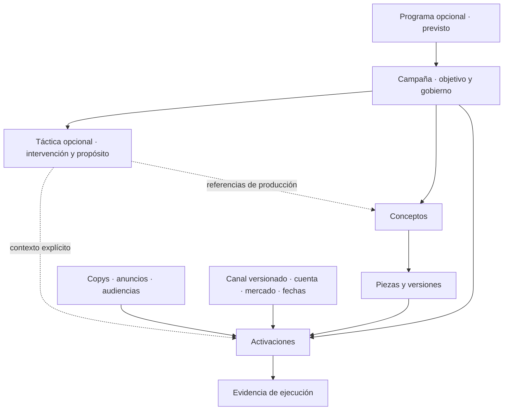

# Studio: discovery de tácticas, modalidades y canales

Fecha: 2026-10-07. Estado: **discovery completado; nombre y definición de táctica acordados; diseño detallado e implementación pendientes**.
Pedido: «y como juegan con los canales, modalidades y demás existentes, lanza discovery».
Alcance: lectura de arquitectura, backlog, código local y API productiva por CLI. Sin cambios de datos,
catálogo, permisos, código de Studio ni despliegues. Los archivos de esta entrega son documentación local.

## 1. Conclusión

**Ajuste acordado con el operador:** «táctica» sustituye a «iniciativa» en esta propuesta. Es una intervención
concreta que contribuye al objetivo de una campaña, mediante una o varias ejecuciones. No se añaden ambos niveles.
La ruta del dossier y el JSON conservan su nombre histórico para preservar enlaces y evidencia del discovery.

La táctica es opcional y explica **qué hacemos para contribuir al objetivo y por qué**; las activaciones conservan
**dónde, cómo, con qué material y cuándo**. Una ocasión o noticia puede motivarla, pero no toda táctica necesita una.
Seasonality y trendjacking pertenecen al ámbito Marketing y son enfoques transversales: no son canales,
modalidades, formatos, servicios ni tipos nuevos de campaña. Always On sigue describiendo continuidad.

El discovery corrige un punto de la propuesta anterior: no basta con poner una táctica encima del
concepto y deducir todo desde allí. La activación debe tener una asociación explícita y opcional con la
táctica. Una activación admite varias piezas; una pieza puede reutilizarse. Deducir el contexto desde
la primera pieza, el nombre del concepto o el canal produciría ambigüedad y cambiaría la lectura histórica.

Recomendación: extensión aditiva de alcance **medio** para agrupar, operar y consultar tácticas;
no exige rehacer canales. La operación editorial SEO completa y el traslado de campañas existentes son
alcances adicionales y separados. No se consideran resueltos por esta entidad.

## 2. Baseline y fuerza de la evidencia

[Checks sanitizados](2026-10-07-initiatives-channels-discovery-checks.json), consolidados a las 11:54 UTC.
Código inspeccionado: Studio `3829a8bc95c0dca7077d7afaae8dd05bdd933143`; ese HEAD local no acredita por sí solo
la revisión desplegada. No se modificó `apps/web/next-env.d.ts`, que ya tenía cambios.

| Fuente | Observación verificada | Límite |
| --- | --- | --- |
| API viva / CLI | API 1.9.0; 80 operaciones, 75 tools; ninguna operación de tácticas | Servido por Studio no equivale a federado por MCP |
| Catálogo vivo v1 | 52 canales: 23 paid, 15 organic, 7 owned, 7 earned; 12 familias | 42 declaran proveedor de readback `none`; no prueba disponibilidad de conectores |
| Especificaciones del catálogo | Sólo 1 canal tiene placements, formatos y límites de copy poblados: LinkedIn Ads | Los otros 51 no tienen ese detalle; no prometer validación exhaustiva por canal |
| Cuentas visibles, sin siguiente página | 3 cuentas Metricool: Instagram Efeonce, LinkedIn Efeonce y LinkedIn Julio Reyes | No hay cuentas web/email/pauta en este readback |
| Calendario 07/10–31/12, sin siguiente página | 29 activaciones scheduled: 12 Instagram y 17 LinkedIn; 27 planes planned y 2 draft; 27 CL y 2 MX | Describe esta ventana y acceso, no todo el historial ni todos los tenants |
| Campañas visibles | 6, todas `kind=campaign` | Always On existe en contrato, pero no hay un ejemplo vivo en estas seis |
| Código de owned readback | Readers para email HubSpot/Resend y web WordPress/URL pública; Salesforce devuelve no configurado | No se ejercitaron ni se refrescaron flags cloud; no afirmar operación productiva multicanal |
| Backlog | Plan/programas, trabajo asignado y circuito editorial SEO tienen dueños identificados | Diseño pendiente no equivale a funcionalidad disponible |

Las 26 activaciones incorporadas anteriormente tienen copy asociado; las otras 3 corresponden a SKY.
No hubo corrección ni reinterpretación de copys en este discovery.

## 3. Encaje con cada dimensión

| Dimensión | Qué responde / dueño actual | Encaje recomendado |
| --- | --- | --- |
| Pilar Marketing | Ámbito de negocio señalado por el operador | La táctica vive en este ámbito. No convertir «Marketing» en familia de canal ni confundirlo con un pilar de mensajes |
| Programa | Tesis que agrupa campañas; previsto en TASK-1907 | Está por encima de campañas; no sustituye la táctica dentro de una campaña |
| Campaña | Objetivo, audiencia, gobierno, brief, presupuesto y pertenencia de piezas/activaciones | Permanece raíz obligatoria. Separar campaña por autonomía estratégica, no por número de posts |
| Continuidad | `campaign.kind = campaign / always_on` | Compatible con tácticas estacionales y coyunturales. No añade una quinta modalidad |
| Táctica, definición acordada | Intervención concreta que contribuye al objetivo; propósito, contexto y coordinación | Opcional, una campaña y su organización; puede agrupar una ejecución o varias |
| Enfoque, propuesto | Seasonality/trendjacking cuando sean pertinentes | Clasificación de táctica, independiente del canal; puede haber una coyuntura dentro de una temporada |
| Concepto | Idea creativa/editorial; hoy ID, título y orden | Se referencia sin convertirlo en brief operativo ni cambiar identidad de piezas |
| Plan de contenidos | Entregable planificado por canal, formato, audiencia, mensaje y ventana; TASK-1907 | Varios items pueden contribuir a una táctica. No crear otro plan de contenidos paralelo |
| Work item | Encargo, asignación, producción, revisión y handoff; TASK-1913 | Referencia la táctica como contexto; conserva su workflow y responsables de ejecución |
| Modalidad | paid / organic / owned / earned | La determina cada canal de activación; la táctica puede combinar varias |
| Familia | social, search, web_content, email, etc. | Continúa siendo familia de distribución/atención. SEO no obliga a que toda ejecución sea `search` |
| Canal | `channelKey` + versión publicada de catálogo | Cada activación conserva uno. La táctica agrupa los canales utilizados, sin sustituir su validación |
| Plataforma | Compra y/o aparición, según canal | Meta Ads puede comprar apariciones en Instagram/Facebook; no usar «Navidad» como plataforma |
| Placement / formato | Ubicación y especificación técnica dentro del canal | Se eligen por activación. El contexto estacional no fija ratio ni formato ni levanta restricciones |
| Cuenta / voz | Página, perfil personal, cuenta publicitaria, sitio o remitente; organización y timezone | LinkedIn Efeonce y LinkedIn Julio son cuentas distintas del mismo canal. No heredar una cuenta única de táctica |
| Mercado / idioma | Activación actual: código de país; idioma no está en ese contrato | Declarar mercados/locales pertinentes en contexto futuro; conservar mercado explícito por activación. País, idioma y timezone son distintos |
| Audiencia / funnel / mensaje | Brief, audiencias y configuraciones actuales; matriz estratégica futura | Referencias al plan/campaña, con énfasis contextual. No crear otro ICP ni asumir que toda temporada es TOFU |
| Buying method / deal type | Compra platform/programmatic/direct; trato del anuncio | Sólo donde corresponde; no deducirlos del enfoque estacional |
| Piezas, versiones, copys, derechos | Material concreto y su autorización | Reusar referencias existentes; variantes literales por ejecución. Pertenecer a táctica no aprueba piezas ni publicación |
| Flight / presupuesto | Plan de medios y líneas de presupuesto de campaña | La táctica no adquiere otra billetera. Atribución de gasto por referencias a líneas/activaciones, sin doble suma |
| Origen del contenido | brand/ugc/creator/stock/ai_generated/mixed | Independiente de enfoque y distribución; UGC no es canal ni seasonality un origen de archivo |
| Provider | Metricool, CMS, plataforma de email/pauta | Ejecutor o fuente de evidencia; no define táctica ni autoridad de campaña |
| Medición / experimento | Fuentes y ventanas propias, experimentos previstos TASK-1911 | Agrupar referencias y resultados comparables; no fabricar causalidad ni sumar métricas heterogéneas |

## 4. Modelo recomendado y alternativas

El diagrama expresa relaciones, no una nueva jerarquía obligatoria para navegar. El usuario debería poder
crear una publicación y, si necesita agruparla, elegir o crear una táctica ligera dentro de la campaña,
sin completar otro asistente de campaña.

| Alternativa | Ventaja | Coste / decisión recomendada |
| --- | --- | --- |
| Etiquetas libres o convención de títulos | Casi ningún cambio | No asegura identidad, referencias, filtros o historial. Útil como nota, insuficiente como modelo durable |
| Ampliar concepto y tratarlo como táctica | Menos entidades | Mezcla ocasión con idea; una táctica puede necesitar varias ideas y una idea reutilizarse. Descartar |
| Campaña por temporada, aunque tenga un post | Usa todo lo actual | Válido si existe autonomía estratégica; demasiado gobierno si sólo cambia la ocasión. No imponer |
| Táctica opcional con asociación explícita en activación | Preserva campaña/canales, agrupa varias ejecuciones y conserva reutilización | Recomendación; requiere contratos, persistencia, comandos, readers y UI |

Ficha mínima propuesta: ID estable, campaña/organización, título, intervención y propósito breve vinculados al objetivo,
enfoques opcionales, contexto/fuentes (ocasión o coyuntura cuando corresponda), mercados/locales pertinentes, ventana de oportunidad opcional,
responsable de coordinación y criterio de evaluación. Revisionado/auditoría y archivo reversible; no otra
máquina de estados creativos/publicitarios. Los enfoques pueden combinarse sin obligar a clasificar todo.

Cardinalidades recomendadas para el primer alcance:

- Campaña 1 → N tácticas; una táctica no cruza organizaciones ni campañas.
- Activación 0 → 1 táctica principal: evita duplicar resultados entre tácticas. Otras etiquetas no dan atribución adicional.
- Conceptos pueden referenciarse desde varias tácticas de la misma campaña mediante relación de uso,
  sin mover la pieza ni cambiar su identidad. No deducir la táctica de una activación por esas referencias.
- Una referencia de concepto ayuda a descubrir material; la activación fija versión y copy exactos. La asociación
  con táctica no recopia contenido, cambia aprobación ni vuelve a sincronizar el proveedor.
- A futuro, `plan_content_item` y `work_item` referencian la táctica; no es requisito implementar todo ese
  backlog para incorporar la agrupación opcional de activaciones existentes.

## 5. Ejemplo de Navidad y sus canales

Ejemplo de diseño, no plan aprobado: campaña Always On de construcción de marca → táctica con título «Navidad 2026»
y propósito explícito de generar afinidad mediante una interpretación de la temporada desde la marca. Navidad es
el contexto; seasonality, el enfoque; la intervención propuesta define la táctica. El título breve no sustituye ese propósito.
La pertinencia depende del objetivo, mercado y fuentes; no se exige utilizar todos estos canales.

| Ejecución / resultado | Encaje en catálogo actual | Qué se conserva separado |
| --- | --- | --- |
| Publicación Instagram | `organic_social_instagram` | Su cuenta, versión, copy y fecha |
| Adaptación LinkedIn | `organic_social_linkedin` | Otra activación por cuenta; puede compartir pieza y diferir en copy |
| Artículo o actualización de página | `owned_web_content_website` | Publicación/actualización CMS y evidencia URL; no fingir que el artículo es una imagen |
| Objetivo de posicionamiento del artículo | `organic_search_google` / `organic_search_bing` como contexto de distribución | Keyword/URL/intención y seguimiento SV360. No crear una segunda «publicación programada» por el mismo artículo sólo por esperar indexación |
| Newsletter | `owned_email_hubspot` | Audiencia de envío, remitente, copy, envío observado; owned no significa que el conector ya esté habilitado |
| Amplificación pagada | `paid_social_meta_ads` o `paid_search_google_ads` | Cuenta, anuncio, tramo de fechas, presupuesto y aprobación de inversión propios |
| Mención espontánea / cita IA | `earned_pr_media_publisher` / canales earned search pertinentes | Ocurrencia observada con fuente; no puede prometerse ni marcarse programada por intención |

Trendjacking utiliza el mismo encaje: cambia la oportunidad, la vigencia y la pertinencia de la respuesta,
no la modalidad. Una noticia puede motivar una actualización SEO, un post y un email cuando cada uso aporte.
Las familias/modalidades del catálogo no bastan para resolver todas las semánticas de earned y search:
su ingestión y evidencia deben respetar los contratos de cada fuente, sin forzarlas como posts sociales.

## 6. Tiempo, medición y tracking

Tres tiempos independientes: oportunidad (temporada/noticia), producción/publicación de cada entregable y
evaluación posterior. La preparación SEO puede anteceder la temporada; la URL puede mantenerse útil después.
Cerrar/archivar una táctica no cancela activaciones, borra contenido ni declara terminada la entrega pagada.

El validador vigente exige span para paid y point para las demás modalidades. Se conserva en la extensión;
la ventana de táctica no reemplaza las fechas de cada activación ni transforma earned en publicación controlable.
Las colisiones siguen evaluándose por cuenta y fecha, incluso entre tácticas distintas.

El tracking actual usa campaña en `utm_campaign`/`utm_id` y activación en `utm_content`. Además,
`utm_marketing_tactic` ya significa always_on o prospecting/retargeting según el caso: es una clasificación de
tracking, **no la identidad de la táctica de campaña**. No sobreescribirlo con seasonality/trendjacking ni con
el ID/título de la nueva entidad. La agrupación inicial se obtiene por relación interna desde activationId, sin cambiar
URLs existentes. Si se requiere atribución de táctica en sistemas externos, exige decisión de tracking versionada.

Medición: distribución y desempeño por canal, con fuente, período y metodología. Deduplicar activaciones al agregar
por campaña; una pieza reutilizada no duplica por sí misma inversión o conversiones. Alcance entre plataformas no es
alcance único; visitas orgánicas no prueban efecto incremental de marca. SEO/AEO consume referencias + snapshots
fechados y seguimiento de SV360, según TASK-1908; no copia series ni recalcula sus métricas en Studio.

Reasignar una activación a otra táctica es un cambio explícito, revisionado y auditable. Los informes deben indicar
si usan la agrupación vigente o la guardada al cierre. Esta política debe quedar resuelta en ADR antes de implementar
reportes históricos; nunca reinterpretar silenciosamente informes cerrados.

## 7. Hallazgos que condicionan el alcance

1. **API de activaciones exige 1–30 versiones de assets; creación de asset sólo admite image/video.** El catálogo sí
   contempla text/html/document/audio. Hay una brecha entre taxonomía y contrato de material editorial. La táctica
   no la resuelve. Integrar contenido SEO puro requiere una referencia editorial/CMS coherente con TASK-1667/1908,
   sin fabricar una pieza de imagen para satisfacer el formulario ni relajar globalmente la validación.
2. **Mercado no equivale a localización completa.** La activación sólo recibe país; idioma y relación con mercados
   necesitan un contrato propio. La oportunidad puede ser pertinente en MX aunque la cuenta opere en timezone Santiago.
3. **El catálogo está mayormente sin detalle técnico.** No inventar placements/formatos/límites para una táctica.
   Completar el catálogo es otro carril versionado. Ni marcar un canal activo ni `readerAvailability=implemented`
   acredita integración, credenciales, binding y observación productiva.
4. **Plan estratégico y work items ya están diseñados.** La nueva entidad debe referenciarlos, no copiar su lifecycle.
   `plan_content_item_progress.post_id` en TASK-1907 exige reconciliación con las activaciones actuales al implementar
   esa task: evitar un tercer calendario o un enlace exclusivo a posts legacy.
5. **Mover CMP-006 no es un update simple.** Conceptos/piezas tienen identidad ligada a campaña; FKs unen copia,
   anuncio y asset a la campaña de activación; tracking congelado protege campaña/canal/destino. Primero operar
   tácticas sin mover registros. Un traslado futuro requiere comando específico, preview, transacción y readback.
6. **UI usa filtros existentes y conteos acotados a 200 filas.** Añadir táctica/enfoque debe conservar filtros
   combinados, deep links y paginación; no presentar conteos truncados como totales. Reusar el calendario y sus hojas.
7. **Marketing no es un pilar de mensaje.** `plan_message_pillar` y `program_pillar` tienen otros significados. No
   introducir «Marketing» en esos campos para aparentar que el ámbito de negocio ya está modelado.

## 8. Impacto y ruta de implementación propuesta

ADR dueño a precisar: [capa de estrategia](../../architecture/marketing-studio/EFEONCE_MARKETING_STUDIO_STRATEGY_LAYER_DECISION_V1.md),
especialmente §14–15, con adenda identificable para táctica y compatibilidad. Continúan gobernando
[API-first](../../architecture/EFEONCE_STUDIO_API_FIRST_DECISION_V1.md) y la vista creativa de las mismas campañas.
La precisión semántica aceptada está registrada en la adenda 2026-10-07 del ADR. El resto del diseño detallado,
cardinalidades físicas, comandos, política histórica y rollout siguen pendientes; el ajuste de nombre no los implementa.

| Entrega separable | Cambios previstos | Dependencias / límite |
| --- | --- | --- |
| A. Contrato y datos de táctica | Esquema aditivo, pertenencia campaign/org, asociaciones, revisionado, auditoría, comandos y readers; operaciones registradas con tool o exclusión razonada | Resolver cardinalidades e historial en ADR. Paridad API/CLI, auth/idempotencia/If-Match existentes |
| B. UI | Campo opcional al planificar, ficha ligera, agrupación/filtros en calendario y contexto en vista creativa | Consume A; sin segundo calendario ni workflow de aprobación |
| C. Enlace a planificación | Referencias en plan_content_item, trabajo asignado y medición | Coordinar TASK-1907/1913/1911; no implementar sus sistemas de nuevo |
| D. Editorial SEO multicanal completo | Referencia de contenido/URL, producción, publicación observada y outcome | TASK-1667/1669,1908,1892; outcome1668 en Greenhouse. Alcance mayor, no requisito de agrupación inicial |
| E. Reorganización de existentes | Inventario, simulación, operación explícita y verificación de IDs/copys/versiones/evidencia/tracking | Separada de A/B; CMP-006 y las 29 activaciones quedan intactas ahora |

Superficies de código afectadas en Studio: `packages/contracts/src/operations.ts` y catálogos/DTOs;
`packages/database/src/schema.ts` y migración nueva; `packages/domain/src/commands`, `activations` y readers;
rutas `/api/v1`; `apps/web/src/components/activations` y `app/calendar/page.tsx`. La CLI Greenhouse es genérica sobre
el manifiesto: no crear un segundo comando administrativo como interfaz habitual. Federación MCP y rollout se
verifican por separado; no reactivar TASK-1899 retirada como requisito.

## 9. Registro de dudas y evidencia necesaria

| Duda / riesgo | Respuesta o propuesta del discovery | Evidencia pendiente antes del alcance dependiente |
| --- | --- | --- |
| ¿Jerarquía pesada por un solo post? | Asociación opcional, creación ligera; sin brief/presupuesto/estados duplicados | Validar flujo UX para crear una pieza con adaptaciones |
| ¿Una activación puede pertenecer a varias tácticas? | Una principal en V1; reutilización de piezas independiente | Decisión ADR y casos de atribución compartida si se requieren |
| ¿Enfoques exclusivos? | Conjunto opcional; temporada y coyuntura pueden coincidir | Vocabulario acotado y criterios de filtro, sin campo obligatorio artificial |
| ¿Quién coordina y quién produce? | Coordinación en táctica; asignación operativa en work item | Identidad/referencia compatible con TASK-1913, no segunda agenda de agentes |
| ¿Canales declarados vs utilizados? | Si existe intención de canales, separarla del agregado de activaciones reales | DTO/UX deben mostrar sin ejecutar / sin evidencia, nunca capacidad supuesta |
| ¿Cambio de táctica cambia el pasado? | Auditoría; reportes cerrados conservan agrupación del corte | Política precisa de snapshot antes de reportes históricos |
| ¿SEO/owned funcionan hoy? | Hay contratos/readers parciales, sin cuentas ni canary vivo en este alcance | Binding, flags, material editorial y evidencia específica por proveedor |
| ¿Cuánto cuesta implementarlo? | Medio A/B; migración y SEO completo separados | Estimación por slices después del ADR; sin fechas inventadas |

Escenarios de aceptación para la futura implementación: clientes antiguos omiten táctica y conservan comportamiento;
rechazo de otra campaña/organización; mismo asset en dos tácticas sin copia; activación con múltiples conceptos sin
inferencia arbitraria; copy literal y derechos intactos; misma cuenta/hora sigue advirtiendo colisión; filtro táctica
AND modalidad/mercado/cuenta con paginación; cambio de enfoque no modifica tracking congelado; archivo de táctica
no cancela ejecución; pieza aprobada no implica permiso de publicación; SEO pretemporada permanece medible después;
agrupación no duplica presupuesto ni evidencia provider; reintento idempotente y revisión concurrente rechazados correctamente.

## 10. Fuentes y cierre

Lecturas CLI: `doctor`, `list`, `describe studio.channels.list`, `describe studio.calendar.get`,
`call studio.channels.list`, `call studio.campaigns.list`, `call studio.activation.accounts.list`,
`call studio.calendar.get --param from=2026-10-07 --param to=2026-12-31 --param limit=200`.

Evidencia de implementación (repo Studio): `packages/contracts/src/{channels,activations,operations-catalog}.ts`;
`packages/domain/src/activations/{validation,tracking,tracking-store,accounts,owned-readback}.ts`;
`packages/database/migrations/1791149145299_campaign-activations.sql` y búsqueda de guards posteriores;
`apps/web/src/components/activations/model.ts`, `write/PlanDrawer.tsx`, `apps/web/src/app/calendar/page.tsx`.

Backlog contrastado: TASK-1907 (plan/programa), TASK-1908 (SEO/AEO), TASK-1913 (trabajo), TASK-1911
(experimentos), TASK-1892 (métricas), TASK-1667/1669 (editorial Studio) y TASK-1668 (outcome Greenhouse).
La existencia de estas specs no prueba su implementación. Handoff runtime conserva la fecha de cada verificación.

Resultado: discovery documentado y nombre/definición de táctica acordados; no nueva capability entregada. Documentación funcional/manual
de uso de tácticas no aplican todavía: se crean con la decisión e implementación, para no describir operación inexistente.
Siguiente paso: completar el diseño contractual bajo la precisión semántica del ADR y descomponer A/B;
reorganización histórica requiere su propio plan.
