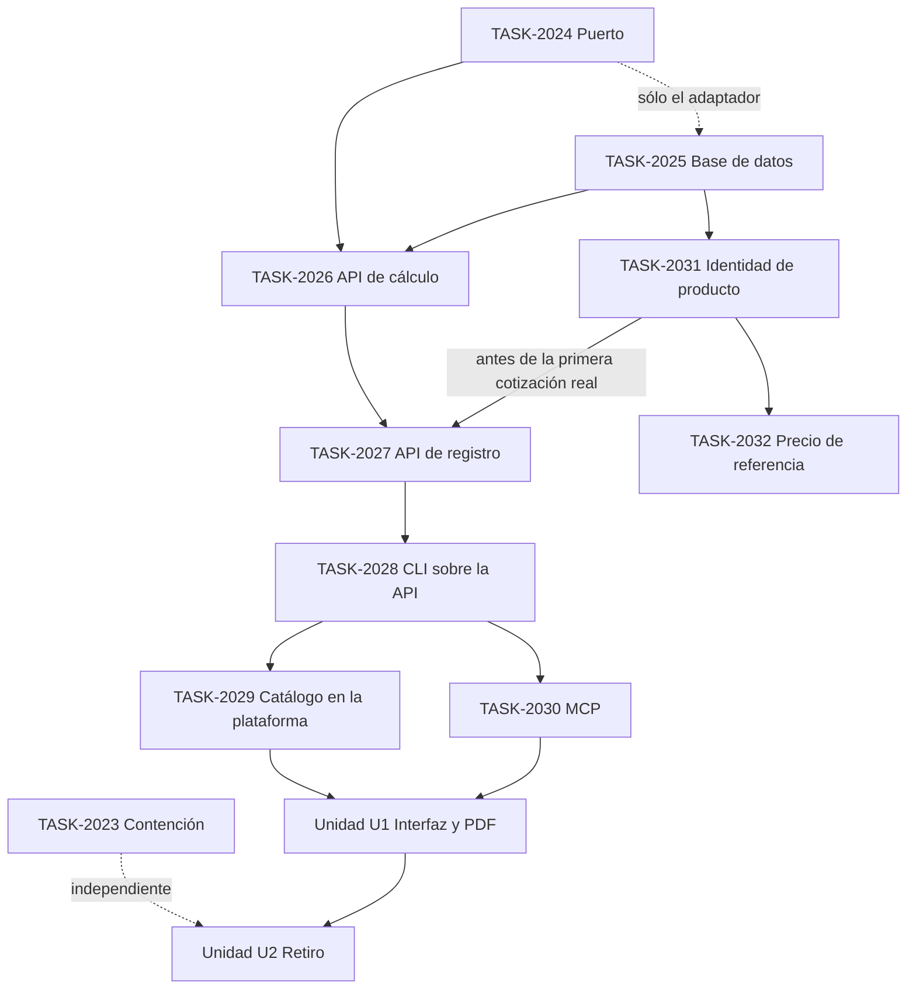

# EPIC-053 — Cotizador V3: promoción a la plataforma

## Status

- Lifecycle: `in-progress`
- Priority: `P1`
- Impact: `Muy alto`
- Effort: `Alto`
- Status real: `Programa aprobado por el CEO el 2026-10-12. Fases 1 y 2 completas (TASK-2024, puerto de almacenamiento; TASK-2025, base de datos aplicada y vacía de cotizaciones). Ninguna ruta de plataforma publicada. Identidad de producto planificada (TASK-2031): va antes de la primera cotización real`
- Rank: `TBD`
- Domain: `cross-domain`
- Owner: `CEO (precios, pisos, excepciones y orden del programa) · Commercial/Finance (catálogo y política) · Platform (contrato, API y datos)`
- Branch: `Greenhouse develop; checkout compartido; sin rama de épica ni worktrees`
- GitHub Issue: `none`
- Created: `2026-10-12`

Priority, Impact y Effort son inferencias de planificación. Registrar la épica y sus tasks no autoriza migraciones,
despliegues, cambios de flags ni el cambio de modo por defecto de la CLI: cada uno tiene su puerta en la task que lo
entrega.

## Summary

Coordina el programa que convierte «Pricing V3», hoy una CLI local sobre archivos del repo, en el cotizador de la
plataforma, con **registro y API propios**, en el orden **API → CLI sobre la API → MCP → interfaz**. La regla que
manda sobre las demás: **la CLI sigue operativa en todo momento y después**; su modo local no se retira, no se
degrada y no se condiciona.

Aparte, y sin depender del resto, contiene el cotizador actual del portal: nadie lo usa para cotizar, pero sus
puertas de escritura siguen abiertas.

## Why This Epic Exists

La [auditoría del 2026-10-12](../../audits/commercial/2026-10-12-cotizador-actual-auditoria.md) concluyó que el
cotizador del portal (motor V2, `greenhouse_commercial.quotations*`) no se usa para cotizar, que el número que guarda
no lo produce el motor sino una segunda etapa, que el control se salta por tres puertas de escritura, que una versión
no congela lo necesario para reproducir un precio y que no existe historial real que migrar. De sus tablas sí cuelgan
las copias de HubSpot y Nubox, contratos, ingresos y el vínculo con las propuestas de licitación.

Por eso V3 no entra «debajo» del cotizador actual: entra con su propio registro, y el actual se contiene ahora y se
retira al final, a propósito. El trabajo cruza motor, datos, API de plataforma, CLI, MCP, interfaz, documento del
cliente y el retiro de un sistema del que cuelgan integraciones: no cabe en una task, y sus fases tienen puertas de
salida distintas.

## Outcome

- Un solo lugar donde se calcula (`src/lib/finance/pricing-v3/**`); API, CLI, MCP e interfaz son transportes sin
  fórmulas.
- Un registro de cotizaciones con identidad estable, número público de secuencia, versiones inmutables verificadas
  por huella e historial de sólo agregar.
- Catálogo, política y créditos versionados por huella en la plataforma, con un puntero que registra quién activó
  qué, cuándo y por qué.
- La CLI opera en local o contra la API con las mismas entradas, salidas, códigos de salida y errores tipados, con
  paridad medida entre ambos caminos.
- Los agentes operan con autonomía: cotizan, registran, preparan el documento y emiten dentro de política. Sólo dos
  actos son de persona y quedan registrados: aprobar una excepción bajo el piso y mover el puntero del catálogo.
- El cotizador actual queda de sólo lectura para autoría desde el principio y se retira con decisión propia al final.
- Una sola identidad de lo que Efeonce vende: Productos nombra (SKU, nombre, vínculo con HubSpot) y V3 precia. Cada
  cotización nombra el SKU de su servicio compuesto y el de cada línea, y el registro lo lee por línea para la
  inteligencia de negocios.

## Architecture Alignment

- [Decisión de promoción](../../architecture/GREENHOUSE_PRICING_V3_PLATFORM_PROMOTION_DECISION_V1.md) — Accepted el
  2026-10-12. Fuente de verdad del alcance.
- [Plan del programa](../../architecture/GREENHOUSE_PRICING_V3_PLATFORM_PROGRAM_PLAN_V1.md) — fases, riesgos y
  decisiones pedidas al CEO.
- [Auditoría del cotizador actual](../../audits/commercial/2026-10-12-cotizador-actual-auditoria.md) y sus anexos
  [A](../../audits/commercial/2026-10-12-cotizador-actual-anexo-a-dominio-api.md),
  [B](../../audits/commercial/2026-10-12-cotizador-actual-anexo-b-base-de-datos.md) y
  [C](../../audits/commercial/2026-10-12-cotizador-actual-anexo-c-interfaz.md).
- [Frontera de promoción de V3](../../documentation/finance/cotizador-v3-promocion-canonica.md) — lo que debe
  preservarse sigue vigente y la decisión lo hace obligatorio; la decisión enmienda «promover debajo de los
  primitives vigentes» y «no crear otra API de cotizaciones».
- [Paridad de API de cotizaciones](../../architecture/GREENHOUSE_QUOTE_API_PARITY_DECISION_V1.md) — enmendada: las dos
  capacidades (simular; autorar y emitir) se conservan como principio, con destino en el registro de V3.
- ADR locales de V3: [flujo operativo](../../architecture/GREENHOUSE_PRICING_V3_OPERATIONAL_WORKFLOW_DECISION_V1.md),
  [motor 1.1](../../architecture/GREENHOUSE_PRICING_V3_ENGINE_1_1_COMMERCIAL_ADJUSTMENTS_DECISION_V1.md),
  [mantenimiento de catálogo](../../architecture/GREENHOUSE_PRICING_V3_CATALOG_MAINTENANCE_DECISION_V1.md),
  [composición de recursos](../../architecture/GREENHOUSE_PRICING_V3_RESOURCE_COMPOSITION_DECISION_V1.md) y
  [prototipo local](../../architecture/GREENHOUSE_PRICING_V3_LOCAL_PROTOTYPE_DECISION_V1.md).
- [Frontera Comercial ↔ Finance](../../architecture/GREENHOUSE_COMMERCIAL_FINANCE_DOMAIN_BOUNDARY_V1.md): las
  cotizaciones son de Comercial y viven en `greenhouse_commercial`.
- [API de plataforma](../../architecture/GREENHOUSE_API_PLATFORM_ARCHITECTURE_V1.md),
  [Full API parity](../../architecture/GREENHOUSE_FULL_API_PARITY_DECISION_V1.md) y
  [arquitectura MCP](../../architecture/GREENHOUSE_MCP_ARCHITECTURE_V1.md).
- [Fronteras de build](../../architecture/GREENHOUSE_BUILD_UNIT_DECOMPOSITION_DECISION_V1.md) y
  [ubicación de trabajo nuevo](../../operations/MODULAR_MIGRATION_NEW_WORK_OPERATING_MODEL_V1.md): no se crean
  aplicaciones, paquetes ni servicios; cada task declara su contrato de ubicación.
- [Modelo de épicas](../../operations/EPIC_OPERATING_MODEL_V1.md).

### Familia única de nombres

Fijada por las tasks de datos para que todas coincidan. Cualquier cambio se hace primero en `TASK-2025` y se avisa.

| Qué | Nombre |
| --- | --- |
| Tablas | `greenhouse_commercial.quoter_*` |
| Rutas | `/api/platform/app/quoter/**` (personas) y `/api/platform/ecosystem/quoter/**` (agentes sin sesión) |
| Capacidades | `commercial.quoter.*` |
| Agregado con estado | `src/lib/commercial/quoter/` |
| Motor (no se mueve) | `src/lib/finance/pricing-v3/` |
| Contrato de almacenamiento | `PricingV3Storage` en `src/lib/finance/pricing-v3/storage/` |

## Child Tasks

| Task | Fase del plan | Rol dentro de la épica | Depende de |
| --- | --- | --- | --- |
| `TASK-2023` | contención (independiente) | Cierra las puertas de escritura del cotizador actual y su salida a HubSpot, por flag; copias entrantes y lecturas intactas | nada |
| `TASK-2024` | 1 · cimientos | Puerto de almacenamiento con adaptador de archivos y en memoria; arnés de conformidad; línea base dorada de la CLI | nada |
| `TASK-2025` | 2 · base de datos | Tablas `quoter_*` (catálogo por huella, puntero, cotización, versiones, estados, documento), capacidades y permisos, adaptador PostgreSQL, importador repo → base | `TASK-2024` sólo para el adaptador |
| `TASK-2026` | 3 · API de cálculo | Catálogo, simulación y todas las lecturas de una cotización, sin persistir | `TASK-2024`, `TASK-2025` |
| `TASK-2027` | 4 · API de registro | Crear cotización, agregar versión, registrar una hecha en local, textos del documento, ciclo de vida con actos humanos, número | `TASK-2025`, `TASK-2026`; `TASK-2031` antes de registrar una cotización real |
| `TASK-2028` | 5 · CLI sobre la API | Capa de transporte comando por comando, diagnóstico de conexión, comando de paridad; al cierre, cambio único del modo por defecto | `TASK-2026`, `TASK-2027` |
| `TASK-2029` | 6 · catálogo en la plataforma | Revisar, aplicar y mover el puntero por la API; exportación al repo | `TASK-2028` |
| `TASK-2030` | 7 · MCP | Herramientas de lectura, simulación y registro (emitir sólo si se decide el permiso de escritura); aprobar una excepción y activar el catálogo no se exponen | `TASK-2028` |
| `TASK-2031` | identidad de producto (antes de la fase 4) | El catálogo de V3 declara el SKU de cada perfil y herramienta en una versión nueva; servicio compuesto con SKU fijo, receta y oferta que lo precia; line item y custom item; control de conformidad con Productos; lecturas por línea reconstruibles para la inteligencia de negocios | `TASK-2025`; curación de su dueño |
| `TASK-2032` | precio de referencia de Productos | Productos deja de tratar la semilla de abril como precio vigente y publica una referencia a jornada completa calculada por V3; ensayo en seco de lo que cambiaría en HubSpot | `TASK-2031` |

Las lecturas nuevas de `TASK-2031` y `TASK-2032` nacen como lectores del agregado, con comando de operador y lectura
local en la CLI. Sus rutas de plataforma las publican `TASK-2026` (lecturas de cálculo y de catálogo) y `TASK-2027`
(lecturas del registro); si alguna cierra antes, la ruta queda como pendiente con dueño en la task que la originó.

### Unidades sin task todavía

No se reservan números hasta que exista la decisión que las destraba.

| Unidad | Fase | Qué entrega | Qué debe decidirse antes |
| --- | --- | --- | --- |
| U1 — Interfaz y documento en producción | 8 | Pantallas de lista, detalle, aprobación y emisión; enlace público; render del PDF en producción | **El CEO decide portal o Rooms.** Además: una prueba de concepto del render (la plantilla A4 hoy es un script con Chromium y el trabajador de artefactos sólo renderiza catálogos del compositor). Las tasks de interfaz se abrirán con perfil `ui-ux`, separadas de su base de datos y API, y cada una necesitará wireframe, y contrato de flujo cuando coordine superficies, antes de declararse lista |
| U2 — Retiro del cotizador actual | 9 | Herramientas de Nexa y MCP sobre V2 apuntando a V3; vínculo de las propuestas de licitación; destino de la salida a HubSpot; retiro de rutas, pantallas y tablas | **Decisión propia con plan de reversa.** Exige las fases 4 a 8 en uso real y un destino para cada cosa que cuelga de `quotations*` (contratos, ingresos, copias de HubSpot y Nubox, `proposals.quote_id`) |

## Sequence and Milestones

Qué puede correr en paralelo, según el plan:

- `TASK-2023` es independiente de todo: puede entregarse antes, durante o después de cualquier otra.
- `TASK-2024` y `TASK-2025` se solapan: las tablas no dependen del puerto. Sólo el adaptador PostgreSQL espera el
  contrato del puerto.
- `TASK-2029` y `TASK-2030` pueden ir a la vez una vez cerrada `TASK-2028`.
- `TASK-2031` corre en paralelo con `TASK-2026`: toca el contrato del catálogo, lecturas del motor y tablas de
  lectura, no las rutas. `TASK-2032` va después de `TASK-2031` y no bloquea cotizar.
- El resto es secuencial: cálculo → registro → CLI. La interfaz va al final y el retiro después de ella.

### Regla de secuencia — identidad de producto antes de la primera cotización real

Decidida por el CEO el 2026-10-12. Una cotización registrada queda congelada para siempre: lo que no lleve dentro al
congelarse no se le agrega después.

- **Ninguna cotización real se registra antes de que `TASK-2031` cierre.** `TASK-2027` puede construirse y probarse
  con cotizaciones sintéticas; su puerta de salida con cotizaciones reales espera a `TASK-2031`.
- La regla tiene guarda en la base de código, no sólo en este documento: la puerta única de escritura rechaza una
  versión de una cotización real cuyo artefacto no declara identidad de producto (`TASK-2031`, Slice 5).
- La versión del catálogo que declara la identidad se activa como cualquier otra, por una persona. El código que
  conoce sus clases de registro nuevas está en producción antes de que el puntero de la plataforma la nombre.
- `TASK-2029` y `TASK-2026` leen las clases de registro del contrato del catálogo; no las enumeran.
- Un SKU nace en Productos, en línea, por un acto del catálogo. Cotizar nunca acuña un SKU y una línea sin producto
  nunca detiene a un agente: se emite y se reporta.

### Regla permanente — la CLI nunca deja de funcionar

Vale en todas las fases y después del programa. Cada task la hereda como criterio de aceptación.

- El modo local sobre archivos no se retira, no se degrada y no se condiciona a la API.
- Hasta el cierre de `TASK-2028`, `pnpm pricing:v3` hace exactamente lo de hoy; el modo plataforma se pide de forma
  explícita. El modo por defecto cambia una sola vez, con la paridad medida y en verde.
- Sin respaldo silencioso: si se pidió el modo plataforma y la API no responde, el comando falla con un error claro.
- Los artefactos congelados del repo se recalculan idénticos en cada entrega, y `pnpm pricing:v3:test` queda en verde.
- Lo cotizado en local se puede registrar después: la API lo recalcula con las versiones que nombra y lo registra
  sólo si la huella coincide.

## Existing Related Work

Barrido por dominio y superficie sobre registries, tasks y épicas (2026-10-12). Ninguna de estas tasks se edita ni se
reasigna desde esta épica; al ejecutar cada fase, la task que las afecta deja un `## Delta` en ellas.

### El programa supera

- `TASK-497` — autosave del constructor V2; la interfaz se rehace al final sobre el registro de V3.
- `TASK-499` — pendientes de pulido del constructor V2.
- `TASK-564` — creación de negocio y vínculo con HubSpot desde el constructor V2.
- `TASK-620.4` — selector directo del constructor V2.
- `TASK-623` — precios por nivel y volumen sobre el motor V2; V3 ya cotiza herramientas por plan, puesto y paquete.
- `TASK-627.1` — clonar y plantillas de cotización V2; V3 arma una demanda con `compose scaffold`.

### El programa absorbe

- `TASK-2017` — economía de V3 (en curso, parcial): cierra el dato económico que el catálogo de la plataforma hereda.
- `TASK-609` — orquestador agéntico de cotización de sólo lectura: V3 ya es «el agente interpreta, el dominio
  calcula», con costo objetivo en vez de costo vivo.
- `TASK-608` — historial de precios del catálogo de productos: se solapa con las versiones inmutables por huella, y
  con la referencia por huella de catálogo de `TASK-2032`.
- `TASK-552` — seguimientos multimoneda de la cotización V2: se solapa con la política de tipo de cambio de V3.
- `TASK-562` — seguimientos de impuesto explícito en la cotización V2: se solapa con el impuesto dentro del artefacto.

### El programa choca con

- `TASK-1206` — cierre a factura (en curso): compone sobre una cotización emitida de `quotations`; debe decidirse
  cómo consume una cotización del registro de V3.
- `TASK-576` — contrato de publicación de cotizaciones en HubSpot: la contención detiene esa salida; falta decidir si
  V3 publica en HubSpot.
- `TASK-620`, `TASK-620.1`, `TASK-620.3`, `TASK-620.5`, `TASK-620.7` — unificación del catálogo vendible relacional
  que alimenta a V2: un solo catálogo debe mandar. Resuelto por el CEO el 2026-10-12: Productos nombra lo que se
  vende y V3 decide cuánto cuesta y a qué precio (`TASK-2031`, `TASK-2032`). Lo que esas tasks proponían sobre
  precio por producto queda superado; lo que proponen sobre identidad y búsqueda se revisa contra esa decisión.
- `TASK-622` — aprobación multinivel sobre el cotizador actual: la autoridad de aprobación de V3 es otra.
- `TASK-1417` — autor de la lámina económica de una propuesta: hoy supone una simulación del motor V2; debe leer la
  proyección para el cliente de V3.
- `TASK-686` — puente de licitación a negocio y cotización sobre el constructor V2.
- `EPIC-029` — Proposal Studio: `proposals.quote_id` referencia `quotations`; se mantiene hasta la unidad U2.
- `EPIC-012` — pide un costo base vivo para cotizar; el CEO fijó el costo objetivo del catálogo, no la nómina.
- `EPIC-016` — ordena varias de las tasks superadas como prioridad de ingresos; este programa cambia ese orden.

### Siguen su curso y dependen del modelo de versión

- `TASK-1222` y `TASK-1223` — reconciliación y corrección de estado de las cotizaciones de HubSpot: operan sobre las
  copias, que la contención no toca.
- `TASK-619` y `TASK-619.3` — firma electrónica por versión: es la firma que V3 difiere; necesita la identidad de
  versión del registro.
- `TASK-628` — enmiendas de cotizaciones firmadas.
- `TASK-625` — idiomas del documento.
- `TASK-631.1` y `TASK-631.2` — endurecimiento del enlace público; relevante para la unidad U1.
- `TASK-1650` — consulta muerta del emisor legal en el enlace público (defecto vivo).
- `TASK-624` — renovaciones; consumidor aguas abajo.
- `TASK-1405` y `TASK-1406` — lista de precios del proveedor para el sitio público: otro dominio; sólo coincide el
  nombre.

### Base ya construida

- `TASK-2015` a `TASK-2022` — V3 local (completas): motor, catálogo, composición, créditos, flujo para agentes.
- `TASK-1211` y `TASK-1212` — simulación y comando de autoría sobre V2: siguen sirviendo hasta el retiro.
- `EPIC-044` — identidad y gateway por los que federa la herramienta MCP de `TASK-2030`.
- `EPIC-052` — Rooms: hogar posible de la interfaz. Sus documentos dicen hoy que Rooms no calcula ni genera precios;
  si el cotizador se muestra ahí, Rooms consume esta API y el cálculo no se muda.
- `EPIC-002` — separación de Comercial y Finance: decide dónde viviría una interfaz en el portal.

## Exit Criteria

Una casilla por puerta de salida de fase. Se marca con evidencia; documentos escritos no cuentan como avance.

- [ ] **Encuadre.** Decisión aceptada, épica y tasks registradas, `pnpm epic:lint` y `pnpm task:lint` sin hallazgos en
      los archivos de esta épica.
- [ ] **Contención (`TASK-2023`).** Cada puerta de escritura del cotizador actual responde el rechazo canónico; una
      copia de HubSpot y otra de Nubox entran sin error; lista, detalle, PDF y página pública responden como antes;
      nada sale hacia HubSpot.
- [x] **Fase 1 (`TASK-2024`).** Suite de V3 en verde; todos los artefactos del repo se recalculan idénticos a través
      del puerto; ninguna salida de la CLI cambió respecto de la línea base.
      Evidencia del 2026-10-12: `pnpm pricing:v3:test` 36 archivos y 1.799 tests en verde; los 48 artefactos se leen
      byte a byte y se reproducen con su huella por los tres adaptadores (archivos sobre el repo, archivos sobre una
      carpeta llenada por el puerto, memoria); la línea base de 107 comandos, capturada antes de tocar la CLI, pasa
      sin regenerar un fixture; `pnpm build` exit 0; `pnpm test` completo con 3 rojos ajenos (desfase del paquete
      AXIS). Detalle en la task.
- [x] **Fase 2 (`TASK-2025`).** Catálogo vigente importado; huellas en la base iguales a las del repo; un artefacto
      guardado se lee con la misma huella. Cerrada el 2026-10-12: tres migraciones aplicadas a la base compartida,
      24 documentos importados (segunda corrida sin escrituras), puntero de la base idéntico byte a byte al del
      repo; la lectura de un artefacto con su misma huella está probada con los 47 artefactos calculados del repo en
      PostgreSQL 16 local (todavía no hay cotizaciones en la base). El build local no se verificó.
- [ ] **Fase 3 (`TASK-2026`).** Paridad en staging: cada ejemplo del repo da la misma huella por la API.
- [ ] **Identidad de producto (`TASK-2031`).** La versión vigente del catálogo declara el SKU de sus perfiles y
      herramientas y sus servicios compuestos; ninguna cifra cambió y todos los artefactos congelados se recalculan
      idénticos; el control de conformidad con Productos no deja errores sin dueño; las lecturas por línea responden,
      con cotizaciones sintéticas, qué se cotiza más, qué se vende más, qué es más rentable y qué se cotiza y no se
      vende, por producto y por compuesto; una cotización real sin identidad de producto es rechazada.
- [ ] **Fase 4 (`TASK-2027`).** Cotizaciones de ejemplo registradas y verificadas recalculando desde la base; un acto
      humano intentado por un agente es rechazado. Ninguna cotización real registrada antes del cierre de
      `TASK-2031`.
- [ ] **Fase 5 (`TASK-2028`).** Un agente nuevo, sólo con la skill, cotiza y registra un negocio real de punta a punta
      por la API; comando de paridad en verde; cambio del modo por defecto hecho una vez; modo local comprobado
      después del cambio.
- [ ] **Fase 6 (`TASK-2029`).** Un cambio real de precio hecho por la API, con su copia en el repo; aplicar no activó.
- [ ] **Fase 7 (`TASK-2030`).** Canario del gateway en verde; las herramientas actuales sobre V2 siguen respondiendo;
      aprobar una excepción y activar el catálogo no están expuestas.
- [ ] **Precio de referencia (`TASK-2032`).** Productos entrega por producto una referencia a jornada completa
      calculada por el motor, igual a cotizar su brief guardado; las cifras de abril siguen intactas y rotuladas como
      históricas; nada se envió a HubSpot.
- [ ] **Fase 8 (U1).** Puerta definida al abrir la fase, después de la decisión portal o Rooms.
- [ ] **Fase 9 (U2).** Decisión propia de retiro aceptada, con plan de reversa, y ejecutada.
- [ ] **Regla permanente.** En cada cierre de fase quedó evidencia de que el modo local de la CLI hace lo mismo que
      antes de la fase.

## Decisiones del CEO

| Decisión | Estado |
| --- | --- |
| Aprobar el plan y escribir la decisión que lo formaliza | Aprobado 2026-10-12 |
| Contener el cotizador actual ahora | Aprobado 2026-10-12 → `TASK-2023` |
| Excepción bajo el piso: sólo administración. Puntero del catálogo: administración y finanzas | Aprobado 2026-10-12 → `TASK-2025` |
| Portal o Rooms como hogar de la interfaz | **Abierta.** No bloquea nada hasta la fase 8 |
| Prorrateo del fee de plataforma | **Abierta.** No bloquea: entra por el catálogo cuando se decida |
| Costo de puesta en marcha de un servicio gestionado | **Abierta.** No bloquea |
| Excepción del diseñador por dedicación | **Abierta.** No bloquea |
| Quién puede emitir una cotización | Resuelta 2026-10-12: los agentes, dentro de política, y administración, cuentas y finanzas |
| Prefijo y arranque del número de cotización | Resuelta 2026-10-12: `EO-QTE-`, la primera cotización real es `EO-QTE-15001` y sigue correlativa; se asigna en la primera emisión |
| Si V3 publica cotizaciones en HubSpot | **Abierta.** La contención detiene la salida actual; el destino se decide en la unidad U2 |
| Cómo se vincula una propuesta de licitación mientras dure la contención | Resuelta 2026-10-12: ese flujo no se usa; no bloquea `TASK-2023` |
| Ejemplos de cotización en la base compartida | Resuelta 2026-10-12: sintéticos, con numeración aparte |
| Actos humanos y autonomía de los agentes | Resuelta 2026-10-12: los agentes cotizan, registran y emiten dentro de política sin aprobación. Sólo son actos de persona la excepción bajo el piso y la activación del catálogo; hasta que haya interfaz, la persona inicia sesión desde la CLI |
| Organización dueña de una cotización | Resuelta 2026-10-12: Efeonce siempre es la dueña y emisora; el destinatario es una organización cliente o potencial cliente |
| Solicitud y rechazo de una excepción | **Abierta.** El modelo registra sólo la aprobación; no queda rastro de una solicitud ni de un rechazo, ni existe cola de pendientes. Ver `TASK-2027` |
| Quién ve costo y margen por MCP | **Abierta, bloquea la federación de `TASK-2030`.** Casi toda lectura del cálculo es de audiencia interna y el carril de ecosistema no distingue personas |
| Alcance de escritura por MCP para registrar cotizaciones | **Abierta.** Exige una clase de permiso nueva entre sistemas; `TASK-2030` puede cerrar sólo con lectura y simulación |
| Si un agente puede aplicar un cambio de catálogo | **Abierta.** Ver `TASK-2029` |
| Número y versión impresos en el documento | **Abierta.** La plantilla A4 no tiene esas claves; hace falta una versión nueva de sus datos, sin tarea dueña |
| Productos y el cotizador | Resuelta 2026-10-12: una identidad, dos responsabilidades. Productos nombra lo que se vende (SKU, nombre, descripción, vínculo con HubSpot); V3 decide cuánto cuesta y a qué precio. Los registros del catálogo de V3 referencian su SKU de forma explícita y un control avisa si se desalinean → `TASK-2031` |
| Qué precio muestra Productos | Resuelta 2026-10-12: prevalece la forma de cotizar de V3. El precio de un producto es una referencia a jornada completa calculada por V3; los precios sembrados en abril dejan de ser precio vigente y se conservan como historia → `TASK-2032` |
| Qué es el producto de un servicio gestionado | Resuelta 2026-10-12: un producto compuesto con SKU propio y fijo, formado por roles y herramientas, con receta por defecto. El SKU identifica el servicio, no la cotización. La oferta de V3 aporta la regla de precio y la cotización guarda la composición real. Compuestos con nombre (lista corta y curada) y uno genérico por práctica. Un SKU nace sólo al definir un servicio en el catálogo → `TASK-2031` |
| Line item y custom item | Resuelta 2026-10-12: line item es una línea con SKU; custom item, una línea sin producto, con categoría de una lista cerrada y motivo. Una línea sin producto no detiene al agente: se emite y se reporta. Guardas sin persona: se proponen los SKU que calzan, lo repetido tiene producto genérico, mucho monto en custom items marca la cotización para revisión y un reporte lista los que se repiten → `TASK-2031` |
| Cuándo se registra la primera cotización real | Resuelta 2026-10-12: no antes de que exista la identidad de producto (`TASK-2031`) |
| Lista de compuestos con nombre, genéricos por práctica y destino de los siete servicios existentes | **Abierta, la decide el CEO en la curación de `TASK-2031`.** Sólo tres de los siete tienen receta y varios no tienen hoy una oferta de V3 que los precie |
| Umbral de monto en custom items que marca una cotización para revisión | **Abierta.** Valor de política del catálogo, del CEO; `TASK-2031` propone 0,20 como punto de partida sin confirmar |
| Productos genéricos (puesta en marcha y terceros por categoría) y código `ETG-017` | **Abierta, en la curación de `TASK-2031`.** `ETG-017` se retira de V3 con ese identificador; en Productos el SKU conserva su significado |
| Definición del precio de referencia | **Abierta, bloquea el Slice 2 de `TASK-2032`.** Oferta, forma, país, mercado, moneda y elecciones de kit que definen «jornada completa»; el motor no calcula una referencia sin que se declare |
| Qué muestra HubSpot como precio de un producto | **Abierta.** Mantener abril, la referencia de V3 (cambia también la unidad, de hora a mes) o ninguno. Cualquier cambio en los productos de HubSpot es un acto aparte, autorizado de forma explícita y con ensayo en seco; `TASK-2032` entrega el ensayo y no envía nada |
| Si una línea del documento del cliente muestra su SKU | **Abierta.** Recomendación de `TASK-2031`: no; si se quiere, entra con la versión nueva de los datos del documento |
| Ciclo de vida después de emitir | Resuelta 2026-10-12: se suman aceptada y rechazada como estados y una fecha de vigencia fijada al emitir; vencida se deriva de esa fecha; una cotización vencida se puede aceptar y queda registrado que fue fuera de vigencia. Todos los estados los aplica un agente sin aprobación. Enviada y vista quedan para el envío y la interfaz; ganada y perdida, para la salida a HubSpot. Entra en `TASK-2025` (base) y `TASK-2027` (comandos) antes de aplicar las migraciones |

## Non-goals

- Cambiar cómo calcula V3: el motor, sus contratos y sus cifras no se tocan.
- Poner V3 debajo del cotizador actual, o escribir en `greenhouse_commercial.quotations*` desde el registro nuevo.
- Migrar las cotizaciones del cotizador actual: no hay ninguna real.
- Reescribir la CLI como cliente puro de la API, o retirar su modo local.
- Firmas electrónicas, cobro, facturación y cierre de negocio: se conectan después, por eventos, sobre una cotización
  emitida.
- Fecha de inicio del servicio y duración de contrato dentro del cotizador; la nómina como base de costo.
- Decidir aquí el hogar de la interfaz o el retiro del cotizador actual.
- Enviar a HubSpot cotizaciones, líneas, precios o productos como efecto de este programa, o vincular una cotización
  con un negocio de HubSpot: se decide en la unidad U2.
- Otorgar madurez de Product Service por tener SKU, receta o precio de referencia.
- Crear aplicaciones, paquetes, servicios o repositorios.
- Ejecutar código, aplicar migraciones, cambiar flags o desplegar como efecto de registrar esta épica.

## Delta 2026-10-12

Creada tras la aprobación del CEO. IDs `EPIC-053` y `TASK-2023` a `TASK-2030` reservados en los registries antes de
escribir los archivos. Las ocho tasks son planificación: ninguna está iniciada. Interfaz y retiro quedan como unidades
sin número. Próximo paso: `TASK-2023` y `TASK-2024` pueden tomarse de inmediato; `TASK-2025` puede empezar su esquema
en paralelo y necesita el visto bueno del operador antes de aplicar cualquier migración, porque hay una sola base para
desarrollo, staging y producción.

## Delta 2026-10-12 — Productos y el cotizador

El CEO señaló lo que el plan no había resuelto y decidió cómo se relacionan Productos y V3 (ver la
[decisión](../../architecture/GREENHOUSE_PRICING_V3_PLATFORM_PROMOTION_DECISION_V1.md), «Delta 2026-10-12 — Productos
y el cotizador: una identidad, dos responsabilidades»). Se suman dos tasks hijas, sólo planificación:

- `TASK-2031` — identidad de producto en el cotizador V3. Va antes de `TASK-2027` y de la primera cotización real.
- `TASK-2032` — precio de referencia de Productos calculado por V3. Después de `TASK-2031`; no bloquea cotizar.

Lo que cambia para las demás: `TASK-2027` no registra cotizaciones reales hasta el cierre de `TASK-2031` y hereda la
guarda de identidad en la puerta de escritura; `TASK-2026` y `TASK-2029` leen del contrato tres clases de registro
nuevas; `TASK-2028` y `TASK-2030` suman las lecturas nuevas a su corpus y a sus herramientas. Cada una recibe su
`## Delta` cuando `TASK-2031` se ejecute. El vínculo con un negocio de HubSpot sigue abierto y no entra en ninguna de
las dos tasks.
