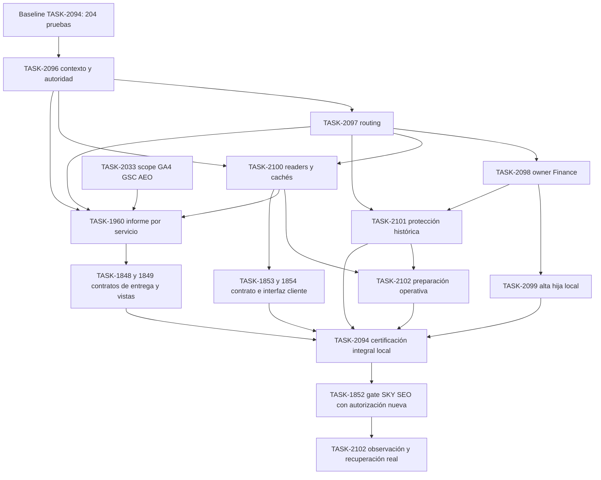

# EPIC-057 — Cuentas operativas por Space bajo una Organization

## Status

- Lifecycle: `in-progress`
- Priority: `P1`
- Impact: `Muy alto`
- Effort: `Alto`
- Status real: `Formalizado y revisado contra código 2026-11-06; TASK-2094 con 204 pruebas locales; ADR aceptado con B el 2026-11-06; siete hijas nuevas to-do; sin split productivo`
- Rank: `57`
- Domain: `cross-domain|identity|data|ops`
- Owner: `Core/Spaces + Identity + Services; Finance/Delivery/ICO/Insights por contrato; Julio aceptó el ADR (B, 2026-11-06) y decide la apertura`
- Branch: `Greenhouse develop; checkout compartido, sin worktrees`

## Summary

Coordina cuentas departamentales bajo un cliente comercial: SKY conserva una Organization y su owner
financiero, con Diseño y Blog SEO/AEO en Spaces separados. Julio aceptó el modelo B el 2026-11-06. Esa
aceptación no inicia código, provisioning ni release: cada uno sigue en su task con autorización propia.

El programa ya tiene investigación y laboratorio en TASK-2094, por eso su lifecycle es in-progress;
las siete implementaciones nuevas permanecen to-do. El avance de planificación no equivale a despliegue.

## Why This Epic Exists

Separar URLs en un informe no separa permisos, fuentes, trabajo, costos ni destinatarios. El laboratorio
reproduce mezcla por org/client, reasignación por sync y reconstrucción histórica con flags actuales.
La solución cruza dominios y reutiliza EPIC-045/046/022, sin trasladarles tareas ni duplicar implementaciones.

## Outcome

- Una identidad comercial y financiera SKY; Diseño conserva IDs, fuentes y toda su historia.
- Dos cuentas operativas con autoridad/contexto por request; usuario Diseño, SEO, dual y sin acceso verificados.
- Sync y atribución deterministas por Space/Service; ambigüedad observable, nunca selección implícita.
- Informes Blog con GA4, GSC y motor AEO nativo acotados a `blog.skyairline.com`, con cobertura y denominadores.
- Apertura por capacidad con rollback y operación observable; emitir, enviar y entregar permanecen estados distintos.

## Architecture Alignment

- [ADR dueño: cuentas operativas](../../architecture/GREENHOUSE_OPERATIONAL_ACCOUNTS_UNDER_ORGANIZATION_DECISION_V1.md), **Accepted** 2026-11-06, modelo B, por decisión explícita de Julio.
- [Modelo Organization/Space/Service](../../architecture/GREENHOUSE_360_OBJECT_MODEL_V1.md).
- [Contrato candidato Blog](../../architecture/EFEONCE_INSIGHTS_BLOG_MEASUREMENT_CONTRACT_V1.md).
- [Finance](../../architecture/GREENHOUSE_FINANCE_ARCHITECTURE_V1.md), [atribución comercial](../../architecture/GREENHOUSE_COMMERCIAL_COST_ATTRIBUTION_V1.md).
- [Operating Loop](../../operations/GREENHOUSE_OPERATING_LOOP_V1.md), [modelo EPIC](../../operations/EPIC_OPERATING_MODEL_V1.md), [modularidad](../../operations/MODULAR_MIGRATION_NEW_WORK_OPERATING_MODEL_V1.md).
- [Comparación real local y límites](../../audits/client-portal/2026-11-01-sky-finance-routing-validation/README.md).

## Child Tasks

| Unidad | Task única | Dueño | Dependencias de implementación local | Estado al formalizar |
| --- | --- | --- | --- | --- |
| U00/U08 | [TASK-2094](../../tasks/in-progress/TASK-2094-sky-measurement-real-component-local-validation.md) | QA/arquitectura transversal | Baseline ya ejecutado; certificación integral tras contratos/consumers indicados abajo | in-progress |
| U01 | [TASK-2096](../../tasks/in-progress/TASK-2096-operational-space-authority-and-request-context.md) | Identity / Spaces | Baseline 204 casos de TASK-2094 | to-do |
| U02 | [TASK-2097](../../tasks/to-do/TASK-2097-operational-space-service-source-routing.md) | Services / Source Sync | TASK-2096 | to-do |
| U02F | [TASK-2098](../../tasks/to-do/TASK-2098-operational-accounts-finance-owner-attribution.md) | Finance / Service Attribution | TASK-2096, TASK-2097 | to-do |
| U03 | [TASK-2099](../../tasks/to-do/TASK-2099-operational-space-provisioning-plan-command.md) | Core / Spaces | TASK-2096, TASK-2097, TASK-2098 | to-do |
| U04 | [TASK-2100](../../tasks/to-do/TASK-2100-operational-space-readers-cache-isolation.md) | Account 360 / Client Portal / Identity | TASK-2096, TASK-2097 | to-do |
| U05 | [TASK-2101](../../tasks/to-do/TASK-2101-operational-space-temporal-history-protection.md) | Delivery / ICO / Finance | TASK-2097, TASK-2098 | to-do |
| U10 | [TASK-2102](../../tasks/to-do/TASK-2102-operational-space-durable-operations-recovery.md) | Workers / Source Sync / Ops | TASK-2096, TASK-2097, TASK-2098, TASK-2100, TASK-2101 | to-do |

TASK-2094 se adscribe al EPIC sin cambiar sus 204 resultados ni declararla completa. [TASK-2073](../../tasks/complete/TASK-2073-operational-account-bridge-local-prototype.md) conserva
su cierre histórico como simulación y se referencia, no se reabre ni cambia de parent. Ninguna hija nueva posee
renderer, sender, algoritmo SEO/AEO o UI paralelos.

## Existing Related Work

Las siguientes tasks son dependencias externas, **no hijas ni copias**. Conservan su Epic, lifecycle, prioridad
y los checks previamente verificados. El delta nuevo agrega exigencias pendientes al alcance multi-Space.

| Dueña existente | EPIC conservado | Contrato reutilizado y gate acotado |
| --- | --- | --- |
| [TASK-2033](../../tasks/in-progress/TASK-2033-efeonce-insights-content-scope-measurement.md) | EPIC-045 | U06: filtro host+ruta por productor GA4/GSC/AEO; versión/pinning. Desarrollo interno no espera alta SEO |
| [TASK-1960](../../tasks/to-do/TASK-1960-efeonce-insights-report-per-contracted-service.md) | EPIC-045 | U07: informe por Service, vínculo Proyecto→Servicio en primitive canónico, receipts de tres fuentes, ownership de edición y destinatarios |
| [TASK-1848](../../tasks/in-progress/TASK-1848-efeonce-insights-sharing-delivery-and-schedules.md) | EPIC-045 | U07/U10: grants, recurrencia y delivery existentes; revalidación antes de dispatch, resultado ambiguo conciliado |
| [TASK-1849](../../tasks/to-do/TASK-1849-efeonce-insights-library-builder-and-shared-web.md) | EPIC-045 | Biblioteca, builder, detalle, descarga y entrada autenticada; ningún segundo visor ni selector propio |
| [TASK-1992](../../tasks/to-do/TASK-1992-efeonce-insights-seo-visibility-360-facts.md) | EPIC-045 | Nuevos facts SEO heredan scope/receipts; sólo sus módulos seleccionados bloquean esa tarjeta, no todo el Blog |
| [TASK-1852](../../tasks/in-progress/TASK-1852-berel-sky-service-access-and-channel-enablement.md) | EPIC-046 | U09: dueña de habilitación/preview/apply/canales; gate SKY SEO nuevo tras certificación y autorización concreta |
| [TASK-1853](../../tasks/to-do/TASK-1853-client-service-progress-and-metrics-read-model.md) | EPIC-046 | Proyección cliente por servicio; consume contexto/bindings compartidos sin duplicar fórmulas |
| [TASK-1854](../../tasks/to-do/TASK-1854-client-home-services-and-cycle-experience.md) | EPIC-046 | Interfaz de cuenta y cambio Diseño/SEO; UI separada de backend, contexto por pestaña y GVC |
| [TASK-1855](../../tasks/to-do/TASK-1855-client-service-requests-and-briefs-commands.md) / [TASK-1856](../../tasks/to-do/TASK-1856-client-service-request-and-brief-self-service-ui.md) | EPIC-046 | Solicitudes/briefs backend/UI; se abren sólo si target/autoridad/historia están certificados |
| [TASK-1857](../../tasks/to-do/TASK-1857-sky-creative-hub-client-surface.md) | EPIC-046 | Creative Hub Diseño conserva su contrato y backlog; SEO no lo rehace ni lo habilita implícitamente |
| [TASK-1655](../../tasks/in-progress/TASK-1655-growth-seo-historical-data-platform.md) | EPIC-022 | Cobertura/historial GSC de las ventanas exigidas; un backfill real requiere autorización propia |
| [TASK-2063](../../tasks/to-do/TASK-2063-greenhouse-customer-login-convergence-native-issuer.md) / [TASK-1631](../../tasks/in-progress/TASK-1631-efeonce-customer-identity-mcp-federation.md) | EPIC-044 | Entrada first-party y binding externo existentes; no nuevo login/emisor/grant store paralelo |
| [TASK-925](../../tasks/to-do/TASK-925-notion-tenant-provisioning-control-plane.md) | conserva parent actual | Adopción Notion cuando proceda; alta de Space no duplica teamspace ni suscripción |
| [TASK-1879](../../tasks/to-do/TASK-1879-leadership-accountability-source-foundation.md) | EPIC-048 | Responsabilidad de liderazgo y atribución as-of; no se modifica su población al abrir SEO |

### Límite entre responsabilidades compartidas

TASK-2097 posee Servicio→Space y Fuente/objeto externo→Space. TASK-1960 posee Proyecto→Servicio, incluso si su
primitive vive en Core/Services: no crea una relación privada de Insights ni usa module_id como service_id.
TASK-2100 posee scopes/cachés compartidos; TASK-1853 y TASK-1960 conservan sus readers de producto. TASK-2101
posee protección temporal operativa/ICO/Finance; TASK-1655 conserva la captura histórica GSC.

Cada archivo compartido tiene un solo dueño: `identity-store.ts` es de TASK-2096; `space-notion-store.ts` y
`project-notion-delivery-to-postgres.ts`, de TASK-2097; `service-attribution/materialize.ts`, de TASK-2098.
TASK-2099, 2100 y 2102 los consumen. TASK-2101 los modifica sólo después de sus dueños, como ya exige su
dependencia. El schema por Space del store Insights es de TASK-1960; los carriles App y ecosystem que amplían un
binding de Space a toda la Organization son de TASK-2100.

## Dependency Plan

Las flechas significan **entregable requerido**, no cierre total de programas externos. Los gates de apertura
son distintos de los contratos que permiten desarrollar con fixtures. Así se evita el ciclo de exigir portal
terminado para construir el backend que lo alimenta.

### Dependencias exactas por hito

| Hito | Inputs requeridos | Criterio de salida |
| --- | --- | --- |
| M0: decisión y programa | ADR + baseline TASK-2094 | EPIC/task graph registrado; ADR aceptado por Julio el 2026-11-06 (B) |
| M1: foundations locales | TASK-2096/2097/2098/2100 | Contexto, routing, owner y base de readers compatibles; contrato de una cuenta preservado |
| M2: alta ensayada | TASK-2099 + M1 | Preview y ejecución sintética idempotentes; cero alta real, ni Space inactivo como atajo |
| M3: medición interna | TASK-2033 + requisitos de TASK-1960; TASK-1655 si falta ventana GSC | GA4/GSC/AEO con receipts válidos; puede desarrollarse sin provisioning real |
| M4: certificación local | M1/M2/M3 + TASK-2101 + preparación TASK-2102 + slices multi-Space 1853/1854/1848/1849 | TASK-2094 prueba HTTP/UI/APIs/cache/recursos, fuentes y control histórico; limitaciones visibles |
| M5: apertura autorizada | M4 + ADR Accepted + plan/digest concreto + gate de entrada TASK-1852/2063 y sus dependencias de Auth aplicables | TASK-1852 habilita sólo personas/capacidades verificadas; readback de Diseño/SEO/control |
| M6: operación real | M5 + TASK-2102 observación + TASK-1848 dispatch autorizado | Fuentes estables, señales y recuperación; accepted/ambiguous/delivered reconciliados |

**Sin ciclo TASK-1852 ↔ portal/QA:** su foundation ya entregada se puede consumir sin esperar su cierre total;
su gate nuevo de apertura SKY SEO espera M4. TASK-1853/1854 siguen consumiendo ese contrato previo. De igual
modo, TASK-2102 prepara preflight/pausa antes de M4 y observa runtime después de M5; no exige su cierre total
para arrancar el canary. TASK-2094 usa su baseline existente como insumo de M1 y certifica la integración al final.

Los briefs TASK-1855/1856 se incorporan a M4 **si se habilita esa capacidad**; en caso contrario permanecen
cerrados y su exclusión se registra. TASK-1857 no bloquea una apertura de sólo Insights, pero toda ruta Diseño
existente entra en regresión. TASK-1992 no bloquea el núcleo Blog por módulos opcionales ni política competidores.
Una ventana GSC faltante sí bloquea el informe que la promete; no se sustituye con ceros o datos ajenos.

## Coverage and Acceptance Matrix

| Concern | Dueño ejecutable | Evidencia exigida |
| --- | --- | --- |
| Sesión, grants, refresh, revocación y dual | TASK-2096 / QA2094 | requests reales, concurrencia, multi-tab y revocación durante write |
| Sources/Services y replay | TASK-2097 | todos los carriles, orden/versiones, batches parciales y conflicto observable |
| Owner/costos/consolidado | TASK-2098 | P&L conservado, allocation concurrente, método y residual explícitos |
| Alta sin duplicar cliente | TASK-2099 | digest/expected version, retry, transacción y compensación |
| Listas/detalle/API/MCP/cache/export | TASK-2100 + consumers 1853/1960/1849 | matriz por superficie; sin fallback org/client-only |
| Historia y reconstrucción | TASK-2101 | as-of, snapshots sellados, control externo, recuperación PG y motor analítico aislado real |
| GA4/GSC/AEO sólo Blog | TASK-2033/1960/1655; facts1992 cuando aplique | host exacto, rutas, panel completo, ventanas, calidad/finalidad y versión sellada |
| Selección e interfaz | TASK-1854/1849; briefs1856 si se abren | wireframe/flow vigentes, cuenta visible, estados y GVC; no nueva UI aquí |
| Destinatarios/schedules/share | TASK-1848/1960 | autoridad vigente antes de dispatch, claves idempotentes, bearer explícito y conciliación |
| Apertura y operación | TASK-1852/2102 | piso de versión, manifest de capacidades, canary autorizado, pausa selectiva y readback |

## Exit Criteria

- [x] EPIC, ADR y dueños existentes conciliados; siete nuevas tasks sin duplicar Insights, portal o productores. Evidencia: documentos y QA de formalización 06-11.
- [x] Baseline previo de 204 pruebas locales vinculado; no presentado como integración productiva.
- [x] ADR aceptado explícitamente. Evidencia: Julio aceptó el modelo B el 2026-11-06; ver sección *Aceptación* del ADR.
- [ ] Schema/contratos de las foundations revisados y aprobados antes de aplicación real.
- [ ] Hijas y slices externos requeridos satisfacen sus criterios y TASK-2094 certifica el alcance habilitable con controles negativos.
- [ ] Historia Diseño y cliente control conservados por evidencias antes/después; ninguna reclasificación implícita por flags actuales.
- [ ] GA4/GSC/AEO Blog completos y comparables por período; ausente, parcial y cero observados diferenciados.
- [ ] Plan concreto de apertura aprobado y ejecutado por TASK-1852; login/roles/capacidades/fuentes/destinatarios verificados.
- [ ] TASK-2102 y delivery existente demuestran operación/recuperación real, con límites y capacidades aún cerradas enumerados.

## Non-goals

- Otra Organization/Company/client financiero, migración de historia Diseño o asignar resultados anteriores al servicio SEO.
- Desplegar, crear cuentas reales, cambiar flags/conexiones o emitir/enviar reportes por registrar este programa.
- Nuevo renderer, scheduler, sender, login, grant store o motor SEO/AEO paralelo; tampoco nueva topología de repos.
- Declarar cerradas tasks existentes o reejecutar sus migraciones/backfills ya entregados.

## Delta 2026-11-06 — Formalización autorizada

Pedido explícito: EPIC con todas las tareas/dependencias, ADR y tasks Insights enlazados, commit propio,
sin producción ni historia Diseño. Revisión de superficies antes de reservar IDs: 1852–1857, 1848/1849,
1960, 2033, 1992, 1655, 925, 1631, 1879 y laboratorio2073/2094. Se registran sólo los siete huecos de contratos
compartidos; el resto añade delta y criterios en su dueña. Prioridad P1/impacto alto/esfuerzo alto son estimaciones
de planificación, sin prometer plazo. No se lanzan subagentes ni implementación por este registro.

## Delta 2026-11-06 — Revisión contra código

Pedido explícito del operador: revisar el programa y contrastarlo con el código, con subagentes de sólo lectura.
La [revisión](../../audits/client-portal/2026-11-06-operational-accounts-code-review/README.md) mantiene B y el grafo.
Corrige tres lecturas: el laboratorio usó una vista de sesión antigua y la vigente elige Space sin orden; un usuario
inactivo conserva claims de cookie sin límite; y un período cerrado del P&L operativo se reescribe. También ajusta
Backend impact, archivos con dueño único y criterios de TASK-2096–2102, más un criterio en TASK-1960 y otro en
TASK-2094. No cambia dependencias, prioridades ni lifecycle, no acepta el ADR y no inicia implementación.

## Delta 2026-11-06 — ADR aceptado con B

Julio aceptó el modelo B tras la explicación A′/B: un client comercial compartido y Space/Service explícito.
El ADR pasa a Accepted, `DECISIONS_INDEX` y TASK-2094/2096–2102 lo reflejan, y el servicio SKY Blog deja de
citar la recomendación A′ del 27-10. No cambia dependencias, prioridades ni lifecycle, y no inicia
implementación, migrations ni provisioning. Siguiente unidad: TASK-2096.

## Verification of Planning

[Auditoría de formalización](../../audits/client-portal/2026-11-06-operational-accounts-epic/README.md):
paridad de IDs/parents, grafo por hitos, cobertura, enlaces y gates documentales. La verificación de este
corte es documental; los 204 tests son evidencia fechada del 01-11, no una nueva corrida del 06-11.
