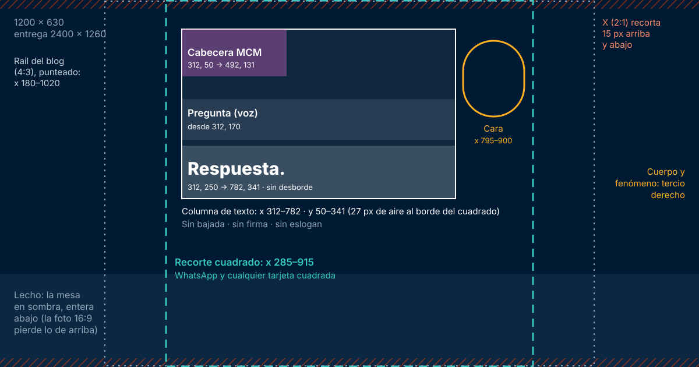
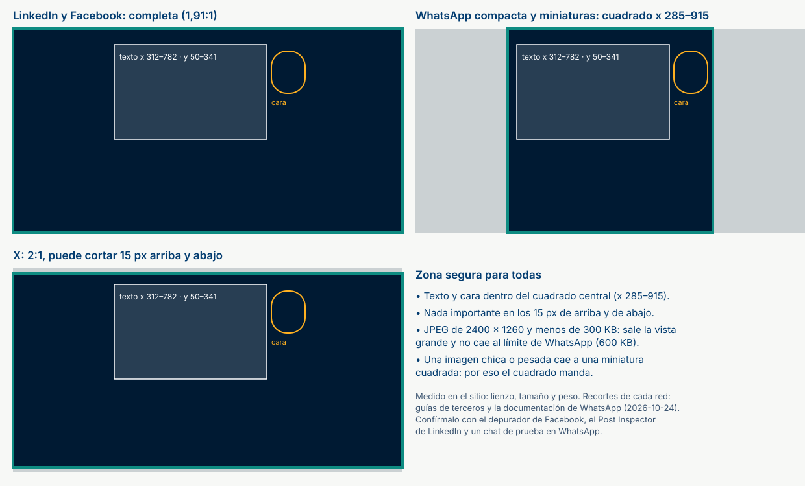
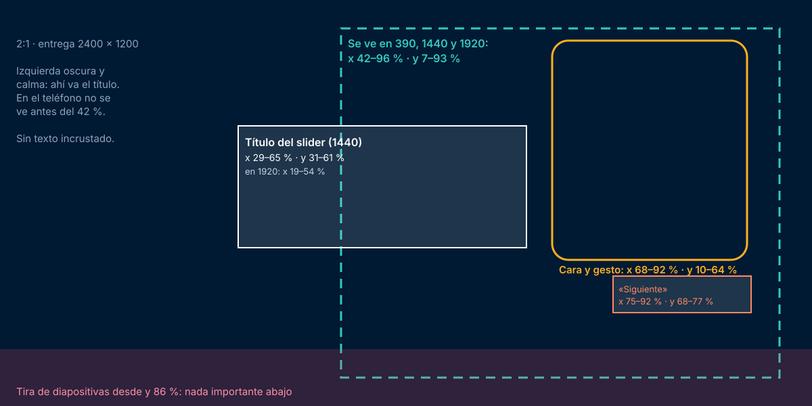
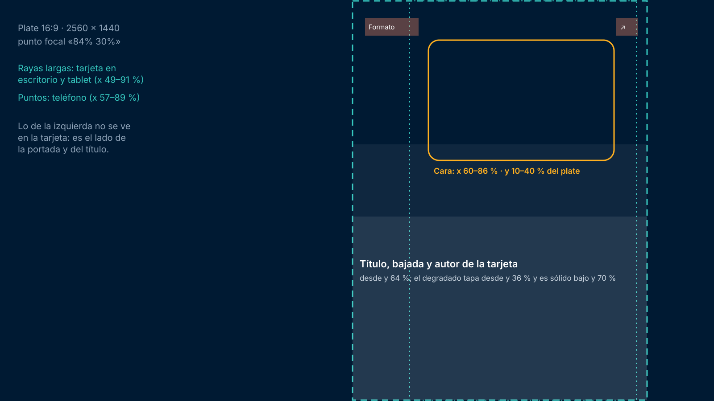

# Inventario de imágenes por artículo del blog

> **Tipo de documento:** Norma operativa (inventario y especificación)
> **Version:** 1.4 (relacionados al pie del artículo y superficies sin imagen)
> **Creado:** 2026-10-24 por Claude, a pedido del operador («cuántas imágenes para todas las posiciones … y sus
> características por cada artículo que se haga»)
> **Alcance:** artículos de Marketing con Manzanitas en `efeoncepro.com/blog`. Glitch tiene sus propias piezas
> (§Fuera de alcance).
> **Medido en vivo:** 2026-10-24, en 390, 768, 1024, 1440 y 1920 px, con la portada del blog v3, las cards v2 del rail
> (`efeonce-editorial-blocks` 0.4.4) y el archivo v3. Si la portada o el rail cambian, vuelve a medir antes de producir.
> **Relacionado:** [Producir la portada de un artículo](../../manual-de-uso/creative/producir-portada-de-articulo-del-blog.md) ·
> [Operar la portada del blog por CLI](../../manual-de-uso/public-site/operar-portada-blog-por-cli.md) ·
> [Estilos editoriales](../../public-site/BLOG_EDITORIAL_BLOCK_STYLES_V1.md) ·
> [Infografías editoriales](../../manual-de-uso/public-site/producir-infografias-editoriales.md) ·
> [Norma de Manzanitas §5.6](../brand-graphic-line/manzanitas/MANZANITAS_REGISTER_V1.md) ·
> [Modelo de key visual de portadas](EDITORIAL_COVER_KEY_VISUAL_OPERATING_MODEL_V1.md) (el método: tesis visual, contrato
> de recorte, versiones; este inventario fija las posiciones y medidas del blog de hoy)

## Ficha completa: un artículo nuevo de Marketing con Manzanitas

**Un artículo nuevo entra solo al slider y al rail de `/blog/`.** El slider llena sus lugares de posts (hoy dos, después
de los fijados) con los más nuevos que tienen imagen y no son Glitch ni Novedad (`EO_Home_Readers::build_featured`).
El rail toma las cuatro lecturas más nuevas de 12 minutos o más (o pódcast) que no son Glitch ni Novedades
(`EO_Home_Readers::rail`). Por eso, al publicar, las imágenes del slider y de la tarjeta **son obligatorias**: sin
ellas, el título del slider y el texto de la tarjeta caen encima del texto de la portada.

| Imagen | Archivo que se produce | Se sube como | Se ve en | Márgenes (lo importante va adentro) | Texto en la imagen | La hace |
|---|---|---|---|---|---|---|
| **1. Plate** | PNG 16:9, 2560 × 1440 | imagen de la tarjeta del rail (`blog-home card … --focus "84% 30%"`) | la tarjeta de «Para leer con calma» (escritorio 440 × 600, tablet 361 × 492, teléfono 304 × 540) | cara en **x 68–75 % · y 10–40 %**; 64 % izquierdo oscuro; mitad de abajo pareja; 7 % libre arriba y abajo. En la tarjeta: cara en x 60–86 % · y 10–40 %, debajo de las etiquetas (y 5–8 %) y encima del degradado (desde y 36 %) | **ninguno** | agente de foto |
| **2. Portada** | JPEG 2400 × 1260 (1,9:1), calidad 88, croma 4:4:4, **menos de 300 KB** | imagen destacada + Open Graph (`blog-post-cover-apply.php`) | Open Graph en LinkedIn, Facebook, WhatsApp, iMessage, Slack, Teams y Telegram; tarjeta grande de X; imagen principal del schema; Google y Discover; **«Te puede interesar» al pie de cada artículo** (cuadrado 339 × 339, 326 × 326 en el teléfono) | texto en **x 312–782 · y 50–341**; todo lo importante dentro del **cuadrado central x 285–915** (WhatsApp y miniaturas); **15 px** libres arriba y abajo (X); cara en x 795–900 | cabecera de Manzanitas, pregunta y respuesta; **sin firma** | agente de composición |
| **3. Imagen del slider** | WebP 2:1, 2400 × 1200, recortada del plate | `hero` (`blog-home hero … --image`) | el slider de `/blog/` (escritorio 1440 y 1920 × 900; teléfono 390 × 300) y la miniatura «Siguiente» (96 × 64) | cara en **x 68–92 % · y 10–64 %**; se ve x 42–96 % · y 7–93 %; tapan el título (x 29–65 % · y 31–61 %), «Siguiente» (x 75–92 % · y 68–77 %) y la tira (desde y 86 %) | **ninguno**: el slider pone su título | agente de composición |
| 4. Imágenes del cuerpo | SVG directo para infografías y diagramas; raster real para fotos y capturas | bloques del artículo (Content Factory) | dentro del artículo, enteras | sin recorte: legibles a 390 px; versión móvil sólo si la de escritorio no se lee | sí, si es una infografía | agente de contenido |

**Cuenta para un artículo nuevo:** **3 archivos** (plate, portada e imagen del slider), **3 subidas** (portada, `hero` y
tarjeta) y de 0 a 2 imágenes de cuerpo. Cada subida lleva su `alt`. Con `efeonce-editorial-blocks` 0.4.6 desplegado,
la descripción de la imagen para redes (`og:image:alt` y `twitter:image:alt`) sale sola del `alt` de la portada.

**Si el artículo es corto (menos de 12 minutos),** no entra al rail: se ahorra la subida de la tarjeta. Si es Glitch o
Novedad, no entra solo al slider. Un artículo viejo que se refresca no entra a ninguno de los dos hasta que se lo fije:
`pnpm public-website:blog-home slider` muestra quién está y por qué.

**Fuera del sitio** (sólo si el plan de canales de la semana lo pide, cada una con su norma, §6): post de LinkedIn
1200 × 627, dos miniaturas de YouTube 1280 × 720 y una story 1080 × 1920.

**Antes de publicar, el operador aprueba** viendo juntas la portada completa, su recorte cuadrado, la imagen del
slider y la tarjeta (1440 y 390). **Después, QA en vivo:** etiquetas Open Graph y X, la tarjeta en 1440 y 390, el slider
en 1440 y 390, `blog-home verify --browser`, y los depuradores de cada red para refrescar la caché.

### Dónde no se usa ninguna imagen del artículo

- **Cabecera del artículo:** Ohio no muestra la imagen destacada.
- **Archivo del blog v3** (temas, etiquetas, autores, búsqueda): lista de texto.
- **Temas de la órbita** en la portada del blog: sólo el título del último post.
- **Tarjetas del menú del sitio** («Para leer» y demás): usan fotos propias del menú (`manzanitas-card.webp`,
  `glitch-card.webp`…), no la portada del post.

## Resumen: cuántas imágenes lleva un artículo

| # | Imagen | ¿Cuándo? | Cuántas | La hace |
|---|---|---|---|---|
| 1 | **Plate** (foto 16:9 sin texto) | siempre | 1 | agente de foto (`design-studio` + `pnpm foto:*`) |
| 2 | **Portada** (destacada + OG + X) | siempre | 1 archivo | agente de composición (`efeonce-graphic-line`) desde el plate |
| 3 | **Imagen del slider** (`hero`) | si el post entra al slider de `/blog/`: **todo artículo nuevo entra solo** (salvo Glitch y Novedad) | 1 en un artículo nuevo | se recorta del plate (sin foto nueva) |
| 4 | **Imagen de la card del rail** | si el post entra al rail: **todo artículo nuevo de 12 minutos o más entra solo**. Obligatoria, porque la portada de Manzanitas trae texto. En producción desde el 2026-10-24 (TASK-2051, 0.4.5) | 1 en un artículo nuevo | se usa el plate tal cual, con punto focal |
| 5 | **Imágenes del cuerpo** (diagramas, infografías, capturas) | sólo si explican algo que el texto no puede | 0 a N (lo normal: 0 a 2) | agente de contenido (`content-marketing-studio` + infografías) |
| 6 | Foto del autor | ya existe; no se hace por artículo | 0 | — |
| 7 | **Piezas de distribución** (LinkedIn, YouTube, story) | según el plan de canales de esa semana, no por defecto | 0 a 4 | agente social (`social-media-studio`), con su propia norma |

**Mínimo por artículo: 2 archivos** (el plate y la portada) y **1 subida** (la portada). Con slider: 3 archivos y 2
subidas. Con rail: el plate se sube como imagen de la tarjeta (sin archivo nuevo). Todo lo demás depende del contenido
o del plan de canales.

Siempre aprueba el operador antes de subir, y el agente que sube avisa antes a las sesiones del blog que estén
trabajando.

## Márgenes de seguridad: cómo debe ser cada imagen

**Sí, cada posición tiene márgenes de seguridad.** Están medidos en vivo el 2026-10-24 (390, 1440 y 1920 px; tablet
como escritorio) y calculados sobre las cajas reales de cada superficie: qué parte de la imagen se ve y qué tapa el
texto del sitio. Se expresan en **% del ancho y del alto de la imagen**, así valen para cualquier resolución de
entrega. La regla general: **lo importante va al menos a un 3 % del borde que corta** y nunca debajo de un texto del
sitio.

### Portada (1200 × 630)



| Zona | Dónde (lienzo de 1200 × 630) | Por qué |
|---|---|---|
| Recorte más estrecho | cuadrado central, **x 285–915** (WhatsApp) | todo el texto y la cara caben adentro |
| Texto (cabecera, pregunta, respuesta) | **x 312–782 · y 50–341** | 27 px de aire contra el borde del cuadrado; 35 px por debajo del recorte de X |
| Bordes de arriba y abajo | nada importante en los **15 px** de cada borde | la tarjeta de X (2:1) puede cortarlos |
| Cara | **x 795–900**, en el tercio de arriba | queda 15 px dentro del borde del cuadrado; si sale más a la derecha, la cara se corta en WhatsApp |
| Lecho | abajo, a lo ancho | ahí no va nada del texto |

### Open Graph: cómo muestra la portada cada plataforma



La imagen Open Graph es la portada. Cada red la muestra distinto y ninguna, salvo WhatsApp, publica sus reglas: la
tabla marca qué está verificado y qué viene de guías de terceros (consultadas el 2026-10-24).

| Plataforma | Cómo la muestra | Margen que exige | Fuente |
|---|---|---|---|
| LinkedIn (post con enlace) | tarjeta grande 1,91:1, completa. Con una imagen de menos de 200 px de ancho cae a una miniatura chica a la izquierda | ninguno extra; algunas guías dicen que en el teléfono recorta al centro | guías de terceros |
| Facebook | tarjeta grande 1,91:1, completa. Bajo unos 600 × 315 cae a una miniatura cuadrada | el cuadrado central si cae a miniatura | guías de terceros |
| WhatsApp | vista grande horizontal, o compacta con **miniatura cuadrada central**. La compacta sale con imágenes chicas, pesadas o poco horizontales | **el cuadrado central, x 285–915** | límites oficiales de Meta: menos de 600 KB, al menos 300 px de ancho y proporción de hasta 4:1. Lo de grande o compacta, guías de terceros |
| X | `summary_large_image` en 2:1 | **15 px arriba y abajo** | validador de X citado en 2020 |
| iMessage, Slack, Teams, Telegram, Discord | la imagen casi completa; con imágenes chicas, una miniatura al costado. Telegram puede reemplazarla con su vista instantánea | el cuadrado central, por la miniatura | sin especificación publicada |

**La zona segura que sirve para todas:** texto y cara dentro del **cuadrado central (x 285–915)** y nada importante en
los **15 px de arriba y de abajo**. Es lo que ya cumple la portada centrada. Además:

- **Peso:** JPEG de menos de **300 KB**. Sale la vista grande y queda lejos del límite de WhatsApp (600 KB). Las tres
  portadas publicadas pesan entre 235 y 288 KB.
- **Tamaño:** 2400 × 1260 supera cualquier mínimo de vista grande (LinkedIn 200 px de ancho, Facebook unos 600 × 315 y
  WhatsApp 300 px).
- **Comprobación:** las redes guardan la vista previa en caché. Revisa cada portada nueva con el depurador de Facebook,
  el Post Inspector de LinkedIn y un chat de prueba en WhatsApp, y vuelve a compartir el enlace en X.

### Imagen del slider (2:1, se entrega a 2400 × 1200)



| Zona | Dónde (% de la imagen) | Por qué |
|---|---|---|
| Lo que se ve en todos los anchos | **x 42–96 % · y 7–93 %** | 1440 muestra x 25–96 %; 1920, x 4–96 %; el teléfono, sólo la parte derecha (x 42–100 %). Arriba y abajo, el parallax corta 6–7 % |
| Título del slider | tapa **x 29–65 % · y 31–61 %** en 1440 (x 19–54 % en 1920) | en escritorio va encima de la imagen; en el teléfono va debajo, sin tapar nada |
| Tarjeta «Siguiente» | tapa **x 75–92 % · y 68–77 %** | abajo a la derecha, en escritorio |
| Tira de diapositivas | tapa desde **y 86 %** | toda la base, en escritorio |
| **Cara y gesto** | **x 68–92 % · y 10–64 %** | a la derecha del título, encima de «Siguiente» y dentro de lo que se ve en el teléfono |
| Mitad izquierda | oscura y calma, sin detalle | es el fondo del título |

### Foto de la tarjeta del rail (el plate, con punto focal «84% 30%»)



| Zona | Dónde (% del plate) | Por qué |
|---|---|---|
| Lo que se ve | **x 49–91 %** en escritorio y tablet; **x 57–89 %** en el teléfono; todo el alto | la tarjeta es vertical y recorta los costados |
| Etiqueta de formato y flecha | las esquinas de arriba: **y 5–8 %** del alto | arriba a la izquierda y arriba a la derecha de la tarjeta |
| Degradado y texto de la tarjeta | el degradado empieza en **y 36 %**, es sólido bajo **y 70 %** y el título va desde **y 64 %** | la mitad de abajo queda tapada |
| **Cara** | **x 60–86 % · y 10–40 %** | dentro del recorte del teléfono con un 3 % de aire, debajo de las etiquetas y encima del degradado |
| Mitad de abajo | pareja y oscura (mesa, suelo, sombra) | un detalle ahí compite con el título de la tarjeta |

Las posiciones de la etiqueta, la flecha y el degradado se midieron en la tarjeta de 440 × 600. En el teléfono se
asume la misma proporción, sin medirla.

### Plate (2560 × 1440): la intersección de todo lo anterior

El plate alimenta las tres imágenes de arriba, así que debe cumplir las tres a la vez:

| Zona | Dónde (% del plate) |
|---|---|
| **Cara** | **x 68–75 % · y 10–40 %**: centro de la cara en torno al **71 %**. Se pide al 85 % en la ficha, porque el modelo la corre unos 15 puntos al centro |
| Lado izquierdo | el **64 % izquierdo** en oscuridad calma: ahí van el texto de la portada y el título del slider |
| Mitad de abajo | lecho parejo y oscuro: ahí van el degradado de la tarjeta y la tira del slider |
| Bordes | nada importante en el **7 %** de arriba y de abajo (parallax del slider) |
| Texto | ninguno |

Si la cara sale entre el 66 % y el 68 %, el `hero` se recorta en 2400 × 1200 quitando hasta 160 px a la izquierda, y
la cara queda en torno al 69 %. Si sale fuera del 66–76 %, se corrige la ficha y se vuelve a generar: no se estira ni
se mueve la foto.

### Imágenes del cuerpo y piezas de distribución

- **Cuerpo:** el artículo las muestra enteras, sin recorte. Su margen es interno: el texto de una infografía tiene que
  leerse a 390 px (la columna del teléfono), así que la composición de móvil existe cuando la de escritorio no se lee
  ahí ([infografías editoriales](../../manual-de-uso/public-site/producir-infografias-editoriales.md)).
- **Post de LinkedIn 1200 × 627:** se ve completo; los márgenes son los de la pieza medida de la lente
  (`applications.md` §A5).
- **Miniatura de YouTube 1280 × 720:** YouTube pone la duración del video abajo a la derecha; esa esquina va sin
  nada importante, y el logo de Efeonce va abajo a la izquierda (práctica de la plataforma, sin medir acá).
- **Story 1080 × 1920:** zona segura del 87 % de AXIS: nada importante en el 13 % de arriba ni de abajo.

## 1. Plate: la foto sin texto

Es la materia prima: de ella salen la portada y, si hace falta, la imagen del slider. No se publica sola.

| Característica | Valor |
|---|---|
| Formato | 16:9, **2560 × 1440**, PNG |
| Cómo | ficha cine (`"registro": "cine"`, `"alcance": "manzanitas"`, la `linea` del tema) → `cine-reviewer` → `pnpm foto:generar <ficha> --quality high --size 2560x1440` → `pnpm foto:validar:cine` y `pnpm foto:validar` → `pnpm foto:emblema` al 100 % |
| Costo | unos USD 0,055 por toma (gpt-image-2.5-sunburst, octubre de 2026) |
| Persona | del **elenco ficticio**, con la prenda de su línea y la marca bordada; nunca Julio ni el equipo real en estas fotos |
| Encuadre | **cara entre el 68 % y el 75 % del ancho** y entre el 10 % y el 40 % del alto (§Márgenes de seguridad, Plate). Se pide en torno al 85 %, porque el modelo la corre unos 15 puntos al centro. El 64 % izquierdo en oscuridad calma, sin luces ni objetos. El lecho (mesa o suelo en sombra) abajo, a lo ancho |
| Texto | **ninguno**: ni letras, ni logos de otras marcas, ni carteles legibles |
| Dónde queda | `ai-generations/<fecha>_<tema>/plates/`; no va a git (`pnpm ai-gen:archive` cuando el operador lo decida) |

## 2. Portada: destacada, Open Graph y X

Un solo archivo cubre la imagen destacada de WordPress, la imagen social de Yoast (Open Graph), la tarjeta de X (usa la
OG cuando el post no tiene una propia) y la imagen principal del schema (`primaryImageOfPage`).

| Característica | Valor |
|---|---|
| Lienzo | 1200 × 630 (1,9:1); **se entrega al doble: 2400 × 1260** |
| Archivo | JPEG calidad 88 con croma 4:4:4 (de 230 a 300 KB en el caso fuente); nombre descriptivo en kebab-case |
| Composición | variante centrada de Manzanitas: cabecera, pregunta y respuesta en x 312–782 · y 50–341; sin bajada, sin firma y sin eslogan |
| Cómo | `ESCALA=2 FIRMA=0 node composicion/componer-centrada.cjs <plate> <linea> "<pregunta>" "<respuesta>" <salida>` y JPEG con `sharp` |
| Metadatos | `alt` que describe la escena y repite el texto de la portada · título del adjunto · sha256 del archivo |
| Subida | `scripts/public-website/blog-post-cover-apply.php`: simulación → `apply` con guardas y respaldo |
| Indexación | el post sale con `max-image-preview:large`: la portada puede salir grande en Google y Discover (pide ≥ 1200 px de ancho; cumple) |

**Open Graph y X: lo que publica el artículo** (leído en vivo en el HTML de 245605, 2026-10-24):

| Etiqueta | Valor | Nota |
|---|---|---|
| `og:image` | la portada (`…/que-es-paid-media-2026.jpg`) | la misma imagen que la destacada; la escribe `blog-post-cover-apply.php` en `_yoast_wpseo_opengraph-image` |
| `og:image:width` / `og:image:height` | 2400 / 1260 | Yoast los lee del adjunto |
| `og:image:type` | `image/jpeg` | JPEG a propósito: los lectores de enlaces no tratan el WebP de forma pareja |
| `twitter:card` | `summary_large_image` | tarjeta grande |
| `twitter:image` | **no se publica** | X usa la `og:image` cuando falta; el script sólo la escribe si el post ya tenía una propia |
| `og:image:alt` y `twitter:image:alt` | **se agregan en `efeonce-editorial-blocks` 0.4.6** (runtime `20575b6`, hecho en local y simulado en vivo; espera el visto bueno del operador para desplegar) | toman el `alt` que Yoast ya resuelve para su `og:image` (Yoast 28.6 lo trae pero no lo imprime); si falta, el del adjunto, sólo cuando es ese mismo archivo. Una línea, 420 caracteres como máximo y nada si está vacío. El `alt` de la portada lo escribe `blog-post-cover-apply.php` |
| Peso | 230–300 KB | muy por debajo del límite de cualquier red |

Los lectores de enlaces y las redes guardan la imagen en caché: después de cambiar una portada, usa el Post Inspector
de LinkedIn y el depurador de Facebook para refrescarla, y comparte de nuevo el enlace en X.

**Dónde se ve y qué recorta** (sobre el lienzo de 1200 × 630):

| Superficie | Qué se ve | Resultado con la portada centrada |
|---|---|---|
| LinkedIn y Facebook (OG) | la imagen completa | ✓ |
| Vista previa compacta de WhatsApp | el cuadrado central, x 285–915 | ✓ texto y cara |
| Tarjeta grande de X | 2:1; puede cortar unos 15 px arriba y abajo (fuente secundaria, sin medir) | ✓ |
| Miniatura «Siguiente» del slider | 96 × 64 (1,5:1), centrada. Usa la imagen del slider si existe (de ella se ve x 12–88 %); si no, la portada (x 127–1072) | ✓ |
| «Te puede interesar» al pie de cada artículo (relacionados de Ohio) | **cuadrado 339 × 339** en escritorio y 326 × 326 en el teléfono, `object-fit: cover` centrado: x 285–915 | ✓ (es el mismo cuadrado que WhatsApp) |
| Archivo del blog v3 (temas, etiquetas, autores, búsqueda) | lista de texto, **sin imagen** | no aplica |
| Cabecera del artículo | Ohio **no muestra** la destacada | no aplica |
| Cards v2 del rail | 440 × 600 y 361 × 492 → x 369–831; 304 × 540 en móvil → x 423–777, con el texto de la tarjeta encima | ✗ **choca**: la card lleva su propia imagen (§4) |
| Slider sin `hero` | la destacada a sangre, anclada a la derecha, con el título del slider encima | ✗ **choca**: ver §3 |

Google recomienda dar al schema del artículo varias proporciones (16:9, 4:3 y 1:1). Yoast publica una sola y no es
requisito: no se producen versiones extra.

## 3. Imagen del slider (`hero`)

**Cuándo:** sólo si el post entra al slider de `/blog/` (fijado con `pin` o por ser de los más recientes con imagen;
`pnpm public-website:blog-home slider` muestra el motivo). Sin `hero`, el slider usa la portada con un velo, y su
título cae encima del texto de la portada: **un post con portada de Manzanitas que entra al slider necesita su `hero`**.

| Característica | Valor |
|---|---|
| Formato | **2:1**. Entrega 2400 × 1200 (la que está en vivo mide 1774 × 887); WebP |
| De dónde sale | **se recorta del plate**, sin foto nueva: de 2560 × 1440 a 2560 × 1280, quitando arriba |
| Texto | **ninguno**: el slider pone su propio título (dos líneas, `--light` y `--bold`) |
| Encuadre | **cara entre x 68 % y x 92 % y entre y 10 % y y 64 %**; mitad izquierda oscura y calma (§Márgenes de seguridad) |
| Medidas del slider | 1440 × 900 y 1920 × 900 en escritorio, con `object-fit: cover`, `object-position: 100% 50%` y un 10 % de margen por el parallax, con el título encima a la izquierda; en 390, la imagen en una franja de 390 × 300 que muestra su parte derecha (x 42–100 %), con el título debajo |
| Subida | `pnpm public-website:blog-home hero <post> --image <archivo.webp> --alt "…" --apply` (el velo desaparece) |

Con la cara del plate en torno al 71 %, el recorte del plate cumple sin recomponer (si sale entre el 66 % y el 68 %, ver §Márgenes de seguridad, Plate).

## 4. Imagen de la card del rail

Sin imagen propia, las cards v2 de «Para leer con calma» usan la **destacada** como foto a sangre vertical, centrada
(x 369–831 sobre 1200 × 630; x 423–777 en el teléfono), y le pintan encima la etiqueta de formato, el título, la bajada
y el autor. Con la portada de Manzanitas, ese recorte corta la cabecera, deja fuera la cara y superpone dos textos:
por eso la card lleva el plate con punto focal. Los tres posts del caso fuente no están hoy entre las cuatro lecturas
más nuevas.

**Encargado y resuelto el 2026-10-24** por la sesión dueña del rail (TASK-2051; runtime `6578773`, Greenhouse
`e60f5045c`): imagen propia de la card (`_eo_card_image`) y punto focal (`_eo_card_focus`, «x% y%» → `object-position`).
**En producción desde el 2026-10-24** (`efeonce-editorial-blocks` 0.4.5). Ningún post la tiene aplicada todavía. A un
post con portada de Manzanitas que entre al rail (sin `--apply` sólo muestra el plan; `--apply` con visto bueno del
operador):

```bash
pnpm public-website:blog-home card <post> --image <plate.png> --alt "<alt>" --focus "84% 30%"
```

| Característica | Valor |
|---|---|
| Lo que se ve | con el punto focal 84 %: **x 49–91 % del plate** en escritorio (440 × 600) y tablet (361 × 492); **x 57–89 %** en el teléfono (304 × 540); todo el alto |
| Texto | ninguno: la tarjeta pone el suyo |
| Encuadre | **cara en x 60–86 % · y 10–40 % del plate**; nada importante en las esquinas de arriba (etiqueta y flecha, y 5–8 %); la mitad de abajo pareja y oscura (el degradado empieza en y 36 % y el título va desde y 64 %) |
| Archivo | **el plate tal cual** (2560 × 1440), sin texto y sin recorte propio. La destacada no cambia y sigue siendo la OG |
| Punto focal | con la cara al 71 % del plate, **84 % 30 %**: se ve del 49 % al 91 % del plate en escritorio y tablet, y del 57 % al 89 % en el teléfono. Si la cara cae en otro lugar, recalcula |
| Subida | `blog-home card` (plan, estado anterior, ledger y lectura de vuelta) o el panel «Imagen de la tarjeta del riel» del editor |

## 5. Imágenes del cuerpo

Sólo si explican lo que el texto no puede: un diagrama, una infografía con datos, una captura de la herramienta. Nunca
para decorar. En el caso fuente: dos en inbound, una en paid media y ninguna en topic clusters.

| Característica | Valor |
|---|---|
| Infografía o diagrama | **SVG directo** (fuente editable aparte del SVG saneado de entrega), sin `@2x`; variantes de escritorio, móvil, claro y oscuro sólo cuando la composición cambia de verdad (`<picture>`). Proceso: [producir infografías editoriales](../../manual-de-uso/public-site/producir-infografias-editoriales.md) y `pnpm content:editorial-svg:audit` |
| Foto o captura | raster real de la biblioteca de medios (nunca inventar IDs o URLs), ancho ≥ la columna del artículo |
| Alineación | `{ "kind": "image", "align": "center" }` si es más angosta que la columna o cuadrada |
| Texto alternativo | `alt` corto y específico; caption con la fuente si es evidencia; descripción larga cerca cuando la infografía es compleja; `alt=""` sólo si es decorativa |
| Marca | color sólo de los tokens de la línea gráfica; el acento es el de la línea del tema |
| Subida | con la spec del artículo (Content Factory); el cuerpo se reemplaza con `blog-post-content-republish.php` |

## 6. Piezas de distribución (fuera del sitio)

No son del artículo: son de cada canal y salen sólo si el plan de canales de la semana las pide. Cada una tiene su
norma y sus medidas. Este inventario no las reemplaza.

| Pieza | Cuándo | Medidas y norma |
|---|---|---|
| Post de LinkedIn con el enlace | si el artículo se empuja en LinkedIn (página de Efeonce o Julio) | 1200 × 627, nativa, nunca recortada de un 16:9 (`efeonce-graphic-line` → `applications.md` §A5). Todavía **sin camino fotográfico canónico** |
| Portada de la edición del newsletter Marketing con Manzanitas (LinkedIn de Julio) | quincenal, no por artículo; enlaza al artículo | 1920 × 1080 (16:9): la composición de la miniatura de YouTube con el título de la edición como voz, logo abajo a la izquierda, sin eslogan; la voz dentro del 80 % central, porque LinkedIn la recorta en el feed (norma de Manzanitas §5.7, desde 2026-10-22) |
| Miniaturas de YouTube | si el artículo acompaña un tutorial | **dos** miniaturas Escena 16:9 (1280 × 720) para la prueba A/B, logo abajo a la izquierda, sin eslogan; cierre de YouTube aparte (norma de Manzanitas §5.7) |
| Story de Instagram | máximo una por semana, como generosidad | 1080 × 1920, zona segura del 87 %, enlace al blog o a Glitch (norma §5.6) |

## Quién hace qué

| Paso | Agente o persona | Skill o herramienta |
|---|---|---|
| Ficha y plate | agente de foto | `design-studio`, `cine-reviewer`, `pnpm foto:*` |
| Portada y recorte del `hero` | agente de composición | `efeonce-graphic-line` (Manzanitas §4.5), `componer-centrada.cjs` |
| Imágenes del cuerpo | agente de contenido | `content-marketing-studio`, infografías editoriales, Content Factory |
| Aprobación | **el operador**, viendo la portada junto a sus recortes | — |
| Subida, `hero`, card y QA en vivo | agente del sitio público, coordinado con las sesiones del blog | `efeonce-public-site-wordpress`, `blog-post-cover-apply.php`, `blog-home hero`, `blog-home card`, `blog-home verify --browser` |
| Piezas de distribución | agente social | `social-media-studio`, con la norma del canal |

## Fuera de alcance

- **Glitch** (ediciones y Flash): banners 16:9 y 1:1, banner de noticia con crédito y sus piezas propias
  (`docs/operations/brand-graphic-line/glitch/GLITCH_GRAPHIC_LINE_V1.md` §6).
- **Recursos de la portada** (guías, herramientas, diagnóstico) y **eventos**: tienen su propia imagen, que se carga
  con `blog-home resource` o `blog-home event` ([manual](../../manual-de-uso/public-site/operar-portada-blog-por-cli.md)).
