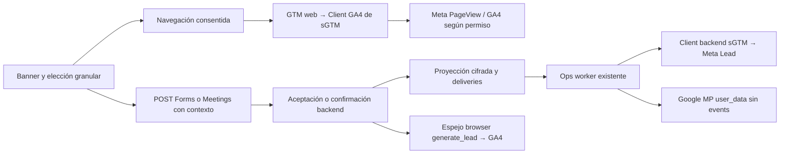

# Runtime de consentimiento y matching de Leads

Código promovido en PR254, main `d692ab51dc486a0585b7950f95bb627197e6f2c6`.
Últimos readbacks externos: 2026-10-14 UTC (Server7 y Test Events); [dossier de release](../../audits/releases/2026-10-13-full-develop-matching-release.md).
**Matching activado; primera conversión comercial consentida post-activación sin observar.**
Este documento describe lo construido; su actualización no certifica tráfico posterior.

[ADR](../../architecture/GREENHOUSE_META_CAPI_SERVER_GTM_DECISION_V1.md),
[consentimiento/hosts](09-hubspot-consent.md), [recuperación e inventario histórico](08-meta-conversions-api-server-side.md).
La [configuración escalable](../../architecture/GREENHOUSE_GROWTH_MEASUREMENT_CONFIGURATION_PROPOSAL_V1.md)
está **propuesta, pendiente de GO y sin implementar**. Hoy hay listas fijas en backend y Client sGTM.

## 1. Componentes y autoridad

| Plano | Dueño |
| --- | --- |
| Elección del visitante | HubSpot portal48713323, categorías por host; bridge común, default denied/GPC |
| Formulario aceptado | forms/commands.ts + forms/store.ts: validación y aceptación persistida |
| Reunión confirmada | meetings/command.ts + meetings/store.ts: provider y ledger succeeded |
| Contexto publicitario | src/growth-measurement-context/context.ts; consentimiento/identificadores permitidos |
| Matching/cola | src/lib/growth/measurement/* y proyección greenhouse_growth, sin segunda verdad de negocio |
| Entrega | Ops existente, /growth/forms/dispatch, cadencia existente2min; no cron/servicio nuevo |
| Meta | GTM Server K2X4ZTTK, cuenta6068297031/container191286361, live7 |
| GA4 | Propiedad486264460, stream10593675149, G-KYPPY57M14; GTM Web NGHPGRLZ live5 |

El último espejo requiere que el browser procese la confirmación. El dataLayer no es prueba
infalsificable de aceptación. El ingreso backend sGTM queda excluido del forwarding GA4.

## 2. Consentimiento, navegación y POST

HubSpot muestra automáticamente el banner sin elección previa y conserva preferencias.
El enlace legal «Preferencias de cookies» lo reabre; no es el paso inicial obligatorio.
_hsp.addPrivacyConsentListener usa booleanos categories.analytics/advertisement/functionality;
no usar el antiguo allowed ni _hsq como fuente del consentimiento de este banner.

| Elección | Navegación | Matching tras aceptación/confirmación |
| --- | --- | --- |
| Analytics sí, ads no | GA4 permitido, Meta bloqueado | Ningún destino de matching |
| Ads sí, analytics no | Meta PageView permitido, GA4 bloqueado | Meta si pasa alcance/identidad |
| Ambos sí | Ambos destinos permitidos | Meta; Google sólo con client_id real válido |
| Unknown/denied | Bloqueado por destino | Sin matching; negocio puede continuar |
| GPC activo | Publicidad bloqueada | Sin matching; analytics conserva su elección separada |

Bridge actualiza Consent Mode/Clarity y atributos data-efeonce-ads-consent / analytics-consent.
Emite gh_consent_page_view una vez por destino y navegación, incluso aceptación tardía;
revoke/regrant no repite esa vista. meta_only evita GA4 cuando sólo corresponde Meta.
Forwarding GA4 exige la señal nativa x-ga-gcs ^G1[01]1$ y no sólo un custom param.

POST portable añade measurementContext opcional: source=hubspot_categories,
policyVersion=efeonce-categories-2026-10-13, capturedAt, advertisement, analytics, GPC;
clientId/fbp/fbc opcionales. Schema estricto y formatos válidos. Backend exige diferencia
absoluta de capturedAt≤10min y veta Sec-GPC:1 aunque el body diga false.
Procesamiento y comunicaciones no conceden publicidad. Missing/malformed/stale/denied
omite matching sin rechazar el formulario/reserva por ese motivo.

client_id se extrae de _ga sólo con analytics. Después del grant publicitario, el bridge
lee _fbp/_fbc del visitante; conserva los valores existentes válidos y crea _fbp first-party
con timestamp + aleatoriedad criptográfica cuando no existe. Captura fbclid al cargar la
landing sólo en memoria; tras el grant construye _fbc = fb.1.<timestamp_ms_landing>.<fbclid>.
Cookies Secure/SameSite=Lax/Path=/, dominio efeoncepro.com, 90 días; sessionStorage consentido
como fallback de navegación por host, memoria si ambos almacenamientos fallan. Un clic real
nuevo reemplaza _fbc; sin clic nunca se inventa. Revocación explícita/GPC limpia atribución.
El renderer consulta efeonceReadMetaAttribution() al enviar, siempre después del gate ads/GPC.
Ni cookies ni hashes entran en dataLayer/GA4 ordinario. El endpoint run.app no lee cookies
cross-domain: recibe el snapshot permitido desde el POST. Retirar consentimiento afecta
nuevos eventos; no cancela HTTP enviado ni borra automáticamente datos de plataformas.

## 3. Cobertura y límites actuales

HTTPS y hosts efeoncepro.com / think.efeoncepro.com. Backend limpia query/fragment y rechaza
cambio de origen, credenciales/puerto, rutas no seguras incluidas shared/report/api/assets/
status/token. Son exclusiones de segmentos conocidos, no un detector universal de rutas
privadas. No autorizar rutas privadas/tokenizadas ni respuestas libres en publicidad.

| Origen | Allowlist actual |
| --- | --- |
| Forms | efeonce-aeo-diagnostic, efeonce-seo-diagnostic, efeonce-desarrollo-web-cotizacion, efeonce-lead-gen-web, efeonce-social-audit, ai-visibility-grader |
| Meetings | scheduler efeonce-discovery-30 **y** surface fhsf-efeonce-lead-gen-web |

Listas en measurement/payload.ts **y** scripts/measurement/sgtm-lead-client.js.
No cubre automáticamente todo Form, calendario, host, postulación o formulario HubSpot/CF7.
El tagging genérico GA4 y la elegibilidad de matching son diferentes. Agregar un slug hoy
requiere código/release y actualizar/publicar el Client servidor después de Preview.
La futura configuración administrable no existe ni quedó autorizada por documentarla.
La API resuelve form_key UUID a su slug actual; el slug legacy pasa directo, sin registro
general de aliases. Matching compara el slug: un rename puede perder elegibilidad aunque
form_key siga estable. La propuesta usa identidad estable precisamente para corregirlo.

## 4. Aceptación, datos e identidad

Forms toma normalizedFields.email/phone/firstName/lastName después de guards comerciales;
encola junto con la submission aceptada. Meetings prepara desde input.contact después de
respuesta provider, antes de descartar contacto recuperable. Finalización CAS
provider_dispatched→succeeded y enqueue comparten transacción. Replay confirmado no encola
de nuevo. El ledger Meetings conserva HMAC, no contactos recuperables.

| Dato | Meta | Google UPD |
| --- | --- | --- |
| Email válido | lowercase/sin whitespace, SHA256hex64; conserva puntos Gmail | normalización separada, elimina puntos locales Gmail/Googlemail; sha256_email_address[] |
| Teléfono válido | E.164 internacional explícito, SHA256 sin + | SHA256 con +, sha256_phone_number[] |
| Nombre/apellido separados | NFKC/lowercase/sin espacios, puntuación ni símbolos Unicode; SHA256 fn/ln si existen | no enviados en esta implementación |
| IP/UA originales válidos | visitor-request.ts lee primer XFF válido (normaliza IPv4/v6/puerto), fallback x-real-ip y UA del POST; ip_override/user_agent sin hash ni sustitución por worker | no incluidos |
| external_id | SHA256hex del email normalizado, fallback teléfono internacional sin +; estable por contacto y sin usar IDs de submission | no incluido |
| Contexto | fbp/fbc consentidos del visitante | client_id real obligatorio para UPD |

No adivinar país/apellido/identidad. Se exige email o teléfono válido; nombres solos no bastan.
Hashes son datos sensibles derivados, no una afirmación de anonimato. No reutilizar HMAC
interno ni apéndices SDK. No PII/hash en GA4 ordinario, dataLayer, dimensiones o URLs.
Clasificadores Meta: lead_source=growth_form|meeting_booking, surface_id y form_slug o
scheduler_key; custom_properties es JSON string por el template oficial pin.

UUID y timestamp durables por ocurrencia; UNIQUE(source_kind,source_id) evita segunda
proyección para la misma fuente. Retries conservan ambos. No usar submissionId/executionId/
receipt privado como event_id externo. UUID browser Meeting sigue sirviendo al espejo GA4;
no es la identidad durable del actual Meta backend.

## 5. Proyección, cifrado y entrega

measurement_conversion: event_id, source_kind/id, occurred_at, consent_snapshot_json,
encrypted_payload_json y created_at. measurement_delivery: PK(event_id,destination), estado,
attempts, next_attempt_at, lease_token/until, http_status, safe_error_class y updated_at.
FKcascade. Constraints ads=true/GPC=false; destinos meta/google_upd. Ocho permisos DML de
ambas tablas para greenhouse_app fueron releídos tras la SQL canónica.

AES-256-GCM: key32bytes hex, IV aleatorio12bytes, tag16, AAD measurement-v1:<eventId>.
Snapshot sin cookies/clientId; hashes/IP/UA/cookies dentro del sobre cifrado. Fallos de clave/
preparación omiten medición; SAVEPOINT aísla enqueue de la transacción comercial. No garantiza
captura si esa instrumentación falla. Logs seguros de clase/sourceKind, sin payload/secretos.

| Estado/mecanismo | Comportamiento |
| --- | --- |
| queued | Espera próximo intento |
| sending | Claim SKIP LOCKED, lease2min; claims concurrentes disjuntos |
| http_accepted | HTTP aceptado, no procesamiento/atribución |
| dead_letter | Error terminal, intentos/ventana agotados |
| Retry | Máximo5, ocurrencia dentro24h; backoff60×2^(attempt-1)s cap1h |
| Finalización | CAS con token lease; respuesta vieja no pisa otro claim |
| Retención | Al ejecutar limpieza con edad>48h, ciphertext pasaNULL; conserva recibos |

Worker reclama justo antes de enviar, máximo50 default/200 permitido y presupuesto60s por
invocación. HTTP timeout15s, redirect error. Red/timeout/429/5xx reintentan; otros4xx terminales.
Meta2xx sin ack válido reintenta; Google2xx sólo http_accepted. Destinos resuelven su secreto
por separado; falta de uno no bloquea al otro. Sin key se detiene esa medición con error
seguro, UX intacta. RETENTION_ENABLED permite limpiar con sendersOFF; también limpia cuando
alguno estáON. La expiración de la ventana de retries no invalida un lease todavía activo.

## 6. Client sGTM, Meta y GA4

POST /efeonce/lead-enrichment, Client31/template30/trigger33, priority100. Bearer64hex
comparado por SHA256 con tokenDigest; tokenMeta sólo en tag servidor. Sólo reclama esa ruta,
POST, raw.length≤16384, schema_version1, generate_lead, website, ads granted, backend_verified1,
UUID y timestamp entero entre24h atrás y5min futuro. Campos adicionales, hash no hex64lower,
ausencia simultánea de em y ph, cookies/URL/UA/IP o alcance inválidos se rechazan. custom_properties≤1000chars,
cuatro claves permitidas, valores≤120 alfanuméricos/_/-.

Meta tag6 dispara sólo PageView11 o backendLead33; legacyLead12/17 retirados. TemplateMeta3
oficial pin a575edb31aa447469b855c3006ed9991dad711cf, Graphv25.0 al publicar. Client espera
callback/tag6status success y responde200 con meta_tag_status=success; ausencia/fallo502.
Eso no sustituye EventsManager Processed. 401/400/405/413 bloquean antes del tag. No contactos
crudos ni user_dataGoogle en ese Client. Forwarding GA4 tag18/trigger20 exige Client Name=GA4:
no otro generate_lead desde backend. PageView consentido y espejoGA4 permanecen.

GoogleUPD: POST MP user_data top-level, client_id real, ad_user_data/ad_personalization GRANTED;
sin events, user_id inventado ni segunda conversión. Requiere ads+analytics y complementa
al espejo browser. HTTP2xx no prueba asociación efectiva/pertenencia de audiencia/serving.

Cuenta252968286/propiedad486264460/stream10593675149. UPD/ack aceptados, autocolecciónOFF,
SignalsOFF. Link10593794382 a customer9531478329, personalización activa.
lead_source/scheduler_key nuevas dimensiones; form_slug/form_kind/surface_id existentes.
Siete audiencias90d, filtros ligados al mismo generate_lead: AEO(2slugs), SEO, proyectosweb,
contacto(efeonce-lead-gen-web), redes, reuniones(scheduler+surface) y comerciales. «Contacto»
no es un séptimo slug fuera de allowlist. Comerciales usa OR entre seis form_slug o
lead_source=meeting_booking; esa rama no exige scheduler/surface como sí Reuniones. Son
filtros del espejo browserGA4, no autorización backend ni prueba de asociaciónUPD.
Cuatro audiencias previas conservadas. No campañas/
gasto, audienciasMeta/CustomerMatch ni importación CRM automáticas.

## 7. Configuración y secuencia aplicada

Cuatro flags prefijo GROWTH_MEASUREMENT_ / sufijo _ENABLED: CAPTURE en Vercel Production;
META/GOOGLE_UPD/RETENTION en Ops y GitHub repo vars persistentes. Source-defaultOFF,
valores live true exacto (no newline), código lector en main antes del flip. Deploy carga repo
vars; update ad hoc sin SoT durable sería efímero.
Tres secretos GCP version1: greenhouse-measurement-payload-key, -ingress-token, -ga4-api-secret;
refs projects/efeonce-group/secrets/<nombre>/versions/1. Grant scoped portalSA; sin valores
en docs/logs/exports. Vercel credencial service_account_key del portalSA; envpull local no
prueba worker. Canary dentro de Ops00775-fnh resolvió tres secretos, 200/processed0/
unavailableDestinations[]. Después capturaVercelON y redeployREADY/alias verificado.
Secrets sinTTL y bindingtagging sin condición temporal: configuración persistente, no tokenMeta
eterno ni costo/disponibilidad garantizados.

Orden: release source/worker/renderers → SQL post-release → refs/secrets → Preview/frozenartifact
verificado → Server6 retira legacy12/17 → destinos/retenciónworkerON → captura/redeployVercel
última. SQL20261013233429748 aplicada. MIGRATE_SKIP_TYPES permitido, contrato explícito compilado;
regenerar tipos con próxima proyección gobernada, no aplicar el parked retirado. Capability
catalogTASK1905 también aplicada por release completo, independiente de matching.
Rollback capture/sendersOFF durable+live, redeploy según runtime, retenciónON. RestaurarServer5
sólo tras backendMetaOFF; preservar SQL/recibos/key vigente48h. Downmatching rechaza drop.
Rollbackrecuperación Server3/Web4/hosting/routing es histórico; no confundirlo con matching.

## 8. Helpers construidos y uso seguro

Helpers en scripts/measurement son de la operación realizada; no todos son CLI generales,
read-only ni tienen dry-run. Inspeccionar estado/código/autorización antes de invocarlos.

| Helper | Efecto y precondición |
| --- | --- |
| hubspot-consent-bridge.js | Fuente browser; copias WP/Think byte-idénticas, sin editar a mano |
| deploy-wordpress-consent.php | Escribe/activa2archivos WP; ZIP/manifest/prestatehash/backup/cache; scope live propio |
| build-sgtm-lead-draft.ts | Muta draft, guard base live5; hoy live6, no rerun como diagnóstico. templates.list usa template |
| prepare-preview-canary.ts | Compila workspace explícito META_TEST_WORKSPACE_ID; nunca muta testEventCode del tag |
| verify-lead-context.ts / send-preview-canary.ts | META_TEST_EVENT_CODE real obligatorio y temporal por petición; Preview header opcional; fixture reservado, ambos hosts, replay y negativos; sin CRM ni GA4 |
| configure-google-lead-audiences.ts | Crea dimensiones/audiencias/readback; sin dry-run implícito ni campañas |
| provision-matching-secrets.ts | Secretos/MPsecret/grants/readback; no diagnóstico ni rotador automático |
| read-release-state.ts | Reader de precondiciones del batch |

Builder no publica ni habilita cutover; revisar Meta/Client/template/fronteraGA4 sobre versión
congelada antes del publish. Si falla tras create_version, recuperar versión/recibo, no recrear
a ciegas. Retirar TestEvents code antes de publicar. Temporales privados propios se eliminaron.

## 9. Evidencia y pendientes

71tests10archivos +21Client PASS; suites contexto/payload/crypto/store/dispatch y contratoOps.
Bridge16 y renderer30 en recuperación previa; no sumar suites solapadas. CI main20.100PASS,
616skipped/0failed; build/Deep/smoke success. No repetir suite/build local que saturó el equipo.
Canary PG rol real prueba SAVEPOINT/idempotencia/claims/leaseCAS/retries/retención y elimina
fixtures de medición. Canary worker prueba contrato/secretos, no entrega de negocio.
Meta Preview/TestEvents Processed/Server em/ph/fn/ln y clasificadores amboshosts; seis negativos
más replayIDestable (no dedupe de atribución). Negativos live no dispararon tag.

Pendiente: fuente real consentida → event_id proyección → delivery por destino → ackHTTP →
lectura provider. No submissions/bookings/CRM/quotes/pagos falsos para cerrarlo. No afirmación
de volumen/calidad/serving/rendimientoAds. Funnel meeting_step y sus dimensiones se verifican
aparte de la confirmación publicada; un workspace previewado no publica todas sus etiquetas.
Diagnóstico en orden: consentimiento/contexto → alcance/contactos/URL → flags/key → cola →
worker/lease/errorseguro → Client/tag → provider. http_accepted no significa Processed.
No se añadió un cockpit ni API pública de gestión de la cola. Su operación usa recibos y
acceso DB canónico autorizado, sin seleccionar contactos/sobre cifrado para diagnosticar.
Dossier contiene recibos, SHAs/revisiones/digests/costos/watchdog y Mindicador separado abierto;
este commit documental no revalida ni resuelve ese incidente.
[Inventario íntegro de documentación](../../audits/measurement/MEASUREMENT_DOCUMENTATION_CLOSURE_2026-10-13.md).

## Arquitecturas fuente y delivery portable

La ruta compacta de project_context conserva aquí sus destinos anteriores:
[Meetings](../../architecture/GREENHOUSE_GROWTH_MEETINGS_SCHEDULER_ARCHITECTURE_V1.md),
[delivery embed](../../architecture/GREENHOUSE_EFEONCE_EMBED_RUNTIME_DELIVERY_DECISION_V2.md),
[arquitectura embed](../../architecture/GREENHOUSE_EFEONCE_EMBED_RUNTIME_ARCHITECTURE_V1.md),
[Forms](../../architecture/GREENHOUSE_GROWTH_PUBLIC_FORMS_ENGINE_ARCHITECTURE_V1.md).
No cambia la autoridad de esos contratos ni la taxonomía/futuro del TrackingEngine.

## Corrección verificada 2026-10-14

[Auditoría y estados de entrega](../../audits/measurement/META_LEAD_VISITOR_CONTEXT_2026-10-14.md).
Server7 sólo modifica customTemplate30; tags/Client31/activadores/transformaciones/GA4 idénticos
al live6. Template oficial Meta pin convierte generate_lead→Lead, page_location→event_source_url,
ip_override/user_agent→client_ip_address/client_user_agent y pasa external_id/fbp/fbc sin rehash.
action_source website y event_time entero UNIX confirmados en el HTTP saliente Preview; Meta
respondió200/events_received1. La UI resume URL por dominio: no confundir ese resumen con la
URL completa, que conserva /aeo-2/ en el payload. Test Events procesó Server/website y nueve
claves de user_data en ambos hosts, Preview y live, sin código fijo en producción.

No hay Pixel Lead web activo; no se añade un segundo sender para deduplicar. Retries usan
el mismo event_id; si se agrega Pixel más adelante, Lead/eventID debe compartir ese UUID.
La prueba sintética acredita transporte/mapeo, no aceptación comercial real ni mejora de EMQ.
Consulta de sólo agregados al ledger últimos7d:0 conversiones al corte; hay Leads anteriores
en Test Events, así que los14 reportados no prueban por sí solos una regresión del backend.
El canary anterior omitía IP/UA: el nuevo usa contexto explícito de request de fixture.
Logs sólo clases/contadores; Sentry elimina body/headers/cookies/env/user de submit/book.

## TASK-2035 configuration checkpoint — 14/10

Published policy data replaces fixed source lists in develop: [ADR](../../architecture/GREENHOUSE_GROWTH_MEASUREMENT_POLICY_DECISION_V1.md), [operator manual](../../manual-de-uso/growth/configurar-medicion-conversiones.md), [evidence](../../audits/measurement/SCALABLE_POLICY_IMPLEMENTATION_2026-10-14.md). Seven initial policies seeded, new source by data verified, schema2 Client Preview only. UI first-fold/CI/release pending; live remains7. Commercial traffic/EMQ not inferred from Test Events.
