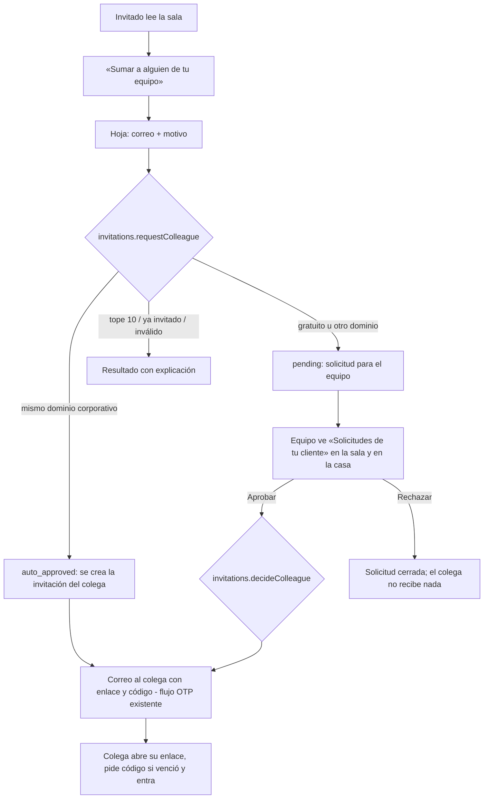

# TASK-2093 — Flujo: el comprador suma a su comité

> Nodo del flujo maestro de Rooms ([rooms-v1](rooms-v1.md)), etapa «Conceder acceso → lectura del comprador»: agrega
> la vuelta en la que el comprador, ya dentro, amplía el acceso a su comité. Contrato:
> [TASK-2092](../../tasks/to-do/TASK-2092-rooms-buyer-committee-colleague-access.md). Wireframe:
> [TASK-2093](../wireframes/TASK-2093-rooms-buyer-committee-colleague-access.md).

## Actores

| Actor | Dónde actúa | Autoridad |
|---|---|---|
| Invitado (champion) | Sala del comprador | Sesión guest con `colleagues.request` |
| Colega | Su correo y luego la misma sala | Invitación propia (su enlace y su código) |
| Equipo Efeonce | Gestión de invitaciones y casa | `access.manage` en la sala |
| Agente | Puede proponer la decisión al equipo | Clase `access`: ejecuta una persona |

## Recorrido principal

## Reglas que el flujo hace visibles

- La invitación del colega es suya: otro correo, otro código, misma sala, sin más permisos ni más vigencia que el
  invitado que lo propuso.
- Un enlace reenviado no sirve: por eso existe este camino.
- El equipo siempre ve el origen («Propuesto por…»), también en las aprobadas automáticamente.

## Transiciones y superficies

| Desde | Acción | Hacia | Superficie |
|---|---|---|---|
| Sala (A) | abrir | Hoja (B) | diálogo; hoja inferior en móvil |
| Hoja (B) | enviar | Resultado (C) | misma hoja |
| Resultado (C) | «Listo» | Sala (A) | cierra y devuelve el foco al botón |
| Casa (F) | insignia | Gestión (D) | navegación a `/rooms/[roomId]/invitations` |
| Gestión (D) | aprobar o rechazar | Gestión (D) actualizada | confirmación en diálogo |
| Gestión (E) | revocar invitado con colegas | Gestión (E) | casilla de revocación en cascada |

## Command map (Full API Parity)

| Paso | Command / reader | Consumers |
|---|---|---|
| Proponer | `invitations.requestColleague` | UI invitado, SDK |
| Ver pendientes | `invitations.colleagueRequests` y `InvitationManagement.colleagueRequests` | UI equipo, SDK, CLI, MCP |
| Decidir | `invitations.decideColleague` | UI equipo, SDK, CLI, MCP (agente propone, persona ejecuta) |
| Revocar con cascada | `invitations.revoke` con opción de colegas | UI equipo, SDK, CLI, MCP |

## Motion

Reusa las primitivas de motion de «La órbita» para abrir y cerrar diálogos y hojas; sin coreografía nueva. Con
`prefers-reduced-motion`, cambio de estado sin desplazamiento.
